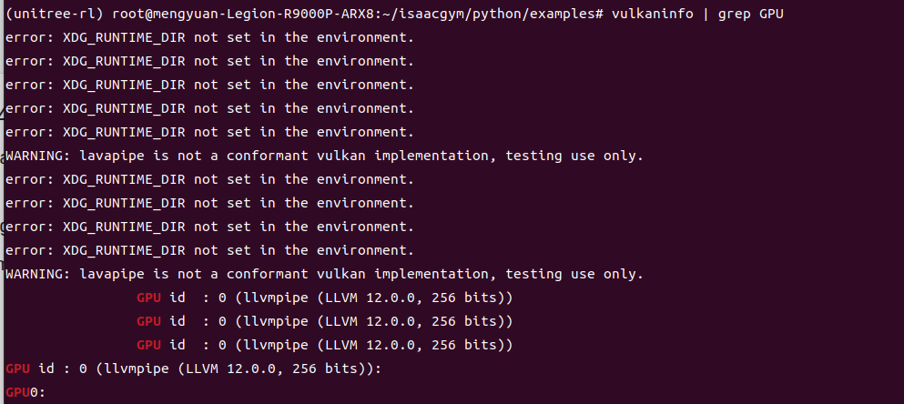
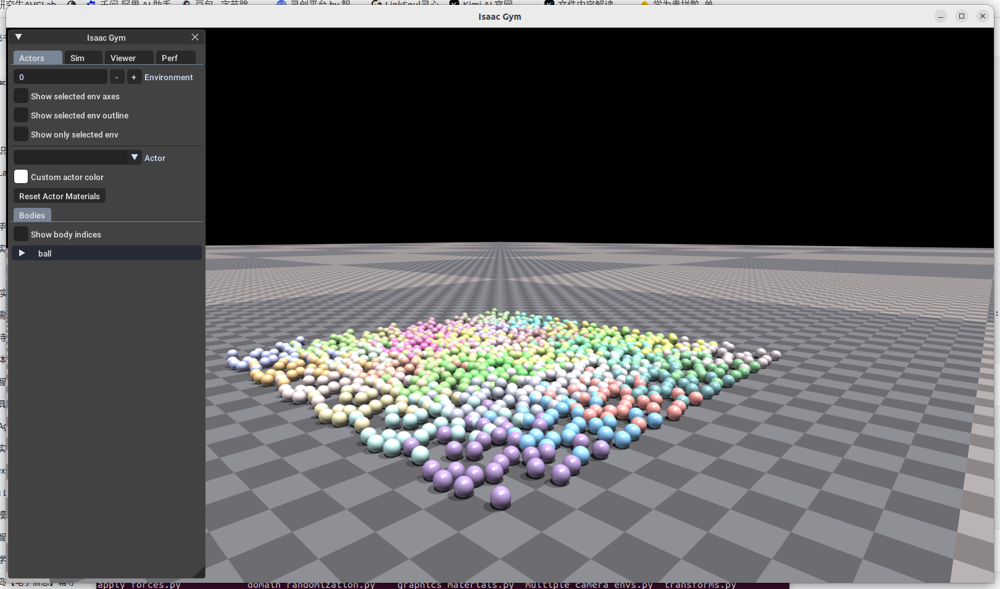
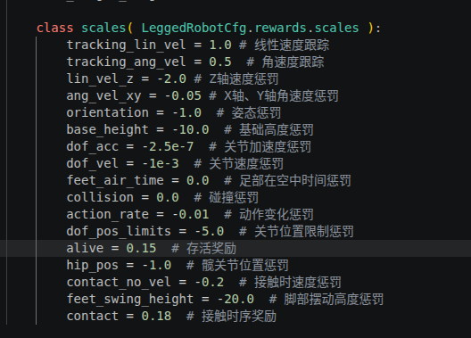
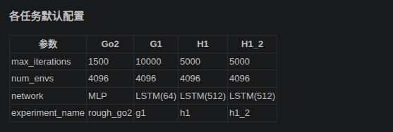
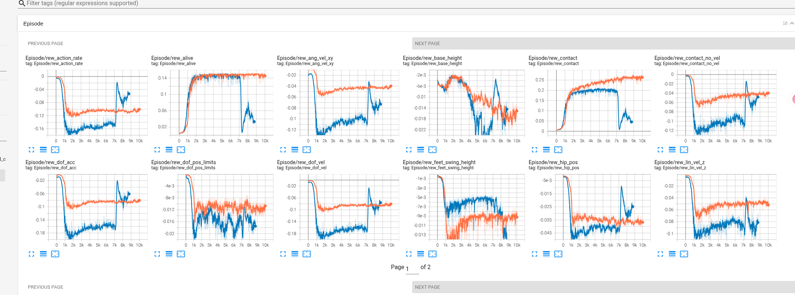
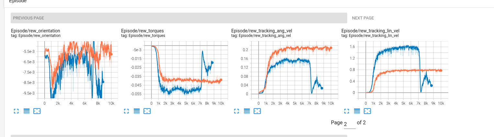
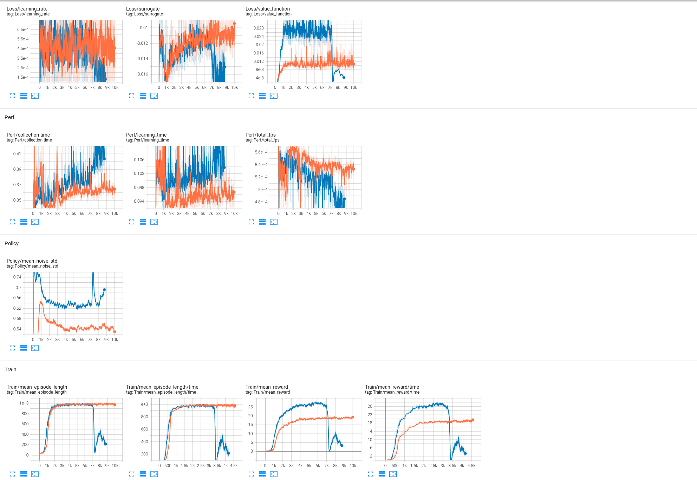
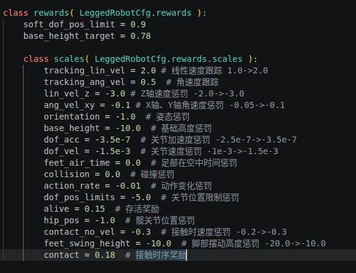
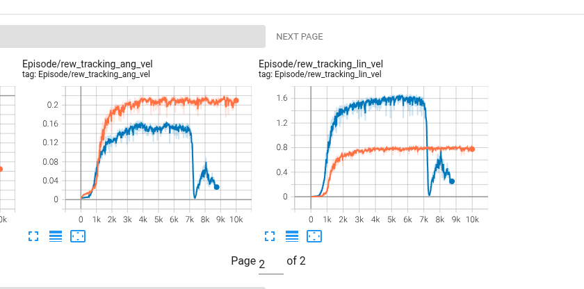

# 行走强化学习与部署：Mengyuan Wang 作业参考笔记

作者：Mengyuan Wang。原始来源：个人 Docker 环境文档，第 690 至 1355 行。

本文件保留个人记录中的步骤、代码、排错与结果。历史命令对应原实验环境；原笔记中的完成状态、曲线和指标是作者记录，整理时没有重新运行训练或真机实验。课件截图改为文字，个人实验截图保留。

## 使用与复核说明

对比 Reward 方案要保留相同场景、种子和评估口径。奖励权重变化会改变奖励总值，不能只比较总奖励。MLP/LSTM 支持范围由部署程序决定；Gazebo 本身不限制策略必须为 MLP。模型转换后仍需核对观测顺序、动作缩放、关节顺序与隐藏状态。

## 原始实验记录整理

### 第二章  实践：训练 G1 人形机器人行走控制强化学习 模型

```Bash
xhost +local:root
docker start ros1_noetic
docker exec -it ros1_noetic bash
cd /root/ros1_ws/robocup_g1
source devel/setup.bash
cd 

docker commit ros1_noetic ros1_noetic_snapshot
docker stop ros1_noetic
docker rm ros1_noetic

# 正常显示isaacgym

xhost +local:root

docker run -it \
    --name ros1_noetic \
    --gpus all \
    --privileged \
    --net=host \
    -e DISPLAY=$DISPLAY \
    -e NVIDIA_VISIBLE_DEVICES=all \
    -e NVIDIA_DRIVER_CAPABILITIES=all \
    -e VK_ICD_FILENAMES=/usr/share/vulkan/icd.d/nvidia_icd.json \
    -e XDG_RUNTIME_DIR=/tmp/runtime-root \
    -v /tmp/.X11-unix:/tmp/.X11-unix \
    -v /dev/dri:/dev/dri \
    -v /usr/share/vulkan/icd.d/nvidia_icd.json:/usr/share/vulkan/icd.d/nvidia_icd.json:ro \
    -v $HOME/ros1_ws:/root/ros1_ws \
    ros1_noetic_snapshot

```

#### 问题可视化闪退 Unhandled descriptor set 433

(unitree-rl) root@mengyuan-Legion-R9000P-ARX8:\~/isaacgym/python/examples# python 1080_balls_of_solitude.py

Importing module 'gym_38' (/root/isaacgym/python/isaacgym/_bindings/linux-x86_64/gym_38.so)

Setting GYM_USD_PLUG_INFO_PATH to /root/isaacgym/python/isaacgym/_bindings/linux-x86_64/usd/plugInfo.json

WARNING: Forcing CPU pipeline.

Not connected to PVD

+++ Using GPU PhysX

Physics Engine: PhysX

Physics Device: cuda:0

GPU Pipeline: disabled

WARNING: lavapipe is not a conformant vulkan implementation, testing use only.

Unhandled descriptor set 433

Unhandled descriptor set -2094920912

Unhandled descriptor set -2094169760

Segmentation fault (core dumped)

该日志出现 lavapipe 警告，说明软件 Vulkan 驱动参与了设备枚举或初始化，但单凭此日志不能确定全部渲染设备及崩溃根因。`NVIDIA_DRIVER_CAPABILITIES=all` 包括 graphics，NVIDIA 官方明确 graphics 支持 OpenGL/EGL/Vulkan；因此原记录中不处理 Vulkan 的说法不正确。应检查容器内驱动库、ICD、设备枚举、权限及 Toolkit 配置。手动挂载 ICD 是当时尝试的修复，是否需要取决于实际镜像。参见 [NVIDIA 官方驱动能力说明](https://docs.nvidia.com/datacenter/cloud-native/container-toolkit/latest/docker-specialized.html)。

> 弹出窗口不证明使用 NVIDIA 硬件渲染；需检查实际设备与渲染器。软件渲染和崩溃可能相关，但不能据该段日志断定软件渲染必然闪退。
> 
> 

##### 对比你原来的命令，需要补上这 3 处

1. 环境变量：`-e VK_ICD_FILENAMES=/usr/share/vulkan/icd.d/nvidia_icd.json`

2. 挂载宿主机的 nvidia_icd.json 到容器：`-v /usr/share/vulkan/icd.d/nvidia_icd.json:/usr/share/vulkan/icd.d/nvidia_icd.json:ro`

3. 设置 `XDG_RUNTIME_DIR=/tmp/runtime-root` 前，需确认目录存在、属于当前用户且权限为 0700；只写环境变量不会创建或修正该目录。

> `/dev/dri`挂载对你独显直连模式其实意义不大，可以保留也可以删掉。
> 
> 

```Bash
vulkaninfo | grep GPU
```



```Bash
docker commit ros1_noetic ros1_noetic_snapshot
docker stop ros1_noetic
docker rm ros1_noetic

# 正常显示isaacgym

xhost +local:root

docker run -it \
    --name ros1_noetic \
    --gpus all \
    --privileged \
    --net=host \
    -e DISPLAY=$DISPLAY \
    -e NVIDIA_VISIBLE_DEVICES=all \
    -e NVIDIA_DRIVER_CAPABILITIES=all \
    -e VK_ICD_FILENAMES=/usr/share/vulkan/icd.d/nvidia_icd.json \
    -e XDG_RUNTIME_DIR=/tmp/runtime-root \
    -v /tmp/.X11-unix:/tmp/.X11-unix \
    -v /dev/dri:/dev/dri \
    -v /usr/share/vulkan/icd.d/nvidia_icd.json:/usr/share/vulkan/icd.d/nvidia_icd.json:ro \
    -v $HOME/ros1_ws:/root/ros1_ws \
    ros1_noetic_snapshot
    
    
```

#### 启动

```Bash
xhost +local:root
docker start ros1_noetic
docker exec -it ros1_noetic bash
conda activate unitree-rl
cd /root/ros1_ws/

```

#### 调试环境

```Plain Text
cd isaacgym/python
cd examples 
python 1080_balls_of_solitude.py
```



#### 训练 默认参数训练：用 python legged_gym/scripts/train.py --task=g1 训练 G1，通过 TensorBoard 记录奖励值等指标曲线。

运行以下命令进行训练：




```Bash
# 最大迭代次数是10000  默认参数训练 
python legged_gym/scripts/train.py --task=g1 --headless --experiment_name=my_g1_test --run_name=v1 --num_envs=1024 
```

##### ⚙️ 参数说明

- `--task`: 必选参数，值可选(go2, g1, h1, h1_2)

- `--headless`: 默认启动图形界面，设为 true 时不渲染图形界面（效率更高）

- `--resume`: 从日志中选择 checkpoint 继续训练

- `--experiment_name`: 运行/加载的 experiment 名称

- `--run_name`: 运行/加载的 run 名称

- `--load_run`: 加载运行的名称，默认加载最后一次运行

- `--checkpoint`: checkpoint 编号，默认加载最新一次文件

- `--num_envs`: 并行训练的环境个数

- `--seed`: 随机种子

- `--max_iterations`: 训练的最大迭代次数

- `--sim_device`: 仿真计算设备，指定 CPU 为 `--sim_device=cpu`

- `--rl_device`: 强化学习计算设备，指定 CPU 为 `--rl_device=cpu`

**默认保存训练结果**：`logs/<experiment_name>/<date_time>_<run_name>/model_<iteration>.pt`




#### 可视化

创建容器时把项目目录挂载进去了（`-v` 参数），在**宿主机**直接启动 TensorBoard 就行：

```Bash
# 在宿主机终端
tensorboard --logdir=/home/mengyuan/ros1_ws/unitree_rl_gym/logs/
```

然后浏览器打开 `http://localhost:6006` 就能看到：

橙色为默认奖励参数训练（10000次迭代）

蓝色为修改后参数训练







TensorBoard 里所有图汇总：

---

##### 一、Train（总览 ， 最重要）

| 曲线                           | 含义                 | 趋势怎么看                     |
| ------------------------------ | -------------------- | ------------------------------ |
| Train/mean_reward              | 每轮平均总奖励       | ↑ 上升=在学，→ 走平=收敛       |
| Train/mean_episode_length      | 每轮平均存活步数     | ↑ 越长说明越稳，走平=不再进步  |
| Train/mean_reward/time         | 按时间维度的奖励     | 同上，横轴是时间而非 iteration |
| Train/mean_episode_length/time | 按时间维度的存活步数 | 同上                           |

---

##### 二、Episode（各项子奖励分解**含实验分析**） 橙色曲线为默认奖励曲线，蓝色曲线为修改reward曲线

注：黄色为修改的reward项

原始参数：


修改参数：



比较记录：两份配置主要修改奖励权重和类名。行为变化与奖励调整可能相关，但未提供多种子控制实验；模型还分别选取 6K 和 10K checkpoint，不能把全部差异单独归因于奖励权重。

修改后的仿真视频速度能快一点，但是机器人的脚摆动高度低了很多，可能是减弱了脚步高度奖励惩罚造成的，修改后的曲线在7K次发生了突变，并且修改后的平均奖励比修改前的更高

| 参数              | 修改前    | 修改后 v2 | 影响判断                                                   |
| ----------------- | --------- | --------- | ---------------------------------------------------------- |
| tracking_lin_vel  | 1         | 2         | 线速度跟踪奖励翻倍，机器人更愿意追速度，所以仿真看起来更快 |
| lin_vel_z         | -2        | -3        | 更强惩罚竖直速度，可能让身体/脚部运动更保守                |
| ang_vel_xy        | -0.05     | -0.1      | 更强惩罚机身横滚/俯仰角速度，步态可能更稳但更拘谨          |
| dof_acc           | -2.50E-07 | -3.50E-07 | 更强惩罚关节加速度，减少大幅快速摆腿                       |
| dof_vel           | -1.00E-03 | -1.50E-03 | 更强惩罚关节速度，进一步压低摆腿幅度/速度                  |
| contact_no_vel    | -0.2      | -0.3      | 更强惩罚接触时脚部速度，落脚更谨慎                         |
| feet_swing_height | -20       | -10       | 抬脚高度约束减半，是脚摆动高度降低的直接嫌疑               |

关键点：平均奖励变高不一定代表策略更好，因为 v2 把 `tracking_lin_vel` 从 `1.0` 提到 `2.0`，奖励尺度已经变了，两条曲线不能直接比较绝对值。7K 次左右突变，也可能是速度跟踪奖励变强后策略突然学会追速度，或者命令/地形/策略分布进入了新区域后的跃迁。

🟢 正向奖励：在相同定义与权重下解释，单项更高不保证整体策略更好



蓝色曲线在7k迭代次发生剧烈突变，因此最后实验选6k迭代次的权重，默认reward选取10k迭代处的权重

| 曲线                         | 含义                   | 趋势                 | 默认奖励训练的观察 |
| ---------------------------- | ---------------------- | -------------------- | ------------------ |
| Episode/rew_tracking_lin_vel | 跟上指令速度的奖励     | ↑ 涨说明走得越来越对 | 涨                 |
| Episode/rew_tracking_ang_vel | 跟上指令转向速度的奖励 | ↑ 涨说明转身跟得准   | 涨                 |

###### 🔴 惩罚项：若记录的是负权重贡献，接近 0 通常表示惩罚较小；须先核对代码定义

| 曲线                       | 含义                     | 趋势                          | 默认训练的观察                                               |
| -------------------------- | ------------------------ | ----------------------------- | ------------------------------------------------------------ |
| Episode/rew_lin_vel_z      | 惩罚竖直方向晃动（蹦跳） | ↑ 往 0 走=身体不上下窜        | 始终是负数，在0附近，先变小，再缓慢变大稳定在-0.05左右       |
| Episode/rew_ang_vel_xy     | 惩罚横滚/俯仰方向晃动    | ↑ 往 0 走=身体不左右前后摇    | 始终是负数，在0附近，先变小，再缓慢变大稳定在-0.04左右       |
| Episode/rew_orientation    | 惩罚身体倾斜             | ↑ 往 0 走=身体越来越直        | 始终是负数，在0附近，先变小，再缓慢变大稳定在-5.5e-3左右上下波动 |
| Episode/rew_base_height    | 惩罚高度偏离目标         | ↑ 往 0 走=高度稳住了          | 始终是负数，在0附近，先变小，再变大-2e-3再变小稳定在-0.018左右上下波动 |
| Episode/rew_torques        | 惩罚关节力矩过大         | ↑ 往 0 走=发力越来越省        | 从0开始变小始终为负数稳定在-0.04                             |
| Episode/rew_dof_vel        | 惩罚关节速度过大         | ↑ 往 0 走=动作变平滑          | 始终是负数，在0附近，先变小到-0.1上下，再变大稳定在-0.09上下波动 |
| Episode/rew_dof_acc        | 惩罚关节加速度过大       | ↑ 往 0 走=动作不抖了          | 始终是负数，在0附近，先变小到-0.1上下，再变大稳定在-0.09上下波动 |
| Episode/rew_action_rate    | 惩罚相邻两步动作变化太大 | ↑ 往 0 走=动作变连贯          | 始终是负数，在0附近，先变小到-0.12上下，再变大稳定在-0.1上下波动 |
| Episode/rew_dof_pos_limits | 惩罚关节超出限位         | ↑ 往 0 走=不卡关节极限了      | 从0变小一直为负数-0.012上下波动                              |
| Episode/rew_alive          | 每步存活奖励             | ↑ 涨=活得久；掉下来说明老摔倒 | 上升0.14上下稳定                                             |

###### 🟡 G1 特有

| 曲线                          | 含义               | 趋势            | 默认训练的观察                              |
| ----------------------------- | ------------------ | --------------- | ------------------------------------------- |
| Episode/rew_hip_pos           | 惩罚胯部位置偏离   | ↑ 往 0 走       | 变小到-0.04再缓慢变大一点点在-0.035上下波动 |
| Episode/rew_contact_no_vel    | 惩罚脚着地不发力   | ↑ 往 0 走       | 先变小-0.07再缓慢变大-0.05上下波动          |
| Episode/rew_feet_swing_height | 惩罚摆动脚抬太高   | ↑ 往 0 走       | 先变小-0.014，缓慢变大一点-0.01上下稳定     |
| Episode/rew_contact           | 脚按预期着地的奖励 | ↑ 涨=步态节奏好 | 涨到0.25稳定                                |

---

##### 三、Loss（网络训练状态）

| 曲线                | 含义                    | 趋势                                       |
| ------------------- | ----------------------- | ------------------------------------------ |
| Loss/value_function | Critic 的值函数预测误差 | ↓ 稳定下降=正常；突然飙升=有问题           |
| Loss/surrogate      | PPO 策略更新的损失      | ↓ 平稳下降=在收敛；剧烈震荡=学习率可能太大 |
| Loss/learning_rate  | 当前学习率              | ↓ 通常会逐步衰减                           |

---

##### 四、Policy（策略行为）

| 曲线                  | 含义                   | 趋势                          |
| --------------------- | ---------------------- | ----------------------------- |
| Policy/mean_noise_std | 策略探索随机性的平均值 | ↓ 逐渐下降=策略从探索转向利用 |

---

##### 五、Perf（训练效率）

| 曲线                 | 含义                   | 趋势                        |
| -------------------- | ---------------------- | --------------------------- |
| Perf/total_fps       | 每秒处理的环境帧数     | 稳定就行，下降可能 GPU 过热 |
| Perf/collection_time | 每轮数据采集耗时（秒） | 稳定                        |
| Perf/learning_time   | 每轮网络更新耗时（秒） | 稳定                        |

---

##### 看图的优先级

```Plain Text
第一步: Train/mean_reward        ← 判断整体训练好不好
第二步: Episode/rew_* 惩罚项     ← 找问题（哪个惩罚项扣分最多）
第三步: Loss/value_function      ← 确认网络训练正常
```

橙色为默认奖励参数训练（10000次迭代）

蓝色为修改后参数训练


#### 修改 Reward 参数训练：调整奖励函数参数，重新训练并保存日志，对比与默认训练的指标差异。

##### 复制一份配置文件（不改原文件，更干净）


###### 步骤

**1.** 复制配置文件：

```Bash
cp legged_gym/envs/g1/g1_config.py legged_gym/envs/g1/g1_config_v2.py
```

改 `g1_config_v2.py` 里的 reward scales 。

修改的地方就两处：

- 第 72-89 行：改 `scales` 里的权重

**2.** 在 init.py 末尾加两行注册：

```Python
from legged_gym.envs.g1.g1_config_v2 import G1RoughCfgV2, G1RoughCfgPPOV2
task_registry.register( "g1_v2", G1Robot, G1RoughCfgV2(), G1RoughCfgPPOV2())
```

这样原 `g1` 和新的 `g1_v2` 互不干扰，训练时：

```Bash
cd /root/ros1_ws/unitree_rl_gym
# 第二次：改了 reward 再训练（用不同的 run_name）
python legged_gym/scripts/train.py --task=g1_v2 --headless --experiment_name=my_g1_test --run_name=v2_reward_changed --num_envs=1024 --max_iterations=15000


```

##### 对比Tensorboard

```Bash
# 在宿主机终端
tensorboard --logdir=/home/mengyuan/ros1_ws/unitree_rl_gym/logs/
```

#### 效果验证与分析

##### • Isaac Gym 验证：用 play.py 分别运行两个模型，观察行走流畅性、稳定性，记录异常（如摔倒）

```Bash
# 默认训练reward
python legged_gym/scripts/play.py --task=g1 --experiment_name=my_g1_test --load_run=Aug07_00-45-39_v1
# 默认训练reward
python legged_gym/scripts/play.py --task=g1_v2 --experiment_name=my_g1_test --load_run=Aug07_07-55-58_v2_reward_changed --checkpoint=6000

# 保存视频

ffmpeg -framerate 50 \
  -i logs/my_g1_test/exported/frames/Aug07_00-45-39_v1_model_-1/%05d.png \
  -c:v mpeg4 -q:v 3 -pix_fmt yuv420p \
  g1_v1_model_10000_real_time.mp4
  

ffmpeg -framerate 50 \
  -i logs/my_g1_test/exported/frames/Aug07_07-55-58_v2_reward_changed_model_6000/%05d.png \
  -c:v mpeg4 -q:v 3 -pix_fmt yuv420p \
  g1_v2_model_6000_real_time.mp4
```

##### • Mujoco 验证：替换 g1.yaml 中模型路径，运行 deploy_mujoco.py ，对比跨仿真平台的性 能差异。

```Bash
export VGL_DISPLAY=:1
/opt/VirtualGL/bin/vglrun python deploy/deploy_mujoco/deploy_mujoco.py g1.yaml

QT_X11_NO_MITSHM=1 MUJOCO_GL=glfw \
/opt/VirtualGL/bin/vglrun -d :1 \
python deploy/deploy_mujoco/deploy_mujoco.py g1.yaml


```

默认模型位于 `deploy/pre_train/{robot}/motion.pt`，个人训练记录保存于 `logs/g1/exported/policies/policy_lstm_1.pt`。修改 `policy_path` 只解决文件选择；部署还需匹配网络、观测/动作、循环状态、关节顺序、增益和控制周期。

##### • 分析总结：结合指标曲线和仿真效果，说明 Reward 参数对训练效率和机器人行为的影响。

#### 问题：Mujoco可视化解决 Xlib: extension "NV-GLX" missing on display ":1".

**VirtualGL**它不让容器自己把 GLX buffer 直接 present 到窗口，而是让宿主机侧帮你完成 OpenGL 渲染和图像传回：

把 VirtualGL 重新梳理成一条干净流程，目标是：

```Bash
Docker 仍然能 --gpus all 启动
容器里的 MuJoCo/GLFW 窗口用 vglrun 正常显示
```

1. **宿主机安装 VirtualGL**

```Bash
sudo apt update
sudo apt install -y wget gpg

wget -q -O- https://packagecloud.io/dcommander/virtualgl/gpgkey | \
  sudo gpg --dearmor -o /etc/apt/trusted.gpg.d/VirtualGL.gpg

echo "deb [signed-by=/etc/apt/trusted.gpg.d/VirtualGL.gpg] https://packagecloud.io/dcommander/virtualgl/any/ any main" | \
  sudo tee /etc/apt/sources.list.d/VirtualGL.list

sudo apt update
sudo apt install -y virtualgl
```

检查：

```Bash
/opt/VirtualGL/bin/vglrun -version
```

2. **配置宿主机 VirtualGL**

执行：

```Bash
sudo /opt/VirtualGL/bin/vglserver_config
```

选择：

```Bash
1
```

后面这样回答：

```Bash
Restrict 3D X server access to vglusers group (recommended)? n
Restrict framebuffer device access to vglusers group (recommended)? n
Disable XTEST extension (recommended)? y
```

原记录将前两项权限限制选为 `n`，用于排查当时的 Docker 设备访问问题，但这会扩大访问范围，不能作为通用推荐。优先核对设备属组、容器用户及 `vglusers` 配置，再按主机实际访问要求决定。参见 [VirtualGL 官方配置说明](https://github.com/VirtualGL/virtualgl/blob/main/doc/index.html)。

```Bash
nvml error: insufficient permissions
```

配置完成后重启：

```Bash
sudo reboot
```

3. **重启后确认 Docker GPU 正常**

```Bash
nvidia-smi
docker run --rm --gpus all nvidia/cuda:11.8.0-base-ubuntu20.04 nvidia-smi
```

如果你不想重新拉 CUDA 镜像，也可以用你的镜像测：

```Bash
docker run --rm --gpus all ros1_noetic_snapshot nvidia-smi
```

4. **启动你的 Docker**

在宿主机：

```Bash
xhost +local:root
```

然后：

```Bash
docker run -it \
    --name ros1_noetic \
    --gpus all \
    --privileged \
    --net=host \
    -e DISPLAY=$DISPLAY \
    -e NVIDIA_VISIBLE_DEVICES=all \
    -e NVIDIA_DRIVER_CAPABILITIES=all \
    -e VK_ICD_FILENAMES=/usr/share/vulkan/icd.d/nvidia_icd.json \
    -e XDG_RUNTIME_DIR=/tmp/runtime-root \
    -v /tmp/.X11-unix:/tmp/.X11-unix \
    -v /dev/dri:/dev/dri \
    -v /usr/share/vulkan/icd.d/nvidia_icd.json:/usr/share/vulkan/icd.d/nvidia_icd.json:ro \
    -v $HOME/ros1_ws:/root/ros1_ws \
    ros1_noetic_snapshot
```

如果旧容器名占用：

```Bash
docker rm ros1_noetic
```

如果正在运行：

```Bash
docker stop ros1_noetic
docker rm ros1_noetic
```

5. **容器里安装 VirtualGL**

容器内：

```Bash
apt update
apt install -y wget gpg

wget -q -O- https://packagecloud.io/dcommander/virtualgl/gpgkey | \
  gpg --dearmor -o /etc/apt/trusted.gpg.d/VirtualGL.gpg

echo "deb [signed-by=/etc/apt/trusted.gpg.d/VirtualGL.gpg] https://packagecloud.io/dcommander/virtualgl/any/ any main" > \
  /etc/apt/sources.list.d/VirtualGL.list

apt update
apt install -y virtualgl
```

检查：

```Plain Text
/opt/VirtualGL/bin/vglrun -version
```

6. **容器里运行 MuJoCo**

```Plain Text
cd /root/ros1_ws/unitree_rl_gym
conda activate unitree-rl
export VGL_DISPLAY=:1
/opt/VirtualGL/bin/vglrun python deploy/deploy_mujoco/deploy_mujoco.py g1.yaml
```

7. **如果仍然报权限问题**

临时恢复 NVIDIA 设备权限：

```Plain Text
sudo chmod 666 /dev/nvidia0 /dev/nvidiactl /dev/nvidia-modeset
sudo chmod 666 /dev/nvidia-uvm /dev/nvidia-uvm-tools
sudo chmod 666 /dev/dri/card1 /dev/dri/renderD128
```

然后再启动 Docker。

`vglserver_config` 的权限选项需要结合用户组和容器配置检查；选 `n` 不保证所有 GPU 权限问题都解决。下面的 `chmod 666` 仅是原排错记录，会允许所有本机用户读写设备，使用前必须确认授权，不应复制为默认设置。

#### 问题：_glfwPlatformSetTls: Assertion \`tls-\>posix.allocated == GLFW_TRUE' failed

该断言涉及 GLFW 线程局部存储/初始化状态。绑定版本、初始化顺序、线程和上下文均可能相关，仅凭断言不能确定原因。降级 glfw 是作者当时的尝试，需结合对应版本、堆栈与复现结果判断，不是通用解法。

```Bash
pip uninstall -y glfw
pip install glfw==2.7.0
```

#### 模型部署至 Gazebo 

将play保存的.onnx网络转换为.mnn，方式如下：

```Bash
cd /root/ros1_ws/robocup_g1/
cd src/unitree_guide/thirdParty/MNN 
mkdir build && cd build 
cmake .. -DMNN_BUILD_CONVERTER=ON
make -j4 
#执行

./MNNConvert -f ONNX --modelFile /root/ros1_ws/unitree_rl_gym/logs/my_g1_test/exported/policies/policy_lstm_g1_v1_10000.onnx --MNNModel policy_lstm_g1_v1_10000.mnn --bizCode MNN 

./MNNConvert -f ONNX --modelFile /root/ros1_ws/unitree_rl_gym/logs/my_g1_test/exported/policies/policy_lstm_g1_v2_6000.onnx --MNNModel policy_lstm_g1_v2_6000.mnn --bizCode MNN 
```

• 将训练好的Policy（神经网络模型）部署到 Gazebo，解决部署中的问题。

• 验证行走效果，对比与其他仿真环境的差异。

##### 快速确认 .mnn 模型规格

你可以用 MNN 的工具查看模型输入输出：

```Bash
# 使用 MNN 自带的 benchmark 工具查看模型信息
cd ~/ros1_ws/robocup_g1/src/unitree_guide/thirdParty/MNN/build
./MNNConvert -f MNN --modelFile policy_lstm_g1_v1_10000.mnn --info 2>&1

./MNNConvert -f MNN --modelFile policy_lstm_g1_v2_6000.mnn --info 2>&1
```

```Bash
(unitree-rl) root@mengyuan-Legion-R9000P-ARX8:~/ros1_ws/robocup_g1/src/unitree_guide/thirdParty/MNN/build# ./MNNConvert -f MNN --modelFile policy_lstm_g1_v1_10000.mnn --info 2>&1
The device support i8sdot:0, support fp16:0, support i8mm: 0
Model default dimensionFormat is NCHW
Model Inputs:
[ obs ]: dimensionFormat: NC4HW4, size: [ 1,47 ], type is float
[ hidden_state ]: dimensionFormat: NC4HW4, size: [ 1,1,64 ], type is float
[ cell_state ]: dimensionFormat: NCHW, size: [ 1,1,64 ], type is float
Model Outputs:
[ action ]
[ next_cell_state ]
[ next_hidden_state ]
Model Version: 2.7.2 
(unitree-rl) root@mengyuan-Legion-R9000P-ARX8:~/ros1_ws/robocup_g1/src/unitree_guide/thirdParty/MNN/build# ./MNNConvert -f MNN --modelFile policy_lstm_g1_v2_6000.mnn --info 2>&1
The device support i8sdot:0, support fp16:0, support i8mm: 0
Model default dimensionFormat is NCHW
Model Inputs:
[ obs ]: dimensionFormat: NC4HW4, size: [ 1,47 ], type is float
[ hidden_state ]: dimensionFormat: NC4HW4, size: [ 1,1,64 ], type is float
[ cell_state ]: dimensionFormat: NCHW, size: [ 1,1,64 ], type is float
Model Outputs:
[ action ]
[ next_cell_state ]
[ next_hidden_state ]
Model Version: 2.7.2 

```

##### 改正完代码

```C++
void State_locomotion::loadPolicy()
{
    std::string policy_file_path;
#ifdef COMPILE_WITH_CATKIN_MAKE 
    #ifdef ROBOT_TYPE_G1
        std::string env_cfg_path = getWorkingDir() + "/src/unitree_guide/data/policy/motion/g1.yaml";
        env_cfg = YAML::LoadFile(env_cfg_path.c_str());
        yamlParam_.setup(env_cfg_path.c_str());
        // policy_file_path = getWorkingDir() + "/src/unitree_guide/data/policy/motion/actor_1.mnn";
        policy_file_path = getWorkingDir() + "/src/unitree_guide/thirdParty/MNN/build/policy_lstm_g1_v1_10000.mnn";
         policy_file_path = getWorkingDir() + "/src/unitree_guide/thirdParty/MNN/build/policy_lstm_g1_v2_6000.mnn";

    #endif
#else 
#endif
```

相比原始代码，涉及修改的文件共 3 个：

1. `src/unitree_guide/include/FSM/State_locomotion.h`

2. `src/unitree_guide/src/FSM/State_locomotion.cpp`

3. `src/unitree_guide/include/FSM/State_FixedStand.h`

模型路径切换也在 `State_locomotion.cpp` 中。

[State_locomotion.h](code/State_locomotion.h)

[State_locomotion.cpp](code/State_locomotion.cpp)

[State_FixedStand.h](code/State_FixedStand.h)

```Bash
# 编译运行
cd ~/ros1_ws/robocup_g1
catkin_make
# 共用
conda deactivate
xhost +local:root
sudo docker exec -it ros1_noetic bash
source /opt/ros/noetic/setup.bash
cd /root/ros1_ws/robocup_g1
conda deactivate


source devel/setup.bash
roslaunch unitree_guide gazebo.launch
# 另一个终端:
source devel/setup.bash
./devel/lib/unitree_guide/junior_ctrl

```

启动后看终端输出：

- `Detected LSTM (recurrent) model` → 说明用 LSTM 模型

- `Detected feedforward (non-recurrent) model` → 说明用前馈模型
