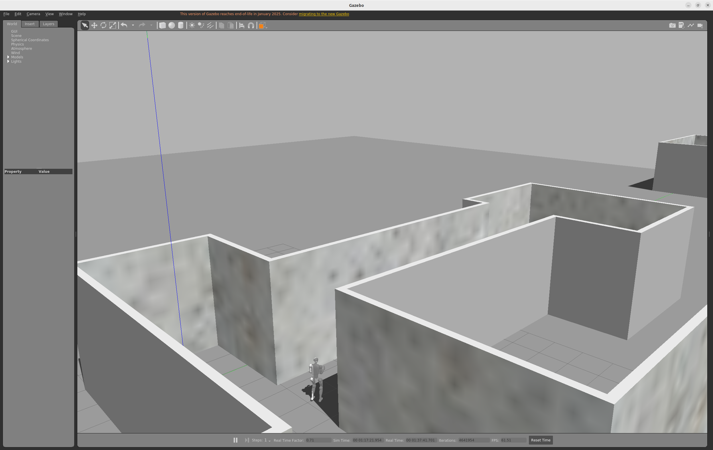
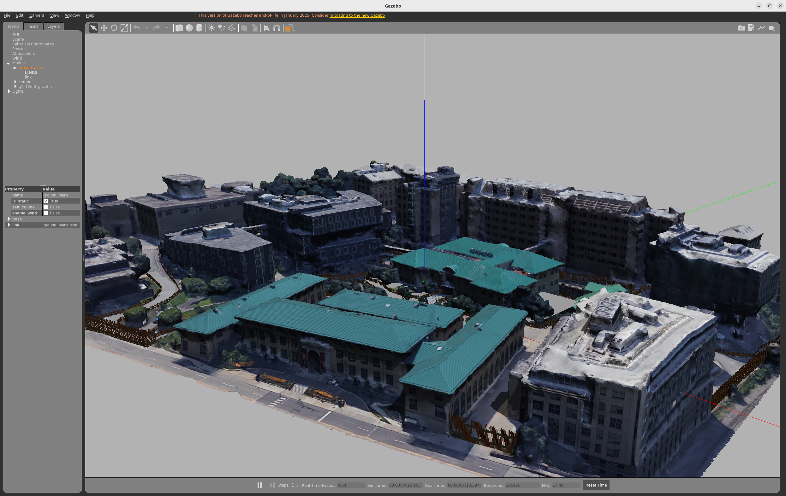
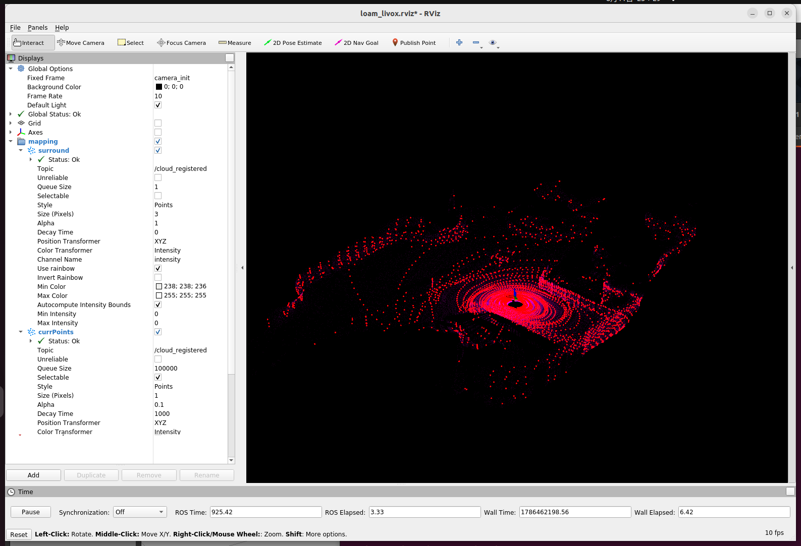
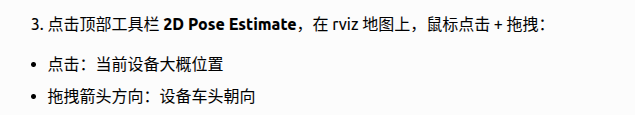

# 激光建图与定位：Mengyuan Wang 作业参考笔记

作者：Mengyuan Wang。原始来源：个人 Docker 环境文档，第 1356 至 1538 行。

本文件保留个人记录中的步骤、代码、排错与结果。历史命令对应原实验环境；原笔记中的完成状态、曲线和指标是作者记录，整理时没有重新运行训练或真机实验。课件截图改为文字，个人实验截图保留。

## 使用与复核说明

倒装雷达修正仅针对对应安装。保存地图后再进行已有地图定位，初始位姿与场景应一致。视觉上点云重合是初步检查，定位精度仍需参考数据和明确指标。

## 原始实验记录整理

### 第三章 实践：宇树 G1 人形机器人激光雷达建图与定位

参考资料：室内室外环境模型文件来自：https://www.cmu-exploration.com/development-environment

```Bash
# 启动界面
conda deactivate
xhost +local:root
docker start ros1_noetic
docker exec -it ros1_noetic bash
cd /root/ros1_ws/unit3-shenlan

```

#### 下载百度网盘上面的robocup_g1

官方地址：https://eigen.tuxfamily.org/ 下载Eligen3.4库代码并解压到当前目录。

```Bash
tar -xzf eigen-3.4.0.tar.gz
cd eigen-3.4.0
# 编译安装
mkdir build
cd build
rm -rf CMakeCache.txt CMakeFiles/
cmake ..
sudo make install
# robocup_g1/下面
cd ../../    
# 编译流程
rm -rf build devel install
catkin_make
```

##### 启动Gazebo仿真流程

```Bash
# 启动界面
conda deactivate
xhost +local:root
docker start ros1_noetic
docker exec -it ros1_noetic bash
conda deactivate
cd /root/ros1_ws/unit3-shenlan/robocup_g1

source devel/setup.bash
roslaunch unitree_guide gazebo.launch
source devel/setup.bash
./devel/lib/unitree_guide/junior_ctrl 
```



#### 解决遥控器用不了问题

```Bash
# 遥控器突然用不了
# 保存镜像
docker commit ros1_noetic ros1_noetic_with_js:v1
# 查看镜像
docker images
# 删除旧容器
docker rm -f ros1_noetic

    
docker run -it \
    --name ros1_noetic \
    --gpus all \
    --privileged \
    --net=host \
    -e DISPLAY=$DISPLAY \
    -e NVIDIA_VISIBLE_DEVICES=all \
    -e NVIDIA_DRIVER_CAPABILITIES=all \
    -e VK_ICD_FILENAMES=/usr/share/vulkan/icd.d/nvidia_icd.json \
    -e XDG_RUNTIME_DIR=/tmp/runtime-root \
    -v /tmp/.X11-unix:/tmp/.X11-unix \
    -v /dev/dri:/dev/dri \
    -v /usr/share/vulkan/icd.d/nvidia_icd.json:/usr/share/vulkan/icd.d/nvidia_icd.json:ro \
    -v $HOME/ros1_ws:/root/ros1_ws \
    --device=/dev/input/js0 \
    ros1_noetic_with_js:v1
    
# 最新的镜像适用
docker run -it \
    --name ros1_noetic \
    --gpus all \
    --privileged \
    --net=host \
    -e DISPLAY=$DISPLAY \
    -e NVIDIA_VISIBLE_DEVICES=all \
    -e NVIDIA_DRIVER_CAPABILITIES=all \
    -e VK_ICD_FILENAMES=/usr/share/vulkan/icd.d/nvidia_icd.json \
    -e XDG_RUNTIME_DIR=/tmp/runtime-root \
    -v /tmp/.X11-unix:/tmp/.X11-unix \
    -v /dev/dri:/dev/dri \
    -v /usr/share/vulkan/icd.d/nvidia_icd.json:/usr/share/vulkan/icd.d/nvidia_icd.json:ro \
    -v $HOME/ros1_ws:/root/ros1_ws \
    --device=/dev/input/js0 \
    ros1_noetic:backup_20260925
```

启动后进入容器测试：

```Bash
ls /dev/input/js0
```

**加载室外场景:**修改`/root/ros1_ws/unit3-shenlan/robocup_g1/src/unitree_guide/launch`下面的gazebo.launch文件

```XML
<!-- indoor_world.world -->
 <!-- <arg name="world_name" value="$(find unitree_gazebo)/worlds/indoor_world.world"/>   -->
 <!-- campus_world.world -->
 <arg name="world_name" value="$(find unitree_gazebo)/worlds/campus_world.world"/>
```



#### 运行建图与定位算法程序

按照robocup_g1的readme控制机器人站立进入运控模式后，

下载基于Fast LIO的建图算法和基于NDT、GICP的定位算法：

百度网盘链接: https://pan.baidu.com/s/1egcr_bkJCr6oni-F-ZnUBg 提取码: juzp

```Bash
conda deactivate
xhost +local:root
docker start ros1_noetic
docker exec -it ros1_noetic bash
conda deactivate
cd /root/ros1_ws/unit3-shenlan/

# 编译：
# Compile and install the Livox-SDK2:
cd catkin_ws/Livox-SDK/
mkdir build
cd build
cmake .. && make -j
sudo make install

cd /root/ros1_ws/unit3-shenlan/catkin_ws/
source /opt/ros/noetic/setup.bash
catkin_make

```

##### 运行建图（先启动gazebo仿真，并让机器人进入到locomotion）

```Bash
# 建图 运行算法（新终端）
source devel/setup.bash
roslaunch fast_lio mapping_mid360.launch
```

**campus 建图启动界面**



```Bash
# 单独终端 可以录制建图数据bag文件。
rosbag record /livox/lidar /livox/imu
```

##### 运行定位：（键盘控制漫游建完图，然后才能进行定位）

```Bash
# 定位：运行算法：
source devel/setup.bash
roslaunch mid360_locate localization.launch
# 可以录制定位数据bag文件
rosbag record /livox/lidar /livox/imu /Odometry 
```





[录屏 2026年08月12日 09时21分20秒.webm](assets/navigation_experiment_20260812.webm)
