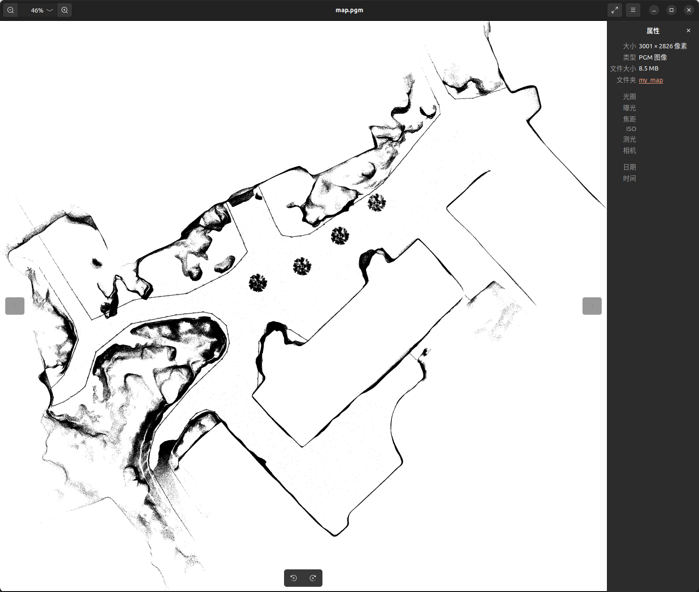
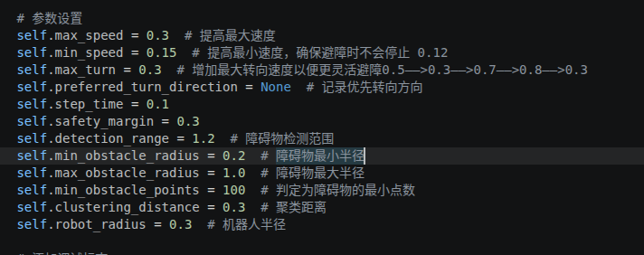
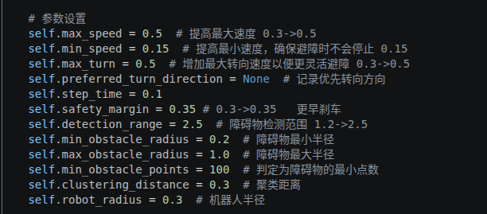
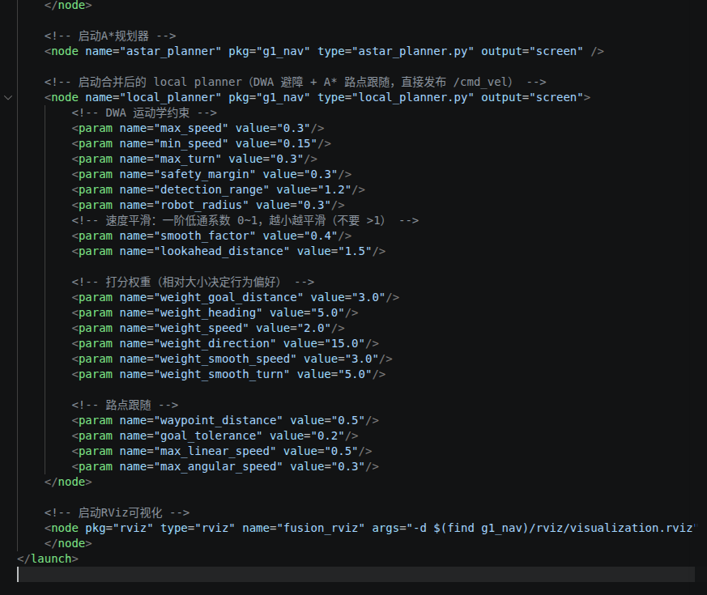

# 地图处理与A星DWA：Mengyuan Wang 作业参考笔记

作者：Mengyuan Wang。原始来源：个人 Docker 环境文档，第 1539 至 4174 行。

本文件保留个人记录中的步骤、代码、排错与结果。历史命令对应原实验环境；原笔记中的完成状态、曲线和指标是作者记录，整理时没有重新运行训练或真机实验。课件截图改为文字，个人实验截图保留。

## 使用与复核说明

A* 的启发函数必须与边代价一致。DWA 的碰撞检查应作为可行性约束，不能仅依赖有限惩罚分。提高最小速度可能导致窄空间无法停车；代码合并后应保证单一速度发布来源，并核对速度、角速度和加速度单位。

## 代码静态核对与已知限制

以下代码按原实验记录保留，没有重新运行，也没有在本轮改写为已验证的安全控制器。

1. A* 中对角边代价是 `1.414`，欧氏启发函数对一步对角距离给出 $\sqrt{2}$，略大于该边代价，严格的可采纳性/一致性条件不成立。可采用一致的精确代价与启发函数后再测试，不能仅凭名称保证最优。
2. `get_neighbors()` 只检查对角目标格，没有检查两侧格，可能切过障碍角；`is_valid()` 将未知值 -1 视为可通行，需要明确未知区域策略。`world_to_map()` 使用 `int()` 且忽略地图原点旋转，负坐标截断和旋转地图会出错；`map_to_world()` 返回格点边界，若使用格中心应加半格偏移。
3. 两版局部规划代码在固定速度范围内采样，没有按当前速度与加速度构造完整动态窗口，也没有显式制动可行性检查，更准确地说是借鉴 DWA 的教学速度采样规划器。
4. `check_for_collisions()` 返回有限负分，`choose_best_path()` 仍会从全部候选中选最高分；全部碰撞时也可能输出前进。应将碰撞作为排除条件，并处理没有可行轨迹的情况。
5. TF 查询失败后代码仍继续处理未变换的点，将其与另一个坐标系的位姿相减；`Time(0)` 取最新 TF 也不保证与扫描时刻一致。点云和里程计没有新鲜度检查，旧数据不能据此持续控制。
6. 原版 `choose_best_path()` 近目标返回 `min_speed`，外层存在归零分支，因此不能说机器人始终不停；但当前周期可能仍发出非零指令。合并版也在避障分支把零速度抬到 `min_speed`，后面的零速判断不能覆盖所有停车情况。
7. 平滑后的速度与采样时预测的速度不同，没有重新验证轨迹；增益、转向降速和较大的安全裕度均不能替代碰撞、制动与失联处理。代码/日志中正转向标为右转，与标准 ROS 正偏航向左不一致，需核对实际接口映射。

这些是直接从本篇代码识别的限制。真实修复需要结合完整工程、仿真与停止测试，不能从本文推断已经修好。

## 原始实验记录整理

### 第四章 实践：基于A*和DWA的路径规划与避障

#### 命令

下载导航代码：

下载基于Gazebo的G1机器人室内仿真环境：

```Bash
conda deactivate
xhost +local:root
docker start ros1_noetic
docker exec -it ros1_noetic bash
conda deactivate
cd /root/ros1_ws/unit4_shenlan/
source /opt/ros/noetic/setup.bash


# 编译：
# Compile and install the Livox-SDK2:
cd catkin_ws/Livox-SDK/
mkdir build
cd build
cmake .. && make -j
sudo make install
cd catkin_ws/
source /opt/ros/noetic/setup.bash
catkin_make

# 运行导航算法：
cd /root/ros1_ws/unit4_shenlan/catkin_ws/
source /opt/ros/noetic/setup.bash
sudo apt update
sudo apt install ros-noetic-robot-localization
catkin_make
# 暂时不需要运行
# roslaunch g1_nav fusion.launch
```

官方地址：https://eigen.tuxfamily.org/ 下载 Eigen 3.4 库代码并解压到当前目录。

```Bash
cd robocup_g1
tar -xzf eigen-3.4.0.tar.gz
cd eigen-3.4.0
# 编译安装
mkdir build
cd build
rm -rf CMakeCache.txt CMakeFiles/
cmake ..
sudo make install
# robocup_g1/下面
cd ../../    
# 编译流程
rm -rf build devel install
catkin_make
```

#### 处理自己的3D点云，补全pcd2pgm，生成2D导航图

```Bash
cd /root/ros1_ws/unit3-shenlan/catkin_ws/src/FAST_LIO/PCD
cp scans.pcd /root/ros1_ws/unit4_shenlan/catkin_ws/src/g1_nav/my_map
# 修改名字
mv scans.pcd map.pcd
# 把 FAST_LIO 建的 **3D 点云**（map.pcd）压平成一张 **2D 栅格导航图**（map.pgm + map.yaml）
conda activate unitree-rl
pip install open3d

cd  /root/ros1_ws/unit4_shenlan/catkin_ws/src/g1_nav/my_map
python3 ../scripts/pcd2pgm.py
```

因为室外场景路面不平，修改pcd2pgm.py代码

```Python
#!/usr/bin/env python3
"""
Point Cloud to PGM Map Converter
Author: shenlanxueyuan
Email: 1347893477@qq.com
Organization: Shen Lan xue yuan
Date: 2025-03-28
 
This script converts point cloud data (.pcd) to PGM map format (.pgm) for ROS navigation.
Features:
- Filters ground points based on Z-axis threshold
- Converts 3D point cloud to 2D occupancy grid
- Generates corresponding YAML configuration file
"""

import open3d as o3d
import numpy as np
from PIL import Image
import yaml

# 配置参数
RESOLUTION = 0.05  # 米/像素
OCCUPIED_THRESH = 0.65
FREE_THRESH = 0.196
GROUND_DIST = 0.4  # 地面距离阈值：比地面高多少(米)以上的点才算障碍物

def main():
    # 读取点云数据
    pcd = o3d.io.read_point_cloud("map.pcd")
    points = np.asarray(pcd.points)

    # 过滤无效点
    valid_points = points[~np.isnan(points).any(axis=1)]
    if len(valid_points) == 0:
        raise ValueError("点云数据中没有有效点")

   
    # 用 RANSAC 拟合地平面（地面倾斜约2°，固定Z阈值不适用）
    pcd_clean = o3d.geometry.PointCloud()
    pcd_clean.points = o3d.utility.Vector3dVector(valid_points)
    
    plane_model, _ = pcd_clean.segment_plane(
    distance_threshold=GROUND_DIST, ransac_n=3, num_iterations=1000)

    # 取出平面参数并归一化：让 (a,b,c) 是单位法向量，s 就等于"到地面的距离(米)"
    a, b, c, d = np.asarray(plane_model).ravel()
    norm = np.sqrt(a*a + b*b + c*c)
    a, b, c, d = a/norm, b/norm, c/norm, d/norm
    if c < 0:                     # 让法向量朝上，保证 s>0 表示"在地面之上"
        a, b, c, d = -a, -b, -c, -d
    print(f"地平面法向量: ({a:.4f}, {b:.4f}, {c:.4f}), d={d:.3f}")

    # 每个点到地平面的有符号距离：s>0 在地面之上，s<0 在地面之下
    s = a*valid_points[:, 0] + b*valid_points[:, 1] + c*valid_points[:, 2] + d

    # 只保留"地面之上 GROUND_DIST米"的点：
    #   - 地面本身(s≈0) 被删掉
    #   - 更低楼面(s≈-0.56) 也被删掉
    valid_points = valid_points[s > GROUND_DIST]

    if len(valid_points) == 0:
        raise ValueError("过滤地面后没有剩余有效点")

    
    # 计算边界
    min_x, min_y = np.min(valid_points[:, 0]), np.min(valid_points[:, 1])
    max_x, max_y = np.max(valid_points[:, 0]), np.max(valid_points[:, 1])
    
    # 计算地图尺寸
    width = int(np.ceil((max_x - min_x) / RESOLUTION)) + 1
    height = int(np.ceil((max_y - min_y) / RESOLUTION)) + 1
    
    # 创建栅格地图
    grid_map = np.full((height, width), 255, dtype=np.uint8)
    
    # 填充障碍物（已过滤地面点）
    for x, y in valid_points[:, 0:2]:
        j = int((x - min_x) / RESOLUTION)
        i = int((max_y - y) / RESOLUTION)
        if 0 <= j < width and 0 <= i < height:
            grid_map[i, j] = 0  # 障碍物设为黑色
    
    # 保存PGM文件
    Image.fromarray(grid_map).save('map.pgm')
    
    # 计算原点坐标（左下角）
    origin_x = float(min_x)
    origin_y = float(max_y) - (height - 1) * RESOLUTION
    
    # TODO::生成YAML文件
    yaml_data = {
        'image': 'map.pgm',
        'resolution': float(RESOLUTION),
        'origin': [origin_x, origin_y, 0.0],
        'negate': 0,
        'occupied_thresh': OCCUPIED_THRESH,
        'free_thresh': FREE_THRESH
    }
    
    with open('map.yaml', 'w') as f:
        yaml.dump(yaml_data, f, default_flow_style=None)

if __name__ == "__main__":
    main()

```



修改fusion.launch

```XML
<!--
Fusion Launch File for Robot Navigation 
Author: shenlanxueyuan
Email: 1347893477@qq.com
Organization: Shen Lan xue yuan
Date: 2024-05-28

This launch file configures the complete navigation system including:
- Map server and localization
- A* path planning
- DWA obstacle avoidance
- Position control
- RViz visualization
-->

<launch>
    <!-- 网络接口参数 -->
    <arg name="interface" default="enp109s0" />
    
    <node pkg="tf2_ros" type="static_transform_publisher" name="base_link_to_pelvis" args="0 0 0 0 0 0 /base_link /pelvis" />  
    
    <!-- 加载地图 -->  
    <node name="map_server" pkg="map_server" type="map_server" args="$(find g1_nav)/my_map/map.yaml" /> 
    
    <!-- 启动一个 ROS 定位节点 -->
    <node name="locate_node" pkg="mid360_locate" type="locate_node" output="screen">
        <param name="map_file_path" value="$(find g1_nav)/my_map/map.pcd"/>
        <param name="points_type" value="3"/>
        <param name="map_roll" value="0"/>
        <param name="map_pitch" value="0.0"/>
        <param name="map_yaw" value="0.0"/>
    </node>
    
    <!-- 启动A*规划器 -->
    <node name="astar_planner" pkg="g1_nav" type="astar_planner.py" output="screen" />
    
    <!-- 启动DWA避障规划器 -->
    <node name="dwa_planner" pkg="g1_nav" type="dwa_planner_ros1_mid360.py" output="screen" />
    
    <!-- 启动位置控制节点 -->
    <node name="g1_position_control" pkg="g1_nav" type="g1_position_control.py" output="screen">
        <param name="waypoint_distance" value="0.5"/>
        <param name="goal_tolerance" value="0.1"/>
        <param name="max_linear_speed" value="0.5"/> 
        <param name="max_angular_speed" value="0.3"/>
    </node>
         
    <!-- 启动RViz可视化 -->
    <node pkg="rviz" type="rviz" name="fusion_rviz" args="-d $(find g1_nav)/rviz/visualization.rviz" output="screen">
    </node>
</launch>
```

#### 补全和完善A*算法，实现全局路径规划

astar_planner.py

```Python
#!/usr/bin/env python3
"""
A* Path Planner for ROS1
Author: shenlanxueyuan
Email: 1347893477@qq.com
Organization: Shen Lan xue yuan
Date: 2025-03-28

This node implements an A* path planning algorithm with:
- Dynamic obstacle avoidance using inflated map
- Path smoothing and optimization
- Path visualization and saving
- Integration with ROS navigation stack
""" 

import rospy
import numpy as np
from nav_msgs.msg import OccupancyGrid, Path, Odometry
from geometry_msgs.msg import PoseStamped, Point, PoseWithCovarianceStamped
from tf.transformations import euler_from_quaternion
import heapq
import math
from scipy import ndimage
import os
import time
import csv
import tf2_ros
import geometry_msgs.msg

class AStarPlanner:
    def __init__(self):
        # 初始化ROS节点
        rospy.init_node('astar_planner', anonymous=True)
        
        # 参数
        self.map_data = None
        self.inflated_map = None
        self.map_width = 0
        self.map_height = 0
        self.map_resolution = 0.05
        self.map_origin_x = 0
        self.map_origin_y = 0
        self.robot_radius = 0.5  # 机器人半径（米）
        self.inflation_radius_m = 0.5  # 膨胀半径（米） 
        
        # 起点和终点
        self.start_x = 0
        self.start_y = 0
        self.goal_x = 0
        self.goal_y = 0
        self.start_set = False  # 添加标志，表示是否设置了起点
        self.is_planning = False  # 添加标志，表示是否正在规划路径  
        
        # 路径
        self.path = None
        
        # 添加TF缓存区
        self.tf_buffer = tf2_ros.Buffer()
        self.tf_listener = tf2_ros.TransformListener(self.tf_buffer)
        
        # ROS订阅和发布
        self.map_sub = rospy.Subscriber('/map', OccupancyGrid, self.map_callback)
        self.goal_sub = rospy.Subscriber('/move_base_simple/goal', PoseStamped, self.goal_callback)
        
        # 使用融合定位替代手动设置的初始位置
        self.odom_sub = rospy.Subscriber('/odometry/map', Odometry, self.odom_callback)
        
        # 保留现有的发布者
        self.path_pub = rospy.Publisher('/astar_path', Path, queue_size=10)
        self.inflated_map_pub = rospy.Publisher('/inflated_map', OccupancyGrid, queue_size=1)
        
    def map_callback(self, data):
        """接收地图数据"""
        self.map_data = np.array(data.data).reshape((data.info.height, data.info.width))
        self.map_width = data.info.width
        self.map_height = data.info.height
        self.map_resolution = data.info.resolution
        self.map_origin_x = data.info.origin.position.x
        self.map_origin_y = data.info.origin.position.y
        
        # 创建膨胀地图
        self.create_inflated_map(data)
    
    def odom_callback(self, data):
        """从融合定位获取机器人当前位置作为起点"""
        if self.map_data is None:
            rospy.logwarn("尚未接收到地图数据，无法设置起始位置")
            return
            
        try:
            # 获取当前位置
            curr_x = data.pose.pose.position.x
            curr_y = data.pose.pose.position.y
            
            # 检查frame_id和child_frame_id并记录
            source_frame = data.header.frame_id
            child_frame = data.child_frame_id
            rospy.loginfo_throttle(1, f"接收到里程计消息，坐标系: {source_frame}->{child_frame}")
            
            # 将世界坐标转换为地图坐标
            start_x, start_y = self.world_to_map(curr_x, curr_y)
            self.start_x, self.start_y = start_x, start_y
            self.start_set = True
            
            # 打印当前位置，调试用
            rospy.loginfo_throttle(1, f"当前机器人位置: 世界坐标({curr_x:.2f}, {curr_y:.2f}), 地图坐标({start_x}, {start_y})")
        except Exception as e:
            rospy.logerr(f"处理里程计数据时出错: {e}")
    
    def create_inflated_map(self, map_msg):
        """创建膨胀地图"""
        # 计算膨胀半径（像素）
        inflation_pixels = int(self.inflation_radius_m / self.map_resolution)
        
        try:
            # 创建二值障碍物地图
            binary_obstacle_map = np.zeros_like(self.map_data)
            binary_obstacle_map[self.map_data >= 50] = 1  # 障碍物为1，自由空间为0
            
            # 使用距离变换来膨胀障碍物
            from scipy import ndimage
            distance_from_obstacles = ndimage.distance_transform_edt(1 - binary_obstacle_map) * self.map_resolution
            
            # 创建膨胀地图
            self.inflated_map = np.copy(self.map_data)
            # 标记膨胀区域（距离障碍物小于膨胀半径的区域）
            inflation_mask = (distance_from_obstacles <= self.inflation_radius_m) & (self.map_data < 50)
            self.inflated_map[inflation_mask] = 99  # 将膨胀区域标记为99（接近障碍物）
            
            # 发布膨胀地图以便在RViz中可视化
            inflated_map_msg = OccupancyGrid()
            inflated_map_msg.header.stamp = rospy.Time.now()
            inflated_map_msg.header.frame_id = "map"
            
            # 完整复制地图元数据，确保所有必要字段都设置
            inflated_map_msg.info = map_msg.info
            
            # 确保地图数据正确格式化
            flat_data = self.inflated_map.flatten()
            inflated_map_msg.data = [int(cell) for cell in flat_data]
            
            # 发布膨胀地图
            self.inflated_map_pub.publish(inflated_map_msg)
            
            # 持续发布膨胀地图，确保RViz能够接收到
            rospy.Timer(rospy.Duration(1.0), self.publish_inflated_map_callback, oneshot=True)
            
        except Exception as e:
            rospy.logerr(f"创建膨胀地图时出错: {e}")
    
    def publish_inflated_map_callback(self, event):
        """定时回调，再次发布膨胀地图"""
        if self.inflated_map is not None and self.map_data is not None:
            try:
                inflated_map_msg = OccupancyGrid()
                inflated_map_msg.header.stamp = rospy.Time.now()
                inflated_map_msg.header.frame_id = "map"
                
                # 正确设置地图信息
                inflated_map_msg.info.resolution = self.map_resolution
                inflated_map_msg.info.width = self.map_width
                inflated_map_msg.info.height = self.map_height
                inflated_map_msg.info.origin.position.x = self.map_origin_x
                inflated_map_msg.info.origin.position.y = self.map_origin_y
                inflated_map_msg.info.origin.orientation.w = 1.0
                
                # 确保地图数据正确格式化和转换
                flat_data = self.inflated_map.flatten()
                inflated_map_msg.data = [int(cell) for cell in flat_data]
                
                # 发布消息
                self.inflated_map_pub.publish(inflated_map_msg)
                
                # 持续发布膨胀地图
                rospy.Timer(rospy.Duration(2.0), self.publish_inflated_map_callback, oneshot=True)
            except Exception as e:
                rospy.logerr(f"再次发布膨胀地图时出错: {e}")
        
    def goal_callback(self, data):
        """接收目标点"""
        if self.map_data is None:
            rospy.logwarn("尚未接收到地图数据，无法规划路径")
            return
            
        # 将世界坐标转换为地图坐标
        goal_x, goal_y = self.world_to_map(data.pose.position.x, data.pose.position.y)
        self.goal_x, self.goal_y = goal_x, goal_y
        
        # 如果起点已设置（通过odom_callback），则规划路径
        if self.start_set:
            self.is_planning = True 
            self.plan_path()
            # self.is_planning = False
        else:
            rospy.logwarn("尚未接收到有效的机器人位置，无法规划路径")
    
    def world_to_map(self, world_x, world_y):
        """将世界坐标转换为地图坐标"""
        x = int((world_x - self.map_origin_x) / self.map_resolution)
        y = int((world_y - self.map_origin_y) / self.map_resolution)
        return x, y
    
    def map_to_world(self, map_x, map_y):
        """将地图坐标转换为世界坐标"""
        world_x = map_x * self.map_resolution + self.map_origin_x
        world_y = map_y * self.map_resolution + self.map_origin_y
        return world_x, world_y
    
    def is_valid(self, x, y):
        """检查坐标是否有效，考虑膨胀地图"""
        if x < 0 or x >= self.map_width or y < 0 or y >= self.map_height:
            return False
            
        # 使用膨胀地图进行检查，避开障碍物和膨胀区域
        if self.inflated_map is not None:
            return self.inflated_map[y][x] < 50  # 小于50视为可通行
        else:
            return self.map_data[y][x] < 50
    
    def get_neighbors(self, x, y):
        """获取邻居节点"""
        neighbors = []
        for dx, dy in [(0, 1), (1, 0), (0, -1), (-1, 0), (1, 1), (1, -1), (-1, 1), (-1, -1)]:
            nx, ny = x + dx, y + dy
            if self.is_valid(nx, ny):
                # 对角线移动的代价为1.414
                cost = 1.414 if dx != 0 and dy != 0 else 1
                neighbors.append((nx, ny, cost))
        return neighbors
    
    def heuristic(self, x, y):
        """启发式函数：使用欧几里得距离"""
        return math.hypot(x - self.goal_x, y - self.goal_y)

    
    def plan_path(self):
        """使用A*算法规划路径"""
        if self.map_data is None:
            rospy.logwarn("尚未接收到地图数据，无法规划路径")
            return
        
        # 检查起点和终点是否有效
        if not self.is_valid(self.start_x, self.start_y):
            rospy.logwarn(f"起点({self.start_x}, {self.start_y})无效或处于障碍物中")
            return
            
        if not self.is_valid(self.goal_x, self.goal_y):
            rospy.logwarn(f"终点({self.goal_x}, {self.goal_y})无效或处于障碍物中")
            return
        
        # A*算法
        open_set = []
        closed_set = set()
        came_from = {}
        tmp_start_x = self.start_x
        tmp_start_y = self.start_y
        g_score = {(tmp_start_x, tmp_start_y): 0}
        f_score = {(tmp_start_x, tmp_start_y): self.heuristic(tmp_start_x, tmp_start_y)}
        
        heapq.heappush(open_set, (f_score[(tmp_start_x, tmp_start_y)], tmp_start_x, tmp_start_y))
        
        while open_set:
            _, current_x, current_y = heapq.heappop(open_set)
            current = (current_x, current_y)
            
            if current_x == self.goal_x and current_y == self.goal_y:
                # 构建路径
                path = []
                while current in came_from:
                    path.append(current)
                    current = came_from[current]
                path.append((tmp_start_x, tmp_start_y))
                path.reverse()
                
                # 转换为世界坐标并发布
                self.publish_path(path)
                rospy.logwarn(f"起点({self.start_x}, {self.start_y})->终点({self.goal_x}, {self.goal_y})")
                rospy.logwarn(f"起点1({tmp_start_x}, {tmp_start_y})->终点({self.goal_x}, {self.goal_y})") 
                return
            
            closed_set.add(current)
            
            for neighbor_x, neighbor_y, cost in self.get_neighbors(current_x, current_y):
                neighbor = (neighbor_x, neighbor_y)
                # 已经处理过的节点，跳过
                if neighbor in closed_set:
                    continue

                # 从当前节点走到该邻居的新代价 g
                tentative_g = g_score[current] + cost

                # 如果这条路径更优，就更新并加入 open_set
                if tentative_g < g_score.get(neighbor, float('inf')):
                    came_from[neighbor] = current
                    g_score[neighbor] = tentative_g
                    f_score[neighbor] = tentative_g + self.heuristic(neighbor_x, neighbor_y)
                    heapq.heappush(open_set, (f_score[neighbor], neighbor_x, neighbor_y))
        
        rospy.logwarn("无法找到路径")
    
    def publish_path(self, path):
        """发布路径消息"""
        path_msg = Path()
        path_msg.header.stamp = rospy.Time.now()
        path_msg.header.frame_id = "map"
        
        # 保存世界坐标路径点
        world_path = []
        
        for x, y in path:
            world_x, world_y = self.map_to_world(x, y)
            world_path.append({'x': world_x, 'y': world_y})
            
            pose = PoseStamped()
            pose.header.stamp = rospy.Time.now()
            pose.header.frame_id = "map"
            pose.pose.position.x = world_x
            pose.pose.position.y = world_y
            pose.pose.position.z = 0
            
            # 简单的朝向计算
            if len(path_msg.poses) > 0:
                prev_x = path_msg.poses[-1].pose.position.x
                prev_y = path_msg.poses[-1].pose.position.y
                yaw = math.atan2(world_y - prev_y, world_x - prev_x) 
                
                pose.pose.orientation.x = 0
                pose.pose.orientation.y = 0
                pose.pose.orientation.z = math.sin(yaw / 2)
                pose.pose.orientation.w = math.cos(yaw / 2)
            else:
                pose.pose.orientation.w = 1.0
            
            path_msg.poses.append(pose)
        
        # 如果路径为空，至少添加起点和终点
        if not path_msg.poses:
            start_world_x, start_world_y = self.map_to_world(self.start_x, self.start_y)
            goal_world_x, goal_world_y = self.map_to_world(self.goal_x, self.goal_y)
            
            world_path.append({'x': start_world_x, 'y': start_world_y})
            world_path.append({'x': goal_world_x, 'y': goal_world_y})
            
            start_pose = PoseStamped()
            start_pose.header.frame_id = "map"
            start_pose.pose.position.x = start_world_x
            start_pose.pose.position.y = start_world_y
            
            goal_pose = PoseStamped()
            goal_pose.header.frame_id = "map"
            goal_pose.pose.position.x = goal_world_x
            goal_pose.pose.position.y = goal_world_y
            
            path_msg.poses.append(start_pose)
            path_msg.poses.append(goal_pose)
        
        # 保存路径到文件
        self.save_path_to_file(world_path)
        
        # 发布路径消息
        self.path_pub.publish(path_msg)
        rospy.loginfo(f"已发布包含{len(path_msg.poses)}个点的路径")
    
    def save_path_to_file(self, world_path):
        """将路径保存到CSV文件"""
        try:
            # 获取包的路径
            package_path = os.path.dirname(os.path.dirname(os.path.abspath(__file__)))
            
            # 创建path文件夹（如果不存在）
            path_dir = os.path.join(package_path, 'path')
            if not os.path.exists(path_dir):
                os.makedirs(path_dir)
            
            # 使用时间戳创建唯一文件名
            timestamp = time.strftime("%Y%m%d_%H%M%S")
            filename = os.path.join(path_dir, f'path_{timestamp}.csv')
            
            # 保存到CSV文件
            with open(filename, 'w', newline='') as csvfile:
                # 创建CSV写入器
                writer = csv.writer(csvfile)
                
                # 写入标题行
                writer.writerow(['x', 'y'])
                
                # 写入所有路径点
                for point in world_path:
                    writer.writerow([point['x'], point['y']])
            
            rospy.loginfo(f"路径已保存到CSV文件: {filename}")
        except Exception as e:
            rospy.logerr(f"保存路径到文件时出错: {e}")

if __name__ == '__main__':
    try:
        planner = AStarPlanner()
        rospy.spin()
    except rospy.ROSInterruptException:
        pass
```

#### 补全和完善DWA算法，优化参数，实现局部避障

```Python
#!/usr/bin/env python3
"""
DWA (Dynamic Window Approach) Planner for ROS1
Author: shenlanxueyuan
Email: 1347893477@qq.com
Organization: Shen Lan xue yuan 
Date: 2025-03-28

This node implements a DWA-based local planner for robot navigation with:
- Dynamic obstacle avoidance
- Path following with A* path
- Smooth motion control
- Point cloud processing for obstacle detection
- Visualization tools for debugging
"""
 
import rospy
import math
import numpy as np
import random
from geometry_msgs.msg import Twist, Point, PoseStamped
from nav_msgs.msg import Odometry, Path
from visualization_msgs.msg import Marker, MarkerArray
from tf.transformations import euler_from_quaternion
from sensor_msgs.msg import PointCloud2
import sensor_msgs.point_cloud2 as pc2
import tf2_ros
import tf2_geometry_msgs

class DWAPlanner:
    def __init__(self):
        # 初始化节点
        rospy.init_node('dwa_planner', anonymous=True)
        
        # 状态变量
        self.goal_x = None
        self.goal_y = None
        self.odom_data = None
        self.astar_path = None
        self.waypoints = []
        self.current_waypoint_index = 0
        self.has_path = False
        self.has_goal = False
        self.goal_pose = None
        self.goal_reached = False
        self.waypoint_distance = 0.1  # 路点到达阈值
        
        # 避障状态
        self.obstacle_detected = False
        self.obstacle_avoidance_active = False
        self.last_obstacle = None  # 记录最后一个检测到的障碍物位置
        
        # 点云数据
        self.pointcloud_data = None
        self.obstacles = []  # 检测到的障碍物列表
        
        # 参数设置
        self.max_speed = 0.3  # 提高最大速度
        self.min_speed = 0.15  # 提高最小速度，确保避障时不会停止 0.12
        self.max_turn = 0.3  # 增加最大转向速度以便更灵活避障0.5——>0.3——>0.7——>0.8——>0.3
        self.preferred_turn_direction = None  # 记录优先转向方向
        self.step_time = 0.1
        self.safety_margin = 0.3
        self.detection_range = 1.2  # 障碍物检测范围
        self.min_obstacle_radius = 0.2  # 障碍物最小半径
        self.max_obstacle_radius = 1.0  # 障碍物最大半径
        self.min_obstacle_points = 100  # 判定为障碍物的最小点数
        self.clustering_distance = 0.3  # 聚类距离
        self.robot_radius = 0.3  # 机器人半径
        
        # 添加调试标志
        self.debug = True
        self.last_debug_time = rospy.Time.now()
        self.debug_interval = rospy.Duration(1) # 每秒打印一次调试信息 
        
        # 增加避障控制的平滑性
        self.last_cmd_vel = {'linear': 0.0, 'angular': 0.0}
        self.smooth_factor = 1.2  # 速度平滑因子0.3
        
        # TF缓存
        self.tf_buffer = tf2_ros.Buffer()
        self.tf_listener = tf2_ros.TransformListener(self.tf_buffer)
        
        # 订阅者
        self.odom_sub = rospy.Subscriber('/odometry/map', Odometry, self.odom_callback, queue_size=1)
        self.path_sub = rospy.Subscriber('/astar_path', Path, self.path_callback, queue_size=1)
        self.pointcloud_sub = rospy.Subscriber('/aligned', PointCloud2, self.pointcloud_callback, queue_size=1)
        
        # 发布者
        self.cmd_publisher = rospy.Publisher('/dwa_cmd_vel', Twist, queue_size=1)
        self.path_publisher = rospy.Publisher('/dwa_paths', Marker, queue_size=1)
        self.obstacle_status_pub = rospy.Publisher('/obstacle_status', Point, queue_size=1)
        self.obstacles_marker_pub = rospy.Publisher('/detected_obstacles', MarkerArray, queue_size=1)
        self.filtered_points_pub = rospy.Publisher('/filtered_points', Marker, queue_size=1)
        
        # 定时器
        self.timer = rospy.Timer(rospy.Duration(self.step_time), self.movement_loop)
        
        rospy.loginfo("DWA planner started, waiting for data...")

    def odom_callback(self, msg):
        self.odom_data = msg
        
    def pointcloud_callback(self, msg):
        """处理点云数据"""
        self.pointcloud_data = msg
        
    def path_callback(self, msg):
        if not msg.poses:
            rospy.logwarn("收到空路径，忽略")
            return
        
        # 清空当前路径点
        self.waypoints.clear()
        
        # 提取路径中的路点
        for pose in msg.poses:
            self.waypoints.append(pose)
        
        self.has_path = True
        self.current_waypoint_index = 0
        self.goal_reached = False  # 重置目标到达标志
        
        rospy.loginfo(f"收到新路径，包含 {len(self.waypoints)} 个路点，frame_id={msg.header.frame_id}")
        
        # 设置最终目标
        if self.waypoints:
            self.goal_pose = self.waypoints[-1]
            self.has_goal = True
            # 更新全局目标坐标
            self.goal_x = self.goal_pose.pose.position.x
            self.goal_y = self.goal_pose.pose.position.y
            rospy.loginfo(f"设置新目标: x={self.goal_x}, y={self.goal_y}")
            
            # 确保从避障模式重置
            if self.obstacle_avoidance_active:
                self.obstacle_avoidance_active = False
                self.preferred_turn_direction = None
                self.publish_obstacle_status(0)
                rospy.loginfo("收到新路径，重置避障状态")

    def process_pointcloud(self):
        """处理点云数据，识别障碍物"""
        if self.pointcloud_data is None or self.odom_data is None:
            return []
            
        # 获取机器人当前位置和朝向
        robot_x = self.odom_data.pose.pose.position.x
        robot_y = self.odom_data.pose.pose.position.y
        orient = self.odom_data.pose.pose.orientation
        roll, pitch, yaw = euler_from_quaternion([orient.x, orient.y, orient.z, orient.w])
        
        # 确保点云和机器人在同一坐标系
        pc_frame_id = self.pointcloud_data.header.frame_id
        odom_frame_id = self.odom_data.header.frame_id
        
        # 提取点云数据
        try:
            # 检查坐标系是否需要转换
            transform_points = False
            transform = None
            
            if pc_frame_id != odom_frame_id:
                rospy.loginfo(f"坐标系需要转换: {pc_frame_id} -> {odom_frame_id}")

                try:
                    # 获取从点云坐标系到里程计坐标系的变换
                    transform = self.tf_buffer.lookup_transform(
                        odom_frame_id,
                        pc_frame_id,
                        rospy.Time(0),
                        rospy.Duration(1.0)
                    )
                    transform_points = True
                    rospy.loginfo_throttle(5.0, f"应用坐标转换: {pc_frame_id} -> {odom_frame_id}")
                except (tf2_ros.LookupException, tf2_ros.ConnectivityException, tf2_ros.ExtrapolationException) as e:
                    rospy.logwarn_throttle(5.0, f"无法获取坐标转换: {e}")
                    # 继续处理，但不进行转换
            
            # 提取点云中的点
            points = list(pc2.read_points(self.pointcloud_data, field_names=("x", "y", "z"), skip_nans=True))
            
            # 过滤点：只保留前方扇区的点，以及水平高度接近的点
            filtered_points = []
            for point in points:
                # 如果需要转换坐标系
                if transform_points and transform:
                    rospy.loginfo(f"需要转换坐标系: {pc_frame_id} -> {odom_frame_id}")
                    # 创建点云中的点的PoseStamped消息
                    point_pose = PoseStamped()
                    point_pose.header.frame_id = pc_frame_id
                    point_pose.pose.position.x = point[0]
                    point_pose.pose.position.y = point[1]
                    point_pose.pose.position.z = point[2]
                    point_pose.pose.orientation.w = 1.0
                    
                    # 转换点到正确的坐标系
                    try:
                        transformed_point = tf2_geometry_msgs.do_transform_pose(point_pose, transform)
                        # 更新点坐标
                        point = (
                            transformed_point.pose.position.x,
                            transformed_point.pose.position.y,
                            transformed_point.pose.position.z
                        )
                    except Exception as e:
                        rospy.logwarn_throttle(5.0, f"点转换失败: {e}")
                        continue
                
                # rospy.loginfo(f"过滤前的点云数量: {len(points)}")
                
                # 计算点相对于机器人的距离和角度
                dx = point[0] - robot_x
                dy = point[1] - robot_y
                distance = math.sqrt(dx*dx + dy*dy)
                
                # 只保留在检测范围内的点
                if distance > self.detection_range:
                    continue
                
                # 计算点相对于机器人的角度
                angle = math.atan2(dy, dx)
                relative_angle = self.normalize_angle(angle - yaw)
                
                # 只保留前方±90度范围内的点
                if abs(relative_angle) > math.pi/2:
                    continue
                    
                # 过滤高度(假设z为高度)
                if point[2] < 0:  # 保留z值在0.1米范围外的点
                    continue

                # print(point[2])
                
                # 添加到过滤后的点集
                filtered_points.append((point[0], point[1], distance))
            
            
            # 打印过滤后的点云数量
            rospy.loginfo(f"过滤后的点云数量: {len(filtered_points)}")
            
            # 使用简单聚类算法识别障碍物
            obstacles = self.cluster_points(filtered_points)
            
            # 更新障碍物列表
            self.obstacles = obstacles
            
            # 发布障碍物可视化
            self.publish_obstacles_visualization()
            
            # 发布过滤后的点云可视化
            self.publish_filtered_points(filtered_points)
            
            return obstacles
            
        except Exception as e:
            rospy.logerr(f"处理点云数据时出错: {e}")
            return []
    
    def cluster_points(self, filtered_points):
        """简单的聚类算法将点聚合为障碍物"""
        if not filtered_points:
            return []
            
        # 未分配的点
        unassigned_points = filtered_points.copy()
        clusters = []
        
        while unassigned_points:
            # 创建新簇
            current_cluster = []
            seed_point = unassigned_points.pop(0)
            current_cluster.append(seed_point)
            
            # 查找簇中所有相邻点
            i = 0
            while i < len(current_cluster):
                current_point = current_cluster[i]
                i += 1
                
                # 寻找当前点的邻居
                j = 0
                while j < len(unassigned_points):
                    neighbor = unassigned_points[j]
                    
                    # 计算两点距离
                    dist = math.sqrt((current_point[0] - neighbor[0])**2 + 
                                      (current_point[1] - neighbor[1])**2)
                    
                    # 如果距离小于阈值，将该点加入当前簇
                    if dist < self.clustering_distance:
                        current_cluster.append(neighbor)
                        unassigned_points.pop(j)
                    else:
                        j += 1
            
            # 只有当簇包含足够多的点时才认为是障碍物
            if len(current_cluster) >= self.min_obstacle_points:
                # 计算簇的中心点
                center_x = sum(p[0] for p in current_cluster) / len(current_cluster)
                center_y = sum(p[1] for p in current_cluster) / len(current_cluster)
                min_distance = min(p[2] for p in current_cluster)  # 最小距离
                
                # 计算障碍物半径：找出离中心最远的点的距离
                max_dist_from_center = 0.0
                for point in current_cluster:
                    dist_from_center = math.sqrt((point[0] - center_x)**2 + (point[1] - center_y)**2)
                    if dist_from_center > max_dist_from_center:
                        max_dist_from_center = dist_from_center
                
                # 限制半径在合理范围内
                radius = max(self.min_obstacle_radius, min(max_dist_from_center, self.max_obstacle_radius))
                
                # 添加到障碍物列表
                clusters.append({
                    'x': center_x,
                    'y': center_y,
                    'radius': radius,
                    'distance': min_distance,
                    'points': len(current_cluster)
                })
                
                # 调试输出障碍物信息
                rospy.loginfo_throttle(1.0, f"检测到障碍物: 中心=({center_x:.2f}, {center_y:.2f}), 半径={radius:.2f}m, 点数={len(current_cluster)}")
        
        return clusters
    
    def publish_obstacles_visualization(self):
        """发布障碍物可视化"""
        marker_array = MarkerArray()
        
        for i, obstacle in enumerate(self.obstacles):
            # 创建障碍物标记
            marker = Marker()
            marker.header.frame_id = "map"
            marker.header.stamp = rospy.Time.now()
            marker.ns = "obstacles"
            marker.id = i
            marker.type = Marker.CYLINDER
            marker.action = Marker.ADD
            marker.scale.x = obstacle['radius'] * 2
            marker.scale.y = obstacle['radius'] * 2
            marker.scale.z = 0.5
            marker.color.r = 1.0
            marker.color.g = 0.0
            marker.color.b = 0.0
            marker.color.a = 0.7
            marker.pose.position.x = obstacle['x']
            marker.pose.position.y = obstacle['y']
            marker.pose.position.z = 0.25
            marker.pose.orientation.w = 1.0
            marker.lifetime = rospy.Duration(0.5)  # 0.5秒
            
            marker_array.markers.append(marker)
            
            # 添加文本标记显示距离
            text_marker = Marker()
            text_marker.header.frame_id = "map"
            text_marker.header.stamp = rospy.Time.now()
            text_marker.ns = "obstacle_texts"
            text_marker.id = i
            text_marker.type = Marker.TEXT_VIEW_FACING
            text_marker.action = Marker.ADD
            text_marker.scale.z = 0.2  # 文本高度
            text_marker.color.r = 1.0
            text_marker.color.g = 1.0
            text_marker.color.b = 1.0
            text_marker.color.a = 0.8
            text_marker.pose.position.x = obstacle['x']
            text_marker.pose.position.y = obstacle['y']
            text_marker.pose.position.z = 0.6
            text_marker.text = f"{obstacle['distance']:.2f}m"
            text_marker.lifetime = rospy.Duration(0.5)  # 0.5秒
            
            marker_array.markers.append(text_marker)
        
        self.obstacles_marker_pub.publish(marker_array)
    
    def check_obstacles(self):
        """检查是否有障碍物在路径上并确定最佳避障方向"""
        # 处理点云数据，获取障碍物
        self.process_pointcloud()
        
        if not self.obstacles or not self.odom_data:
            # 如果没有障碍物数据，但之前检测到障碍物，则重置状态
            if self.obstacle_detected:
                rospy.loginfo("障碍物数据为空，重置检测状态")
                self.obstacle_detected = False
                self.obstacle_avoidance_active = False
                self.preferred_turn_direction = None  # 重置优先转向方向
                self.publish_obstacle_status(0)  # 0表示无障碍物
            return False
            
        # 获取机器人当前位置和朝向
        robot_x = self.odom_data.pose.pose.position.x
        robot_y = self.odom_data.pose.pose.position.y
        orient = self.odom_data.pose.pose.orientation
        roll, pitch, yaw = euler_from_quaternion([orient.x, orient.y, orient.z, orient.w])
        
        # 记录是否检测到前方有障碍物
        obstacle_in_front = False
        closest_obstacle = None
        closest_distance = float('inf')
        
        # 计算目标方向（如果有目标）
        goal_direction = None
        if self.goal_x is not None and self.goal_y is not None:
            goal_angle = math.atan2(self.goal_y - robot_y, self.goal_x - robot_x)
            goal_direction = self.normalize_angle(goal_angle - yaw)
        
        # 在这里，我们检查是否有障碍物在机器人前方的路径上
        for obstacle in self.obstacles:
            # 计算障碍物相对于机器人的距离和角度
            dx = obstacle['x'] - robot_x
            dy = obstacle['y'] - robot_y
            distance = math.sqrt(dx*dx + dy*dy)
            
            # 计算障碍物相对于机器人的角度
            angle = math.atan2(dy, dx)
            relative_angle = self.normalize_angle(angle - yaw)
            angle_diff = abs(relative_angle)
            
            # 定期打印调试信息
            now = rospy.Time.now()
            if self.debug and (now - self.last_debug_time) > self.debug_interval:
                self.last_debug_time = now
                rospy.loginfo(f"障碍物检测: 距离={distance:.2f}m, 角度差={angle_diff:.2f}rad, 相对角度={relative_angle:.2f}rad")
                rospy.loginfo(f"机器人位置: ({robot_x:.2f}, {robot_y:.2f}), 障碍物: ({obstacle['x']:.2f}, {obstacle['y']:.2f}), 半径: {obstacle['radius']:.2f}m")
            
            # 只在前方扇区检测障碍物，和安全距离内
            if distance < (obstacle['radius'] + self.safety_margin + self.robot_radius + self.detection_range) and angle_diff < math.pi / 3:
                obstacle_in_front = True
                
                # 记录最近的障碍物
                if distance < closest_distance:
                    closest_distance = distance
                    closest_obstacle = obstacle
                    closest_obstacle['relative_angle'] = relative_angle  # 记录相对角度用于确定转向方向
        
        # 如果找到了障碍物，确定最佳避障方向
        if obstacle_in_front and closest_obstacle:
            if not self.obstacle_detected:
                # 新检测到障碍物，确定避障方向
                relative_angle = closest_obstacle['relative_angle']
                
                # 确定最佳避障方向（根据障碍物位置和目标位置）
                if self.preferred_turn_direction is None:
                    # 如果障碍物在左侧，则向右转避障；如果在右侧，则向左转避障
                    suggested_direction = 1 if relative_angle < 0 else -1
                    
                    # 考虑目标位置的影响
                    if goal_direction is not None:
                        # 如果目标在障碍物的一侧，优先选择朝目标方向绕行
                        if (goal_direction < 0 and relative_angle > 0) or (goal_direction > 0 and relative_angle < 0):
                            suggested_direction = -1 if relative_angle > 0 else 1
                    
                    self.preferred_turn_direction = suggested_direction
                    rospy.loginfo(f"确定避障方向: {'右' if self.preferred_turn_direction > 0 else '左'}, 障碍物相对角度: {relative_angle:.2f}rad")
                
                rospy.loginfo(f"检测到障碍物: 距离={closest_distance:.2f}m, 角度差={abs(relative_angle):.2f}rad")
                self.obstacle_detected = True
                self.obstacle_avoidance_active = True
                self.last_obstacle = closest_obstacle
                self.publish_obstacle_status(1)  # 1表示检测到障碍物
        
        # 如果前方没有障碍物但是标志位还是True，需要重置状态
        elif not obstacle_in_front and self.obstacle_detected:
            rospy.loginfo("已避开障碍物")
            self.obstacle_detected = False
            self.obstacle_avoidance_active = False
            self.preferred_turn_direction = None  # 重置优先转向方向
            self.publish_obstacle_status(0)  # 0表示无障碍物
            return False
        
        return obstacle_in_front
        
    def publish_obstacle_status(self, status):
        """发布障碍物状态信息"""
        msg = Point()
        msg.x = float(status)  # 0: 无障碍物, 1: 有障碍物
        msg.y = float(self.obstacle_avoidance_active)  # 避障是否激活
        self.obstacle_status_pub.publish(msg)
        
        # 添加日志
        if self.debug:
            rospy.loginfo(f"发布障碍物状态: 检测={status}, 避障激活={self.obstacle_avoidance_active}")
        
    def normalize_angle(self, angle):
        """归一化角度到[-pi, pi]"""
        while angle > math.pi:
            angle -= 2.0 * math.pi
        while angle < -math.pi:
            angle += 2.0 * math.pi
        return angle
        
    def predict_motion(self, speed, turn_rate):
        """预测机器人在给定速度和转向率下的运动轨迹"""
        if self.odom_data is None:
            return []

        x = self.odom_data.pose.pose.position.x
        y = self.odom_data.pose.pose.position.y
        orient = self.odom_data.pose.pose.orientation
        roll, pitch, yaw = euler_from_quaternion([orient.x, orient.y, orient.z, orient.w])

        path = []
        for i in range(100):
            yaw += turn_rate * self.step_time
            x += speed * math.cos(yaw) * self.step_time
            y += speed * math.sin(yaw) * self.step_time
            path.append((x, y))

        return path

    def check_for_collisions(self, path):
        """检查路径是否与障碍物碰撞，并返回更精细的风险评分"""
        if not self.obstacles:
            return 0
            
        min_distance = float('inf')  # 记录路径与障碍物的最小距离
        collision_detected = False
        
        for i, (x, y) in enumerate(path):
            # 每个路径点的风险随着路径长度增加而降低（远处的碰撞风险影响较小）
            path_weight = 1.0 - 0.2 * (i / len(path))  # 路径权重从1.0递减到0.5
            
            # 检查与每个障碍物的碰撞
            for obstacle in self.obstacles:
                # 计算路径点到障碍物的距离
                dx = x - obstacle['x']
                dy = y - obstacle['y']
                distance = math.sqrt(dx*dx + dy*dy)
                
                # 更新最小距离
                if distance < min_distance:
                    min_distance = distance
                
                # 如果距离小于障碍物半径加安全裕度和机器人半径，判定为碰撞
                if distance < (obstacle['radius'] + self.safety_margin + self.robot_radius):
                    collision_detected = True
                    return -100000 * path_weight  # 碰撞惩罚，越近的路径点权重越高
        
        # 如果没有碰撞，则根据最小距离返回一个柔和的风险评分
        if min_distance < float('inf'):
            # 使用最大障碍物半径进行评分，确保与所有障碍物保持足够距离
            max_obstacle_radius = max([obstacle['radius'] for obstacle in self.obstacles])
            if min_distance < (max_obstacle_radius + self.safety_margin + self.robot_radius + 0.3):
                return -5 * (1.0 - (min_distance / (max_obstacle_radius + self.safety_margin + self.robot_radius + 0.3)))
        
        return 0  # 无碰撞风险

    def choose_best_path(self, possible_paths):
        """选择最佳路径，优化评分规则以确保速度平滑且方向更一致"""
        if self.odom_data is None:
            return self.min_speed, 0.0
        
        if self.goal_x is None or self.goal_y is None:
            rospy.logwarn("目标坐标未设置，等待路径...")
            return self.min_speed, 0.0

        current_x = self.odom_data.pose.pose.position.x
        current_y = self.odom_data.pose.pose.position.y
        orient = self.odom_data.pose.pose.orientation
        roll, pitch, yaw = euler_from_quaternion([orient.x, orient.y, orient.z, orient.w])

        distance_to_goal = math.hypot(self.goal_x - current_x, self.goal_y - current_y)
        if distance_to_goal < 0.1:  # 增加目标到达阈值，避免频繁停止
            if not self.goal_reached:
                self.goal_reached = True
                rospy.loginfo(f"Goal reached at ({self.goal_x}, {self.goal_y})!")
            return self.min_speed, 0.0  # 返回最小速度，确保平稳减速

        best_score = float('-inf')
        best_speed, best_turn = self.min_speed, 0.0

        # 获取当前速度和角速度，用于平滑计算
        current_speed = self.last_cmd_vel['linear']
        current_turn = self.last_cmd_vel['angular']

        for speed, turn, path in possible_paths:
            # 计算路径终点与目标的距离
            goal_distance_score = -math.hypot(path[-1][0] - self.goal_x, path[-1][1] - self.goal_y) * 3
            
            # 计算朝向目标的偏差
            angle_to_goal = math.atan2(self.goal_y - current_y, self.goal_x - current_x)
            heading_diff = abs(self.normalize_angle(angle_to_goal - yaw))
            heading_score = -heading_diff * 5
            
            # 检查碰撞风险
            collision_risk = self.check_for_collisions(path)
            
            # 平滑度评分 - 降低与当前速度差异太大的路径得分
            speed_change = abs(speed - current_speed)
            turn_change = abs(turn - current_turn)
            smoothness_score = -3.0 * speed_change - 5.0 * turn_change
            
            # 速度奖励（鼓励更高的速度）- 适当提高速度权重
            speed_reward = speed * 2
            
            # 避障方向奖励（如果有优先避障方向）
            direction_bonus = 0
            if self.preferred_turn_direction is not None:
                # 如果转向方向与优先方向一致，给予奖励
                if (self.preferred_turn_direction > 0 and turn > 0) or (self.preferred_turn_direction < 0 and turn < 0):
                    direction_match = 1.0 - abs(abs(turn) - 0.3) / 0.3  # 转向率接近0.3时得分最高
                    direction_bonus = 15 * direction_match  # 提高方向一致性的权重
            
            # TODO：：总分计算
            total_score = (goal_distance_score + heading_score + collision_risk +
                           smoothness_score + speed_reward + direction_bonus)

            
            # 如果得分更高，则更新最佳路径
            if total_score > best_score:
                best_score = total_score
                best_speed, best_turn = speed, turn
        
        # 确保返回的速度不小于最小速度，即使最佳路径的分数很低
        if best_speed < self.min_speed:
            best_speed = self.min_speed
        
        if self.debug and (rospy.Time.now() - self.last_debug_time) > self.debug_interval:
            rospy.loginfo(f"选择最佳路径: vx={best_speed:.2f}, vyaw={best_turn:.2f}, 分数={best_score:.2f}")
        
        return best_speed, best_turn

    def generate_paths(self):
        """生成可能的路径样本，考虑优先避障方向，并确保有足够多的前进路径"""
        possible_paths = []
        
        # 根据是否有优先转向方向，调整路径生成策略
        if self.preferred_turn_direction is not None:
            # 有优先转向方向时，60%的路径按照优先方向生成
            # 30%的路径是直行路径
            # 10%的路径是随机生成
            
            # 确保最小速度不为零
            min_speed = max(self.min_speed, 0.12)
            
            # 60%按照优先方向生成
            for i in range(60):
                # 确保速度在最小值和最大值之间，且分布更均匀
                speed = min_speed + (self.max_speed - min_speed) * (i / 60.0)
                # 根据优先方向生成转向角，确保转向角在正确的方向
                if self.preferred_turn_direction > 0:  # 右转优先
                    turn = random.uniform(0.05, self.max_turn)
                else:  # 左转优先
                    turn = random.uniform(-self.max_turn, -0.05)
                path = self.predict_motion(speed, turn)
                possible_paths.append((speed, turn, path))
            
            # 30%直行路径，让机器人可以在合适的情况下直行通过
            for i in range(30):
                # 确保直行路径有不同的速度
                speed = min_speed + (self.max_speed - min_speed) * (i / 30.0) 
                turn = random.uniform(-0.05, 0.05)  # 接近直线的小转向
                path = self.predict_motion(speed, turn)
                possible_paths.append((speed, turn, path))
            
            # 10%随机路径，以防万一上述策略不适用
            for i in range(10):
                speed = random.uniform(min_speed, self.max_speed)
                turn = random.uniform(-self.max_turn, self.max_turn)
                path = self.predict_motion(speed, turn)
                possible_paths.append((speed, turn, path))
                
        else:
            # 没有优先转向方向时，生成均匀分布的路径
            # 确保最小速度不为零
            min_speed = max(self.min_speed, 0.12)
            
            for i in range(100):
                # 确保速度在最小值和最大值之间，且分布更均匀
                speed = min_speed + (self.max_speed - min_speed) * (i / 100.0)
                turn = random.uniform(-self.max_turn, self.max_turn)
                path = self.predict_motion(speed, turn)
                possible_paths.append((speed, turn, path))
                
        return possible_paths 

    def find_closest_waypoint(self):
        """找到距离当前位置最近的路径点，同时考虑与所有障碍物的距离"""
        if not self.has_path or not self.odom_data:
            return None
            
        robot_x = self.odom_data.pose.pose.position.x
        robot_y = self.odom_data.pose.pose.position.y
        
        min_dist = float('inf')
        closest_idx = self.current_waypoint_index
        found_safe_waypoint = False
        min_safe_distance = 1.0  # 设置安全距离为1米
        
        # 从当前索引开始查找最近的路径点
        for i in range(self.current_waypoint_index, len(self.waypoints)):
            waypoint = self.waypoints[i]
            dist = math.hypot(
                waypoint.pose.position.x - robot_x,
                waypoint.pose.position.y - robot_y
            )
            
            # 检查此路径点是否与所有障碍物都保持至少1米的距离
            is_safe = True
            if self.obstacles:
                for obstacle in self.obstacles:
                    obstacle_dist = math.hypot(
                        waypoint.pose.position.x - obstacle['x'],
                        waypoint.pose.position.y - obstacle['y']
                    )
                    
                    # 如果路径点距离任何障碍物太近（小于1米），标记为不安全
                    if obstacle_dist < min_safe_distance:
                        is_safe = False
                        break
            
            # 只考虑安全的路径点
            if is_safe:
                found_safe_waypoint = True
                if dist < min_dist:
                    min_dist = dist
                    closest_idx = i
        
        # 如果没有找到安全的路径点，直接返回最后一个路径点
        if self.obstacles and not found_safe_waypoint:
            rospy.loginfo("没有找到距离所有障碍物至少1米的路径点，切换到最后一个路径点")
            return self.waypoints[-1]
        
        # 如果找到的点就是当前点，尝试前进以避开障碍物
        if closest_idx == self.current_waypoint_index and closest_idx + 3 < len(self.waypoints):
            # 检查前方的点是否安全
            for i in range(closest_idx + 3, len(self.waypoints)):
                waypoint = self.waypoints[i]
                is_safe = True
                
                # 检查此前方路径点是否安全
                if self.obstacles:
                    for obstacle in self.obstacles:
                        obstacle_dist = math.hypot(
                            waypoint.pose.position.x - obstacle['x'],
                            waypoint.pose.position.y - obstacle['y']
                        )
                        if obstacle_dist < min_safe_distance:
                            is_safe = False
                            break
                
                if is_safe:
                    rospy.loginfo(f"使用前方安全路径点：索引 {i}，距离当前 {i - closest_idx} 个点")
                    return self.waypoints[i]
            
            # 如果前方没有安全点，返回最后一个点
            rospy.loginfo("前方没有安全路径点，切换到最后一个路径点")
            return self.waypoints[-1]
        
        return self.waypoints[closest_idx]

    def movement_loop(self, event):
        """主运动控制循环，优化平滑控制"""
        if self.odom_data is None:
            rospy.logwarn_throttle(1, "odom_data is None, waiting for odometry data...")
            return
            
        if self.pointcloud_data is None:
            rospy.logwarn_throttle(1, "pointcloud_data is None, waiting for point cloud data...")
            return
        
        # 修改：首先检查是否有有效路径，如果没有则直接返回，不发送任何控制命令
        if not self.has_path or self.goal_reached:
            # 如果之前在避障模式，先发布避障状态已清除
            if self.obstacle_avoidance_active:
                rospy.loginfo("退出DWA避障模式")
                self.obstacle_avoidance_active = False
                self.preferred_turn_direction = None
                self.publish_obstacle_status(0)
                
                # 发送一个停止命令以确保机器人停止
                stop_cmd = Twist()
                stop_cmd.linear.x = 0.0
                stop_cmd.angular.z = 0.0
                self.cmd_publisher.publish(stop_cmd)
                
                # 重置速度记录
                self.last_cmd_vel['linear'] = 0.0
                self.last_cmd_vel['angular'] = 0.0
            
            # 不发送任何控制命令就直接返回
            return
        
        # 检查路径是否已完成（到达最后一个路径点）
        if self.current_waypoint_index >= len(self.waypoints):
            # 路径已完成
            if not self.goal_reached:
                rospy.loginfo("DWA路径跟踪完成")
                self.goal_reached = True
                
                # 发送一个停止命令
                stop_cmd = Twist()
                stop_cmd.linear.x = 0.0
                stop_cmd.angular.z = 0.0
                self.cmd_publisher.publish(stop_cmd)
                
                # 重置速度记录
                self.last_cmd_vel['linear'] = 0.0
                self.last_cmd_vel['angular'] = 0.0
                
                # 如果之前在避障模式，发布避障状态已清除
                if self.obstacle_avoidance_active:
                    self.obstacle_avoidance_active = False
                    self.preferred_turn_direction = None
                    self.publish_obstacle_status(0)
            
            return
            
        # 检查是否有障碍物
        obstacle_present = self.check_obstacles()
        
        # 生成候选路径
        possible_paths = self.generate_paths()
        
        # 根据是否有障碍物决定控制模式
        # if False:
        if obstacle_present or self.obstacle_avoidance_active:
            # 障碍物避障模式
            if not self.obstacle_avoidance_active:
                rospy.loginfo("启动DWA避障模式") 
                self.obstacle_avoidance_active = True
                self.publish_obstacle_status(1) 
                
            # 使用DWA算法选择最佳路径
            speed, turn = self.choose_best_path(possible_paths)
            
            # 确保最小速度不为零，保持避障平滑
            if speed < self.min_speed:
                speed = self.min_speed
                
            # 如果转向角过大，适当降低速度以保证安全，但不低于最小速度
            if abs(turn) > 0.4:
                # 转向角越大，速度越低，但不低于最小速度
                speed = max(self.min_speed, speed * (1.0 - (abs(turn) - 0.4) / 0.6))
            
            # 平滑速度变化
            smooth_speed = self.last_cmd_vel['linear'] + self.smooth_factor * (speed - self.last_cmd_vel['linear'])
            smooth_turn = self.last_cmd_vel['angular'] + self.smooth_factor * (turn - self.last_cmd_vel['angular'])
            
            # 发布控制命令
            move_cmd = Twist()
            move_cmd.linear.x = smooth_speed
            move_cmd.angular.z = smooth_turn
            self.cmd_publisher.publish(move_cmd)
            
            # 更新上一次的速度记录
            self.last_cmd_vel['linear'] = smooth_speed
            self.last_cmd_vel['angular'] = smooth_turn
            
            if self.debug and (rospy.Time.now() - self.last_debug_time) > self.debug_interval:
                rospy.loginfo(f"DWA避障控制: vx={smooth_speed:.2f}, vyaw={smooth_turn:.2f}, 方向={'右' if self.preferred_turn_direction > 0 else '左' if self.preferred_turn_direction < 0 else '无'}")
            
            # 发布可视化路径
            self.publish_path_visualization(possible_paths)
            
        else:
            # 如果刚刚从避障模式切换回来，找到最近的路径点
            if self.obstacle_avoidance_active:
                rospy.loginfo("障碍物已清除")
                rospy.loginfo("退出DWA避障模式，恢复A*路径跟踪")
                self.obstacle_avoidance_active = False
                self.preferred_turn_direction = None
                self.publish_obstacle_status(0)
                
                # 找到最近的路径点
                if self.has_path and len(self.waypoints) > 0:
                    closest_waypoint = self.find_closest_waypoint()
                    if closest_waypoint:
                        new_index = self.waypoints.index(closest_waypoint)
                        old_index = self.current_waypoint_index
                        if new_index > self.current_waypoint_index:
                            rospy.loginfo(f"避障后重新定位到路径点 {new_index} (原路径点: {old_index}，总点数: {len(self.waypoints)})")
                            self.current_waypoint_index = new_index
            
            # 正常模式，发送零速度，让A*路径控制接管
            # 但是，为了保持平滑过渡，我们逐渐将速度降低到0，而不是突然停止
            if self.last_cmd_vel['linear'] > 0.01 or abs(self.last_cmd_vel['angular']) > 0.01:
                # 平滑减速
                new_linear = self.last_cmd_vel['linear'] * 0.5  # 每次减少50%
                new_angular = self.last_cmd_vel['angular'] * 0.5  # 每次减少50%

                print(f"平滑减速: new_linear={new_linear:.2f}, new_angular={new_angular:.2f}")
                
                # 如果速度非常小，直接设为0
                if new_linear < 0.01: 
                    new_linear = 0.0
                if abs(new_angular) < 0.01:
                    new_angular = 0.0
                    
                # 发送逐渐减小的速度
                move_cmd = Twist()
                move_cmd.linear.x = new_linear
                move_cmd.angular.z = new_angular
                self.cmd_publisher.publish(move_cmd)
                
                # 更新上一次的速度记录
                self.last_cmd_vel['linear'] = new_linear
                self.last_cmd_vel['angular'] = new_angular
            else:
                # 完全停止
                stop_cmd = Twist()
                stop_cmd.linear.x = 0.0
                stop_cmd.angular.z = 0.0
                self.cmd_publisher.publish(stop_cmd)
                
                # 重置速度记录
                self.last_cmd_vel['linear'] = 0.0
                self.last_cmd_vel['angular'] = 0.0

            
    def publish_path_visualization(self, possible_paths):
        """发布路径可视化标记"""
        marker = Marker()
        marker.header.frame_id = "map"
        marker.header.stamp = rospy.Time.now()
        marker.type = Marker.LINE_STRIP
        marker.action = Marker.ADD
        marker.scale.x = 0.01
        marker.color.r = 1.0
        marker.color.a = 1.0
        
        for _, _, path in possible_paths:
            for x, y in path:
                point = Point()
                point.x = x
                point.y = y
                point.z = 0.0
                marker.points.append(point)
                
        self.path_publisher.publish(marker)
        
    def publish_filtered_points(self, points):
        """发布过滤后的点云可视化"""
        marker = Marker()
        marker.header.frame_id = "map"
        marker.header.stamp = rospy.Time.now()
        marker.type = Marker.POINTS
        marker.action = Marker.ADD
        marker.scale.x = 0.01
        marker.scale.y = 0.01
        marker.color.r = 0.0
        marker.color.g = 1.0
        marker.color.b = 0.0
        marker.color.a = 1.0
        
        for x, y, _ in points:
            point = Point()
            point.x = x
            point.y = y
            point.z = 0.0
            marker.points.append(point)
        
        self.filtered_points_pub.publish(marker)
        
    def run(self):
        """运行DWA规划器"""
        rospy.spin()

if __name__ == '__main__':
    try:
        planner = DWAPlanner()
        planner.run()
    except rospy.ROSInterruptException:
        pass # Test

```


原始未补全版本缺少 `total_score` 赋值，会导致使用未定义变量。本篇上方代码已经补入求和，下面保留当时的修复说明，不能把当前片段仍描述为必然报 NameError。

补成下面这样（把 6 个分加起来）：

```python
total_score = (goal_distance_score + heading_score + collision_risk +
               smoothness_score + speed_reward + direction_bonus)
```

##### 这 6 个分分别是什么

| 分数                | 含义                            |
| ------------------- | ------------------------------- |
| goal_distance_score | 离目标越近分越高                |
| heading_score       | 朝向目标越准分越高              |
| collision_risk      | 撞障碍物就大幅扣分（负很多）    |
| smoothness_score    | 速度/转向变化越小分越高（防抖） |
| speed_reward        | 速度越快分越高                  |
| direction_bonus     | 朝避障优先方向转有奖励          |

##### "优化参数"指什么

补完能跑通后，"优化"就是调这些**旋钮**，让机器人避障又稳又快：

**顶部参数（第 58-78 行）：**

- `max_speed` / `max_turn`：速度和转向上限

- `safety_margin`（0.3）：离障碍物多近就算危险

- `detection_range`（1.2）：看多远的障碍物

- `smooth_factor`（原值 1.2）：速度更新系数；超过 1 会对新指令外推，不能称为常规凸组合平滑

**打分权重（那些数字）：**

- `3`（目标距离权重）、`* 5`（朝向权重）、`* 2`（速度奖励）、`15`（避障方向奖励）

- 这些数字的相对大小决定"机器人更想靠近目标 / 更想朝目标走 / 更想快点 / 更想绕着障碍物走"

#### 加载室外场景

```Bash
cd /root/ros1_ws/unit4_shenlan/robocup_g1/
source devel/setup.bash 
roslaunch unitree_guide gazebo.launch
```


```Bash
cd /root/ros1_ws/unit4_shenlan/robocup_g1/
source devel/setup.bash 
./devel/lib/unitree_guide/junior_ctrl
```

#### 运行导航规划

```Bash
# 1. 退出 conda 环境，让 ROS 用系统 python3
conda deactivate
# 2. 安装缺失的包（map_server + rospkg）
sudo apt-get update
sudo apt-get install -y ros-noetic-map-server python3-rospkg
# 3. 重新 source
source /opt/ros/noetic/setup.bash
source ~/ros1_ws/unit4_shenlan/catkin_ws/devel/setup.bash
# 4. 重新启动
roslaunch g1_nav fusion.launch
```

##### 问题：进行全局路径规划的时候，没有显示规划的绿色路径 容器里根本没装 scipy ，并且numpy和scipy版本不匹配

```Bash
apt-get install --reinstall python3-numpy
apt-get install -y python3-scipy
```

#### 问题：进行全局路径规划的时候，机器人的最大线速度如果太小就会卡在小坡上面原地踏步

fusion.launch

```Bash
<param name="max_linear_speed" value="0.5"/> 
```

#### 全局路径规划-原参数



#### 全局路径规划-调参数



##### 一、运动学参数（决定机器人能跑多快、转多快）

##### 1. `max_speed` 0.3 → 0.5

在 generate_paths 里作为候选速度的采样上界（L643、L655、L662、L674）。而评分里又有 `speed_reward = speed * 2`（L598）鼓励高速。

- **影响**：提高候选速度上限，可能提升无障碍段速度；整体耗时还受转向、避障与控制影响，原记录未提供严格计时对比。

- **代价**：速度越高，同样的减速时间下刹车距离越长，留给避障的反应时间变短。所以它必须和 `safety_margin`、`detection_range` 一起调，否则就是「跑得快但刹不住」。

##### 2. `min_speed` = 0.15

在 choose_best_path 里 `best_speed` 的下限（L574、L619-620），以及 generate_paths 里 `min_speed = max(self.min_speed, 0.12)`。

- **影响**：避障候选和返回值被设置了非零速度下限；其他外层分支仍可停车，因此不能说机器人永远不停。没有安全候选时也维持前进，是需要修正的控制风险。

- **风险**：原版函数在近目标时返回 `min_speed`，当前控制周期可能继续发非零速度；后续外层可因 `goal_reached` 停车，但这不是明确的终点减速设计。

##### 3. `max_turn` 0.3 → 0.5

在 generate_paths 里是转向角速度的采样边界（L646、L648、L663、L675）。

- **带来**：候选路径里有更急的转弯，狭窄空间里绕障碍物更灵活。

- **风险**：代码在角速度绝对值超过 0.4 rad/s 时降低线速度，但保留最小速度。该经验规则不保证制动距离、接触稳定性或狭窄空间安全，需要实际测试。

##### 二、安全参数（决定「多远算危险、何时刹车」）

##### 4. `safety_margin` 0.3 → 0.35

碰撞判定里真正的「禁入半径」是 `障碍物半径 + safety_margin + robot_radius`，见 check_for_collisions、L547-548。

- **影响**：示例碰撞检测的几何半径扩大 5 cm，会改变候选轨迹的判定；因代码仍以有限惩罚处理碰撞，不能据此直接认定碰撞概率已经下降。

- **代价**：禁入圈变大后，原本能挤过去的窄门/窄通道可能被判成「不可通行」，路径选择更保守，可能绕远路或卡在窄口。

##### 5. `detection_range` 1.2 → 2.5

两处使用：

- process_pointcloud 里 `if distance > self.detection_range: continue` ，， 超过这个距离的点直接丢弃，所以它决定了「看得多远」。

- check_obstacles 里 `distance < (radius + safety_margin + robot_radius + detection_range)` ，， 决定「前方多少范围内算有障碍物」。

- **影响**：点筛选距离由 1.2 m 增至 2.5 m，可保留更远的有效点；是否看见真实障碍仍受视场、遮挡、滤波和 TF 影响。

- **阈值核对**：触发公式代入示例半径得到约 3.35–4.15 m，但上游已丢弃 2.5 m 外的点，不能据此说实际检测到了 3 m 外障碍。需结合聚类中心、半径和筛选条件检查；阈值过宽可能使保留的前方障碍大多触发避障，原记录没有给出单一故障原因的证据。

##### 一句话总结

这组参数同时改变候选速度范围、几何裕度和感知筛选距离，应结合跟踪、停车和碰撞测试评价。加大几何裕度不能为强制非零速度和有限碰撞惩罚兜底。

#### 附加题：对现有的DWA进行改进 优化DWA和posization_control的逻辑，合并为local planner

```Bash
# 1. 部署 local_planner.py 并加执行权限
sudo cp /home/mengyuan/下载/local_planner.py \
  /home/mengyuan/ros1_ws/unit4_shenlan/catkin_ws/src/g1_nav/scripts/local_planner.py
sudo chmod +x \
  /home/mengyuan/ros1_ws/unit4_shenlan/catkin_ws/src/g1_nav/scripts/local_planner.py

# 2. 备份旧 launch，再覆盖成新版本
sudo cp /home/mengyuan/ros1_ws/unit4_shenlan/catkin_ws/src/g1_nav/launch/fusion.launch \
  /home/mengyuan/ros1_ws/unit4_shenlan/catkin_ws/src/g1_nav/launch/fusion.launch.bak
sudo cp /home/mengyuan/下载/fusion.launch \
  /home/mengyuan/ros1_ws/unit4_shenlan/catkin_ws/src/g1_nav/launch/fusion.launch

```

```Bash
cd /home/mengyuan/ros1_ws/unit4_shenlan/catkin_ws
source devel/setup.bash
roslaunch g1_nav fusion.launch
```



```XML
<!--
Fusion Launch File for Robot Navigation
Author: shenlanxueyuan
Email: 1347893477@qq.com
Organization: Shen Lan xue yuan
Date: 2024-05-28 / 修改 2026-08-22

本 launch 把原来的 dwa_planner + g1_position_control 合并为单个 local_planner 节点，
直接发布 /cmd_vel。可调参数均以 <param> 写在此处，无需改源码。
-->

<launch>
    <!-- 网络接口参数 -->
    <arg name="interface" default="enp109s0" />

    <node pkg="tf2_ros" type="static_transform_publisher" name="base_link_to_pelvis" args="0 0 0 0 0 0 /base_link /pelvis" />

    <!-- 加载地图 -->
    <node name="map_server" pkg="map_server" type="map_server" args="$(find g1_nav)/my_map/map.yaml" />

    <!-- 启动一个 ROS 定位节点 -->
    <node name="locate_node" pkg="mid360_locate" type="locate_node" output="screen">
        <param name="map_file_path" value="$(find g1_nav)/my_map/map.pcd"/>
        <param name="points_type" value="3"/>
        <param name="map_roll" value="0"/>
        <param name="map_pitch" value="0.0"/>
        <param name="map_yaw" value="0.0"/>
    </node>

    <!-- 启动A*规划器 -->
    <node name="astar_planner" pkg="g1_nav" type="astar_planner.py" output="screen" />

    <!-- 启动合并后的 local planner（DWA 避障 + A* 路点跟随，直接发布 /cmd_vel） -->
    <node name="local_planner" pkg="g1_nav" type="local_planner.py" output="screen">
        <!-- DWA 运动学约束 -->
        <param name="max_speed" value="0.3"/>
        <param name="min_speed" value="0.15"/>
        <param name="max_turn" value="0.3"/>
        <param name="safety_margin" value="0.3"/>
        <param name="detection_range" value="1.2"/>
        <param name="robot_radius" value="0.3"/>
        <!-- 速度平滑：一阶低通系数 0~1，越小越平滑（不要 >1） -->
        <param name="smooth_factor" value="0.4"/>
        <param name="lookahead_distance" value="1.5"/>

        <!-- 打分权重（相对大小决定行为偏好） -->
        <param name="weight_goal_distance" value="3.0"/>
        <param name="weight_heading" value="5.0"/>
        <param name="weight_speed" value="2.0"/>
        <param name="weight_direction" value="15.0"/>
        <param name="weight_smooth_speed" value="3.0"/>
        <param name="weight_smooth_turn" value="5.0"/>

        <!-- 路点跟随 -->
        <param name="waypoint_distance" value="0.5"/>
        <param name="goal_tolerance" value="0.2"/>
        <param name="max_linear_speed" value="0.5"/>
        <param name="max_angular_speed" value="0.3"/>
    </node>

    <!-- 启动RViz可视化 -->
    <node pkg="rviz" type="rviz" name="fusion_rviz" args="-d $(find g1_nav)/rviz/visualization.rviz" output="screen">
    </node>
</launch>

```

```Python
#!/usr/bin/env python3
"""
Local Planner (DWA + 路点跟随 合并节点) for ROS1
Author: shenlanxueyuan
Email: 1347893477@qq.com
Organization: Shen Lan xue yuan
Date: 2026-08-22

本节点把原来的 dwa_planner_ros1_mid360.py 和 g1_position_control.py 合并为一个
local planner，内部一个控制循环：
  - 前方有障碍物 -> DWA 采样打分选速度
  - 前方无障碍物 -> A* 路点跟随（比例控制）
直接发布 /cmd_vel，去掉原来 /dwa_cmd_vel + /obstacle_status 的跨节点转发。

同时修复了两个问题：
  1. 朝向评分 heading_score 原来用“当前位姿”计算，对每条候选路径都是同一常数，
     不参与排序；改为用“路径末端方向”计算。
  2. smooth_factor 原来取 1.2，在一阶低通里是过冲（>1 放大而非平滑）；改为 0.4。
所有可调参数均通过 rosparam 读取，可在 launch 文件里调参而无需改源码。
"""

import rospy
import math
import random
from geometry_msgs.msg import Twist, Point, PoseStamped
from nav_msgs.msg import Odometry, Path
from visualization_msgs.msg import Marker, MarkerArray
from tf.transformations import euler_from_quaternion
from sensor_msgs.msg import PointCloud2
import sensor_msgs.point_cloud2 as pc2
import tf2_ros
import tf2_geometry_msgs

class LocalPlanner:
    def __init__(self):
        rospy.init_node('local_planner', anonymous=True)

        # ---------------- 状态变量 ----------------
        self.goal_x = None
        self.goal_y = None
        self.odom_data = None
        self.waypoints = []              # A* 路径点
        self.current_waypoint_index = 0
        self.has_path = False
        self.has_goal = False
        self.goal_pose = None
        self.goal_reached = False

        # 避障状态（合并后只需要一个转向方向做迟滞，无需跨节点同步）
        self.avoiding = False            # 上一周期是否处于避障
        self.preferred_turn_direction = None
        self.last_obstacle = None

        # 点云数据
        self.pointcloud_data = None
        self.obstacles = []

        # 上一次发出的速度（用于平滑）
        self.last_v = 0.0
        self.last_w = 0.0

        # ---------------- 参数（rosparam 化，可在 launch 里调） ----------------
        # DWA 运动学约束
        self.max_speed = rospy.get_param('~max_speed', 0.3)
        self.min_speed = rospy.get_param('~min_speed', 0.15)
        self.max_turn = rospy.get_param('~max_turn', 0.3)
        self.safety_margin = rospy.get_param('~safety_margin', 0.3)
        self.detection_range = rospy.get_param('~detection_range', 1.2)
        self.robot_radius = rospy.get_param('~robot_radius', 0.3)
        self.min_obstacle_radius = rospy.get_param('~min_obstacle_radius', 0.2)
        self.max_obstacle_radius = rospy.get_param('~max_obstacle_radius', 1.0)
        self.min_obstacle_points = rospy.get_param('~min_obstacle_points', 100)
        self.clustering_distance = rospy.get_param('~clustering_distance', 0.3)
        self.step_time = rospy.get_param('~step_time', 0.1)
        # 一阶低通系数（0~1，越小越平滑；不要 >1，会过冲震荡）
        self.smooth_factor = rospy.get_param('~smooth_factor', 0.4)

        # 路点跟随
        self.waypoint_distance = rospy.get_param('~waypoint_distance', 0.5)
        self.goal_tolerance = rospy.get_param('~goal_tolerance', 0.2)
        self.max_linear_speed = rospy.get_param('~max_linear_speed', 0.5)
        self.max_angular_speed = rospy.get_param('~max_angular_speed', 0.3)

        # DWA 局部子目标前视距离
        self.lookahead_distance = rospy.get_param('~lookahead_distance', 1.5)

        # 打分权重（相对大小决定“更想靠近目标 / 更想朝目标走 / 更想快点 / 更想绕障”）
        self.w_goal = rospy.get_param('~weight_goal_distance', 3.0)
        self.w_heading = rospy.get_param('~weight_heading', 5.0)
        self.w_speed = rospy.get_param('~weight_speed', 2.0)
        self.w_direction = rospy.get_param('~weight_direction', 15.0)
        self.w_smooth_speed = rospy.get_param('~weight_smooth_speed', 3.0)
        self.w_smooth_turn = rospy.get_param('~weight_smooth_turn', 5.0)

        # 调试
        self.debug = True
        self.last_debug_time = rospy.Time.now()
        self.debug_interval = rospy.Duration(1)

        # ---------------- TF ----------------
        self.tf_buffer = tf2_ros.Buffer()
        self.tf_listener = tf2_ros.TransformListener(self.tf_buffer)

        # ---------------- 订阅 ----------------
        self.odom_sub = rospy.Subscriber('/odometry/map', Odometry, self.odom_callback, queue_size=1)
        self.path_sub = rospy.Subscriber('/astar_path', Path, self.path_callback, queue_size=1)
        self.pointcloud_sub = rospy.Subscriber('/aligned', PointCloud2, self.pointcloud_callback, queue_size=1)

        # ---------------- 发布 ----------------
        self.cmd_publisher = rospy.Publisher('/cmd_vel', Twist, queue_size=1)
        self.path_publisher = rospy.Publisher('/dwa_paths', Marker, queue_size=1)
        self.obstacle_status_pub = rospy.Publisher('/obstacle_status', Point, queue_size=1)
        self.obstacles_marker_pub = rospy.Publisher('/detected_obstacles', MarkerArray, queue_size=1)
        self.filtered_points_pub = rospy.Publisher('/filtered_points', Marker, queue_size=1)

        # ---------------- 定时器 ----------------
        self.timer = rospy.Timer(rospy.Duration(self.step_time), self.movement_loop)

        rospy.loginfo("Local planner 已启动（DWA + 路点跟随 合并），等待数据...")

    # ================= 回调 =================
    def odom_callback(self, msg):
        self.odom_data = msg

    def pointcloud_callback(self, msg):
        self.pointcloud_data = msg

    def path_callback(self, msg):
        if not msg.poses:
            rospy.logwarn("收到空路径，忽略")
            return

        self.waypoints = list(msg.poses)
        self.has_path = True
        self.current_waypoint_index = 0
        self.goal_reached = False

        # 目标取路径最后一个点
        if self.waypoints:
            self.goal_pose = self.waypoints[-1]
            self.has_goal = True
            self.goal_x = self.goal_pose.pose.position.x
            self.goal_y = self.goal_pose.pose.position.y

        # 收到新路径，重置避障状态
        self.avoiding = False
        self.preferred_turn_direction = None

        rospy.loginfo(f"收到新路径，共 {len(self.waypoints)} 个路点，目标=({self.goal_x:.2f}, {self.goal_y:.2f})")

    # ================= 工具 =================
    def normalize_angle(self, angle):
        while angle > math.pi:
            angle -= 2.0 * math.pi
        while angle < -math.pi:
            angle += 2.0 * math.pi
        return angle

    def robot_pose(self):
        """返回 (x, y, yaw)；无数据返回 None"""
        if self.odom_data is None:
            return None
        x = self.odom_data.pose.pose.position.x
        y = self.odom_data.pose.pose.position.y
        orient = self.odom_data.pose.pose.orientation
        _, _, yaw = euler_from_quaternion([orient.x, orient.y, orient.z, orient.w])
        return x, y, yaw

    # ================= 点云 / 障碍物 =================
    def process_pointcloud(self):
        """处理点云，聚类出障碍物列表"""
        if self.pointcloud_data is None or self.odom_data is None:
            return []

        pose = self.robot_pose()
        if pose is None:
            return []
        robot_x, robot_y, yaw = pose

        pc_frame_id = self.pointcloud_data.header.frame_id
        odom_frame_id = self.odom_data.header.frame_id

        try:
            transform_points = False
            transform = None
            if pc_frame_id != odom_frame_id:
                try:
                    transform = self.tf_buffer.lookup_transform(
                        odom_frame_id, pc_frame_id, rospy.Time(0), rospy.Duration(1.0))
                    transform_points = True
                    rospy.loginfo_throttle(5.0, f"应用坐标转换: {pc_frame_id} -> {odom_frame_id}")
                except (tf2_ros.LookupException, tf2_ros.ConnectivityException,
                        tf2_ros.ExtrapolationException) as e:
                    rospy.logwarn_throttle(5.0, f"无法获取坐标转换: {e}")

            points = list(pc2.read_points(self.pointcloud_data, field_names=("x", "y", "z"), skip_nans=True))

            filtered_points = []
            for point in points:
                if transform_points and transform:
                    point_pose = PoseStamped()
                    point_pose.header.frame_id = pc_frame_id
                    point_pose.pose.position.x = point[0]
                    point_pose.pose.position.y = point[1]
                    point_pose.pose.position.z = point[2]
                    point_pose.pose.orientation.w = 1.0
                    try:
                        tp = tf2_geometry_msgs.do_transform_pose(point_pose, transform)
                        point = (tp.pose.position.x, tp.pose.position.y, tp.pose.position.z)
                    except Exception:
                        continue

                dx = point[0] - robot_x
                dy = point[1] - robot_y
                distance = math.sqrt(dx * dx + dy * dy)
                if distance > self.detection_range:
                    continue

                angle = math.atan2(dy, dx)
                relative_angle = self.normalize_angle(angle - yaw)
                if abs(relative_angle) > math.pi / 2:
                    continue

                if point[2] < 0:
                    continue

                filtered_points.append((point[0], point[1], distance))

            rospy.loginfo_throttle(2.0, f"过滤后点云数量: {len(filtered_points)}")

            obstacles = self.cluster_points(filtered_points)
            self.obstacles = obstacles
            self.publish_obstacles_visualization()
            self.publish_filtered_points(filtered_points)
            return obstacles
        except Exception as e:
            rospy.logerr(f"处理点云数据时出错: {e}")
            return []

    def cluster_points(self, filtered_points):
        """简单聚类：把邻近点聚成障碍物"""
        if not filtered_points:
            return []

        unassigned = filtered_points.copy()
        clusters = []

        while unassigned:
            current_cluster = [unassigned.pop(0)]
            i = 0
            while i < len(current_cluster):
                cur = current_cluster[i]
                i += 1
                j = 0
                while j < len(unassigned):
                    nb = unassigned[j]
                    dist = math.sqrt((cur[0] - nb[0]) ** 2 + (cur[1] - nb[1]) ** 2)
                    if dist < self.clustering_distance:
                        current_cluster.append(nb)
                        unassigned.pop(j)
                    else:
                        j += 1

            if len(current_cluster) >= self.min_obstacle_points:
                center_x = sum(p[0] for p in current_cluster) / len(current_cluster)
                center_y = sum(p[1] for p in current_cluster) / len(current_cluster)
                min_distance = min(p[2] for p in current_cluster)

                max_dist_from_center = 0.0
                for p in current_cluster:
                    d = math.sqrt((p[0] - center_x) ** 2 + (p[1] - center_y) ** 2)
                    if d > max_dist_from_center:
                        max_dist_from_center = d
                radius = max(self.min_obstacle_radius,
                             min(max_dist_from_center, self.max_obstacle_radius))

                clusters.append({
                    'x': center_x, 'y': center_y, 'radius': radius,
                    'distance': min_distance, 'points': len(current_cluster)
                })

                rospy.loginfo_throttle(1.0, f"障碍物: 中心=({center_x:.2f},{center_y:.2f}), 半径={radius:.2f}m, 点数={len(current_cluster)}")

        return clusters

    def check_obstacles(self):
        """检测前方是否有障碍物；维护优先转向方向。返回 bool"""
        self.process_pointcloud()

        if not self.obstacles:
            self.preferred_turn_direction = None
            return False

        pose = self.robot_pose()
        if pose is None:
            return False
        robot_x, robot_y, yaw = pose

        goal_direction = None
        lg = self.find_local_goal()
        if lg is not None:
            goal_angle = math.atan2(lg[1] - robot_y, lg[0] - robot_x)
            goal_direction = self.normalize_angle(goal_angle - yaw)

        obstacle_in_front = False
        closest = None
        closest_distance = float('inf')

        for obstacle in self.obstacles:
            dx = obstacle['x'] - robot_x
            dy = obstacle['y'] - robot_y
            distance = math.sqrt(dx * dx + dy * dy)
            angle = math.atan2(dy, dx)
            relative_angle = self.normalize_angle(angle - yaw)
            angle_diff = abs(relative_angle)

            if distance < (obstacle['radius'] + self.safety_margin + self.robot_radius + self.detection_range) \
                    and angle_diff < math.pi / 3:
                obstacle_in_front = True
                if distance < closest_distance:
                    closest_distance = distance
                    closest = obstacle
                    closest['relative_angle'] = relative_angle

        if obstacle_in_front and closest:
            if self.preferred_turn_direction is None:
                relative_angle = closest['relative_angle']
                suggested = 1 if relative_angle < 0 else -1
                if goal_direction is not None:
                    if (goal_direction < 0 and relative_angle > 0) or (goal_direction > 0 and relative_angle < 0):
                        suggested = -1 if relative_angle > 0 else 1
                self.preferred_turn_direction = suggested
                rospy.loginfo(f"确定避障方向: {'右' if suggested > 0 else '左'}, 障碍物相对角度={relative_angle:.2f}rad")
            self.last_obstacle = closest
        else:
            self.preferred_turn_direction = None

        self.publish_obstacle_status(1 if obstacle_in_front else 0)
        return obstacle_in_front

    # ================= DWA =================
    def find_local_goal(self):
        """取路径前方约 lookahead_distance 米处的路点作为 DWA 的局部子目标"""
        if not self.has_path or not self.waypoints:
            if self.has_goal:
                return self.goal_x, self.goal_y
            return None

        pose = self.robot_pose()
        if pose is None:
            return None
        robot_x, robot_y, _ = pose

        for i in range(self.current_waypoint_index, len(self.waypoints)):
            wp = self.waypoints[i]
            d = math.hypot(wp.pose.position.x - robot_x, wp.pose.position.y - robot_y)
            if d >= self.lookahead_distance:
                return wp.pose.position.x, wp.pose.position.y

        return self.waypoints[-1].pose.position.x, self.waypoints[-1].pose.position.y

    def predict_motion(self, speed, turn_rate):
        """预测给定 (v, w) 下的运动轨迹"""
        pose = self.robot_pose()
        if pose is None:
            return []
        x, y, yaw = pose

        path = []
        for _ in range(100):
            yaw += turn_rate * self.step_time
            x += speed * math.cos(yaw) * self.step_time
            y += speed * math.sin(yaw) * self.step_time
            path.append((x, y))
        return path

    def check_for_collisions(self, path):
        """检查轨迹是否与障碍物碰撞，返回风险评分（0 或负值）"""
        if not self.obstacles:
            return 0

        min_distance = float('inf')
        for i, (x, y) in enumerate(path):
            path_weight = 1.0 - 0.2 * (i / len(path))
            for obstacle in self.obstacles:
                dx = x - obstacle['x']
                dy = y - obstacle['y']
                distance = math.sqrt(dx * dx + dy * dy)
                if distance < min_distance:
                    min_distance = distance
                if distance < (obstacle['radius'] + self.safety_margin + self.robot_radius):
                    return -100000 * path_weight

        if min_distance < float('inf'):
            max_obstacle_radius = max(ob['radius'] for ob in self.obstacles)
            safe = max_obstacle_radius + self.safety_margin + self.robot_radius + 0.3
            if min_distance < safe:
                return -5 * (1.0 - min_distance / safe)

        return 0

    def generate_paths(self):
        """生成候选 (speed, turn, path) 集合"""
        possible_paths = []
        min_speed = max(self.min_speed, 0.12)

        if self.preferred_turn_direction is not None:
            # 有优先转向方向：60% 按该方向，30% 直行，10% 随机
            for i in range(60):
                speed = min_speed + (self.max_speed - min_speed) * (i / 60.0)
                if self.preferred_turn_direction > 0:
                    turn = random.uniform(0.05, self.max_turn)
                else:
                    turn = random.uniform(-self.max_turn, -0.05)
                possible_paths.append((speed, turn, self.predict_motion(speed, turn)))

            for i in range(30):
                speed = min_speed + (self.max_speed - min_speed) * (i / 30.0)
                turn = random.uniform(-0.05, 0.05)
                possible_paths.append((speed, turn, self.predict_motion(speed, turn)))

            for _ in range(10):
                speed = random.uniform(min_speed, self.max_speed)
                turn = random.uniform(-self.max_turn, self.max_turn)
                possible_paths.append((speed, turn, self.predict_motion(speed, turn)))
        else:
            # 无优先方向：均匀采样
            for i in range(100):
                speed = min_speed + (self.max_speed - min_speed) * (i / 100.0)
                turn = random.uniform(-self.max_turn, self.max_turn)
                possible_paths.append((speed, turn, self.predict_motion(speed, turn)))

        return possible_paths

    def choose_best_path(self, possible_paths):
        """DWA 打分，选出最优 (speed, turn)"""
        pose = self.robot_pose()
        if pose is None:
            return self.min_speed, 0.0
        current_x, current_y, yaw = pose

        local_goal = self.find_local_goal()
        if local_goal is None:
            rospy.logwarn("目标未设置，等待路径...")
            return self.min_speed, 0.0
        local_goal_x, local_goal_y = local_goal

        # 已到达最终目标 -> 停车
        if self.goal_x is not None and self.goal_y is not None:
            d_to_final = math.hypot(self.goal_x - current_x, self.goal_y - current_y)
            if d_to_final < self.goal_tolerance:
                if not self.goal_reached:
                    self.goal_reached = True
                    rospy.loginfo(f"到达目标 ({self.goal_x:.2f}, {self.goal_y:.2f})")
                return 0.0, 0.0

        best_score = float('-inf')
        best_speed, best_turn = self.min_speed, 0.0
        current_speed = self.last_v
        current_turn = self.last_w

        for speed, turn, path in possible_paths:
            # 终点离局部目标越近越好
            goal_distance_score = -math.hypot(path[-1][0] - local_goal_x, path[-1][1] - local_goal_y) * self.w_goal

            # 朝向：用路径末端方向（修复：原来用当前 yaw，对所有路径是常数）
            angle_to_goal = math.atan2(local_goal_y - current_y, local_goal_x - current_x)
            path_yaw = math.atan2(path[-1][1] - path[-2][1], path[-1][0] - path[-2][0])
            heading_diff = abs(self.normalize_angle(angle_to_goal - path_yaw))
            heading_score = -heading_diff * self.w_heading

            collision_risk = self.check_for_collisions(path)

            speed_change = abs(speed - current_speed)
            turn_change = abs(turn - current_turn)
            smoothness_score = -self.w_smooth_speed * speed_change - self.w_smooth_turn * turn_change

            speed_reward = speed * self.w_speed

            direction_bonus = 0
            if self.preferred_turn_direction is not None:
                if (self.preferred_turn_direction > 0 and turn > 0) or \
                        (self.preferred_turn_direction < 0 and turn < 0):
                    direction_match = max(0.0, 1.0 - abs(abs(turn) - self.max_turn) / self.max_turn)
                    direction_bonus = self.w_direction * direction_match

            total_score = (goal_distance_score + heading_score + collision_risk +
                           smoothness_score + speed_reward + direction_bonus)

            if total_score > best_score:
                best_score = total_score
                best_speed, best_turn = speed, turn

        if best_speed < self.min_speed:
            best_speed = self.min_speed

        if self.debug and (rospy.Time.now() - self.last_debug_time) > self.debug_interval:
            rospy.loginfo(f"选择最佳路径: vx={best_speed:.2f}, vyaw={best_turn:.2f}, 分数={best_score:.2f}")

        return best_speed, best_turn

    # ================= 路点跟随（比例控制） =================
    def get_current_waypoint(self):
        if self.has_path and self.current_waypoint_index < len(self.waypoints):
            return self.waypoints[self.current_waypoint_index]
        if self.has_goal and self.goal_pose is not None:
            return self.goal_pose
        return None

    def update_waypoint_if_needed(self):
        if not self.has_path or self.current_waypoint_index >= len(self.waypoints):
            return
        pose = self.robot_pose()
        if pose is None:
            return
        robot_x, robot_y, _ = pose

        wp = self.waypoints[self.current_waypoint_index]
        d = math.hypot(wp.pose.position.x - robot_x, wp.pose.position.y - robot_y)
        if d < self.waypoint_distance:
            self.current_waypoint_index += 1

    def find_closest_waypoint(self):
        """避障结束后，重新定位到最近的前方路点"""
        if not self.has_path or not self.waypoints:
            return
        pose = self.robot_pose()
        if pose is None:
            return
        robot_x, robot_y, _ = pose

        closest_idx = self.current_waypoint_index
        min_dist = float('inf')
        for i in range(self.current_waypoint_index, len(self.waypoints)):
            wp = self.waypoints[i]
            d = math.hypot(wp.pose.position.x - robot_x, wp.pose.position.y - robot_y)
            if d < min_dist:
                min_dist = d
                closest_idx = i

        # 若最近点就是当前点，前进 3 个点以绕过障碍物
        if closest_idx == self.current_waypoint_index and closest_idx + 3 < len(self.waypoints):
            closest_idx += 3

        if closest_idx != self.current_waypoint_index:
            rospy.loginfo(f"避障后重新定位到路径点 {closest_idx} (原 {self.current_waypoint_index}, 共 {len(self.waypoints)})")
            self.current_waypoint_index = closest_idx

    def follow_path(self):
        """路点跟随（比例控制），返回 (v, w)"""
        self.update_waypoint_if_needed()

        if not self.has_path or self.current_waypoint_index >= len(self.waypoints):
            return 0.0, 0.0

        pose = self.robot_pose()
        if pose is None:
            return 0.0, 0.0
        robot_x, robot_y, yaw = pose

        target = self.get_current_waypoint()
        if target is None:
            return 0.0, 0.0

        dx = target.pose.position.x - robot_x
        dy = target.pose.position.y - robot_y
        distance = math.hypot(dx, dy)

        # 已到最后一个路点且足够近 -> 停车
        if distance <= self.goal_tolerance and self.current_waypoint_index >= len(self.waypoints) - 1:
            return 0.0, 0.0

        theta = math.atan2(dy, dx)
        angle_diff = self.normalize_angle(theta - yaw)

        v = self.max_linear_speed
        if abs(angle_diff) > 0.5:
            v = self.max_linear_speed * (1.0 - abs(angle_diff) / math.pi)
        if distance < 0.3:
            v = v * (distance / 0.3)

        w = min(self.max_angular_speed, abs(angle_diff) * 1.0) * (1 if angle_diff > 0 else -1)
        return v, w

    # ================= 主循环 =================
    def stop(self):
        cmd = Twist()
        cmd.linear.x = 0.0
        cmd.angular.z = 0.0
        self.cmd_publisher.publish(cmd)
        self.last_v = 0.0
        self.last_w = 0.0

    def movement_loop(self, event):
        if self.odom_data is None or self.pointcloud_data is None:
            return

        if not self.has_path or self.goal_reached:
            self.stop()
            return

        # 双模式：前方有障碍 -> DWA；否则 -> 路点跟随
        obstacle_in_front = self.check_obstacles()

        if obstacle_in_front:
            self.avoiding = True
            v, w = self.choose_best_path(self.generate_paths())
            if v < self.min_speed:
                v = self.min_speed
        else:
            if self.avoiding:
                # 刚结束避障，重新定位到路径
                self.avoiding = False
                self.find_closest_waypoint()
            v, w = self.follow_path()

        # 大转角限速
        if abs(w) > 0.4:
            v = max(self.min_speed, v * (1.0 - (abs(w) - 0.4) / 0.6))

        # 一阶低通平滑（alpha=smooth_factor）
        smooth_v = self.last_v + self.smooth_factor * (v - self.last_v)
        smooth_w = self.last_w + self.smooth_factor * (w - self.last_w)

        # 目标是停车时，直接归零（避免被 min_speed 卡住）
        if v < 1e-3 and abs(w) < 1e-3:
            smooth_v = 0.0
            smooth_w = 0.0

        self.last_v = smooth_v
        self.last_w = smooth_w

        cmd = Twist()
        cmd.linear.x = smooth_v
        cmd.angular.z = smooth_w
        self.cmd_publisher.publish(cmd)

        if self.debug and (rospy.Time.now() - self.last_debug_time) > self.debug_interval:
            mode = "DWA避障" if obstacle_in_front else "路点跟随"
            rospy.loginfo(f"[{mode}] vx={smooth_v:.2f}, vyaw={smooth_w:.2f}, 方向="
                          f"{'右' if (self.preferred_turn_direction or 0) > 0 else '左' if (self.preferred_turn_direction or 0) < 0 else '无'}")

        if obstacle_in_front:
            self.publish_path_visualization()

    # ================= 可视化 =================
    def publish_path_visualization(self, possible_paths=None):
        marker = Marker()
        marker.header.frame_id = "map"
        marker.header.stamp = rospy.Time.now()
        marker.type = Marker.LINE_STRIP
        marker.action = Marker.ADD
        marker.scale.x = 0.01
        marker.color.r = 1.0
        marker.color.a = 1.0

        if possible_paths is not None:
            for _, _, path in possible_paths:
                for x, y in path:
                    p = Point()
                    p.x = x
                    p.y = y
                    p.z = 0.0
                    marker.points.append(p)

        self.path_publisher.publish(marker)

    def publish_obstacles_visualization(self):
        marker_array = MarkerArray()
        for i, obstacle in enumerate(self.obstacles):
            marker = Marker()
            marker.header.frame_id = "map"
            marker.header.stamp = rospy.Time.now()
            marker.ns = "obstacles"
            marker.id = i
            marker.type = Marker.CYLINDER
            marker.action = Marker.ADD
            marker.scale.x = obstacle['radius'] * 2
            marker.scale.y = obstacle['radius'] * 2
            marker.scale.z = 0.5
            marker.color.r = 1.0
            marker.color.g = 0.0
            marker.color.b = 0.0
            marker.color.a = 0.7
            marker.pose.position.x = obstacle['x']
            marker.pose.position.y = obstacle['y']
            marker.pose.position.z = 0.25
            marker.pose.orientation.w = 1.0
            marker.lifetime = rospy.Duration(0.5)
            marker_array.markers.append(marker)

            text_marker = Marker()
            text_marker.header.frame_id = "map"
            text_marker.header.stamp = rospy.Time.now()
            text_marker.ns = "obstacle_texts"
            text_marker.id = i
            text_marker.type = Marker.TEXT_VIEW_FACING
            text_marker.action = Marker.ADD
            text_marker.scale.z = 0.2
            text_marker.color.r = 1.0
            text_marker.color.g = 1.0
            text_marker.color.b = 1.0
            text_marker.color.a = 0.8
            text_marker.pose.position.x = obstacle['x']
            text_marker.pose.position.y = obstacle['y']
            text_marker.pose.position.z = 0.6
            text_marker.text = f"{obstacle['distance']:.2f}m"
            text_marker.lifetime = rospy.Duration(0.5)
            marker_array.markers.append(text_marker)

        self.obstacles_marker_pub.publish(marker_array)

    def publish_filtered_points(self, points):
        marker = Marker()
        marker.header.frame_id = "map"
        marker.header.stamp = rospy.Time.now()
        marker.type = Marker.POINTS
        marker.action = Marker.ADD
        marker.scale.x = 0.01
        marker.scale.y = 0.01
        marker.color.g = 1.0
        marker.color.a = 1.0

        for x, y, _ in points:
            p = Point()
            p.x = x
            p.y = y
            p.z = 0.0
            marker.points.append(p)

        self.filtered_points_pub.publish(marker)

    def publish_obstacle_status(self, status):
        msg = Point()
        msg.x = float(status)
        msg.y = float(self.avoiding)
        self.obstacle_status_pub.publish(msg)

    def run(self):
        rospy.spin()

if __name__ == '__main__':
    try:
        planner = LocalPlanner()
        planner.run()
    except rospy.ROSInterruptException:
        pass


```

##### 一、架构：三节点 → 两节点（合并）

| 改动         | 原来                                                         | 现在                                           |
| ------------ | ------------------------------------------------------------ | ---------------------------------------------- |
| 节点数量     | DWA + position_control 两个                                  | 一个 local_planner                             |
| 输出链路     | DWA 发 /dwa_cmd_vel → position_control 转发 /cmd_vel         | 直接发 /cmd_vel，少一跳                        |
| 状态同步     | 靠 /obstacle_status 话题 + 0.5s 超时判断                     | 单节点内部一个循环，无需同步                   |
| 状态机       | 两套 waypoints/current_waypoint_index/obstacle_avoidance_active | 一套                                           |
| 避障后重定位 | position_control 里 find_closest_waypoint() 跨节点触发       | 同节点 avoiding 标志 + find_closest_waypoint() |

##### 二、Bug 修复（2 处，直接影响调参有效性）

1. **朝向权重失效**：原 `heading_score` 用"当前 yaw"算，对每条候选路径都是同一常数，`*5` 等于白设。改为用**路径末端方向** `path_yaw`（local_planner.py 的 choose_best_path 内）。

2. **速度更新系数**：原值 1.2 会对新指令外推，恒定输入下且没有其他非线性限制时，误差系数为 -0.2，可产生交替过冲；不能笼统断言必然发散或只做放大。改为 0.4 后是凸组合平滑，但仍需检查延迟和实际轨迹。

##### 三、行为/算法改进（3 处）

1. **采用局部子目标**：`find_local_goal()` 选择路径前方约 1.5 m 的路点，有助于结合全局路径；它本身不保证局部轨迹不会斜穿、偏离路径或碰撞。

2. **保留比例控制路点跟随**：把 position_control 的 `follow_path()`（角度差比例 + 近目标减速）原样并入，作为"无障碍"分支。

3. **增加零速处理**：当进入平滑前的 `v≈0` 且 `w≈0` 时直接归零；但避障分支先将 `v` 抬到 `min_speed`，仍可能阻止该判断生效，需要继续修正并测试。

##### 四、参数（数值 + 形式）

列出的主要速度平滑参数变化为 `smooth_factor` 1.2 → 0.4；其余参数还应按两版完整配置核对，不以这段总结代替差异检查。

其余是**补进 position_control 那半的参数**（原来 DWA 没有）：

| 参数               | 值   | 说明                     |
| ------------------ | ---- | ------------------------ |
| max_linear_speed   | 0.5  | 路点跟随线速度上限       |
| max_angular_speed  | 0.3  | 角速度上限               |
| waypoint_distance  | 0.5  | 原 DWA 的 0.1 从未被使用 |
| goal_tolerance     | 0.2  | 注意原 launch 设的是 0.1 |
| lookahead_distance | 1.5  | 新增                     |

**形式变化**：所有硬编码参数 → `rospy.get_param('~xxx', 默认值)`；打分权重 3/5/2/15 从内联数字提成 `w_goal/w_heading/w_speed/w_direction`（还有 `w_smooth_speed/w_smooth_turn`），全部可在 launch 里调。
