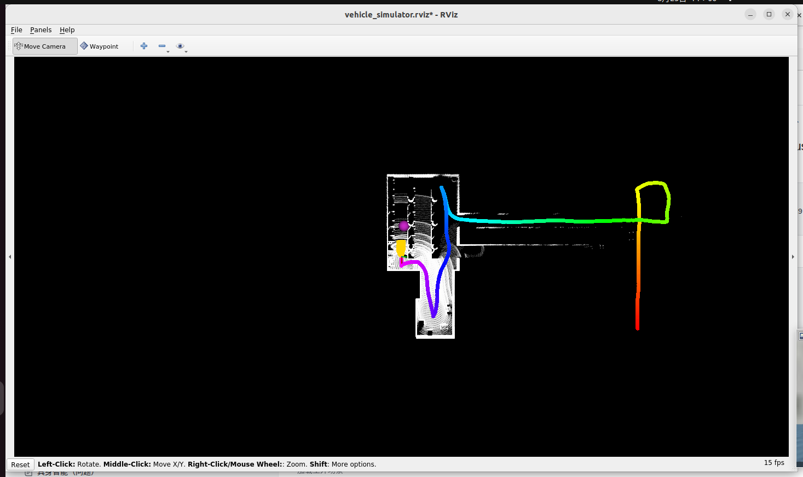
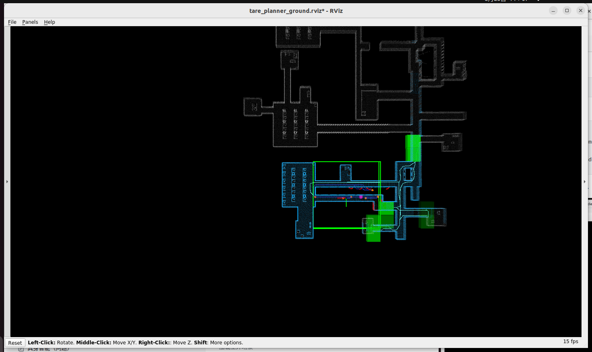

# TARE与FAR自主探索：Mengyuan Wang 作业参考笔记

作者：Mengyuan Wang。原始来源：个人 Docker 环境文档，第 4175 至 4966 行。

本文件保留个人记录中的步骤、代码、排错与结果。历史命令对应原实验环境；原笔记中的完成状态、曲线和指标是作者记录，整理时没有重新运行训练或真机实验。课件截图改为文字，个人实验截图保留。

## 使用与复核说明

TARE 的探索目标选择与 FAR 的路线规划职责不同。零静态 TF 是该仿真模型的简化约定，不能迁移为真实安装外参。延长探索结束时间只改变停止判据，不自动保证完整覆盖。

## 原始实验记录整理

### 第五章 仿真环境中的机器人自主探索实践

第4章的环境 robocup_g1 和 catkin_ws

```Bash
conda deactivate
xhost +local:root
docker start ros1_noetic
docker exec -it ros1_noetic bash
conda deactivate
cd /root/ros1_ws/unit4_shenlan/
source /opt/ros/noetic/setup.bash
```

#### 2.Autonomous Exploration Development Environment

1. 安装依赖

```bash
sudo apt update
sudo apt install libusb-dev
```

2. 克隆源码

```bash
git clone https://github.com/HongbiaoZ/autonomous_exploration_development_environment.git
```

3. 分支检查与编译安装

```bash
cd autonomous_exploration_development_environment
git checkout noetic # Ubuntu 20.04 则将 melodic 替换为 noetic
catkin_make
```

4. 通过脚本安装仿真环境

```bash
./src/vehicle_simulator/mesh/download_environments.sh
```

5. 启动开发环境

```bash
source devel/setup.sh
roslaunch vehicle_simulator system_indoor.launch
```

xxx 可替换为对应的 5 种环境之一：campus、forest、garage、indoor、tunnel

#### 3、TARE 分层自主探索规划器

1. 克隆源码

```bash
cd /root/ros1_ws/unit4_shenlan/autonomous_exploration_development_environment
git clone https://github.com/caochao39/tare_planner.git
```

2. 编译安装

```bash
cd tare_planner
catkin_make
```

3. 启动开发环境

```Shell
cd /root/ros1_ws/unit4_shenlan/autonomous_exploration_development_environment
source devel/setup.sh
roslaunch vehicle_simulator system_indoor.launch
```

xxx 可替换为对应的 5 种环境之一：campus、forest、garage、indoor、tunnel



4. 启动 TARE（另开一个终端）

```Shell
cd /root/ros1_ws/unit4_shenlan/autonomous_exploration_development_environment/tare_planner
source devel/setup.sh
roslaunch tare_planner explore_indoor.launch
```

xxx 可替换为对应的 5 种环境之一：campus、forest、garage、indoor、tunnel



#### 4 、FAR Planner

1. 克隆源码

```bash
cd /root/ros1_ws/unit4_shenlan/autonomous_exploration_development_environment
git clone https://github.com/MichaelFYang/far_planner
```

2. 编译安装

```bash
cd far_planner
catkin_make
```

3. 启动开发环境

```Shell
cd /root/ros1_ws/unit4_shenlan/autonomous_exploration_development_environment
source devel/setup.sh
roslaunch vehicle_simulator system_indoor.launch
```

4. 启动 FAR Planner（另开一个终端）

```bash
cd /root/ros1_ws/unit4_shenlan/autonomous_exploration_development_environment/far_planner
source devel/setup.sh
roslaunch far_planner far_planner.launch
```

#### 本章作业


<details>
<summary>原课件配图的文字说明</summary>

探索三层架构：上层选择探索目标或搜索全局路线，向中层提供航点、导航边界和速度；中层负责地形通行分析、局部避障与航点跟随；下层提供位姿、点云并执行速度控制。TARE 与 FAR 的职责不同，可以分别运行，具体如何配合取决于工程集成。图中地形范围是原示例配置。

</details>


<details>
<summary>原课件配图的文字说明</summary>

三层数据关系：状态估计输出 state_estimation、registered_scan 与 TF；地形分析和局部规划处理环境与上层航点，运动控制接收 command_velocity。上层航点与 navigation_boundary、navigation_speed 应和当前工程接口对应。

</details>


<details>
<summary>原课件配图的文字说明</summary>

G1 适配架构：FAST-LIO 输出状态和配准点云，经中层地形分析、局部规划、航点跟随与位置控制，产生 cmd_vel，接入仿真或实机速度接口；地形分析模块发布 terrain_map，上层提供 way_point、导航边界及 navigation_speed 等接口。话题名、类型、frame 与时间须与当前代码一致。

</details>


<details>
<summary>原课件配图的文字说明</summary>

接口适配：课程将 /Odometry 对接 /state_estimation，将 /registered_cloud 对接 /registered_scan。TF 保持 map → camera_init → body，body 下连接 pelvis、sensor；扫描时刻相关 frame 由对应节点发布。速度接收端由 Twist 适配到 TwistStamped。重命名不等于坐标转换，零静态外参仅针对课程模型。

</details>


<details>
<summary>原课件配图的文字说明</summary>

问题：registered_scan 异常离群点被地形分析误判为障碍物。课程在 laserMapping 的配准点云输出中增加离群点过滤。过滤参数应核对真障碍保留情况，不能以清掉全部噪点作为唯一目标。

</details>


<details>
<summary>原课件配图的文字说明</summary>

问题：TARE 过早宣布探索结束。课件将停止条件中的时间门槛从 5 s 改成 1005 s；条件还涉及返回状态与局部覆盖完成。延时只改变停止判据，不保证所有未知区域已经覆盖，需进一步检查覆盖、路径和回家条件。

</details>


在G1的仿真环境中，适配运行 TarePlanner 和 FarPlanner（适配是几乎完全一样的，因为适配的本质 是适配中层

- 修改 Autonomous Exploration Development Environment：去除仿真vehicle和环境 (robocup_g1已经有了，所以需要关闭这里的仿真)，同时提供一下静态tf：body-\>sensor,body- \>pelvis,map-\>camera_init（全是0,0,0,0,0,0）

课程 TF 示意的文字版：`map → camera_init → body`，`body → pelvis`、`body → sensor`；扫描时刻 frame 为 `sensor_at_scan`。静态 TF 图的统计频率不应解释为实际传感器采样频率。该图与课件相同，未保留图片。


- 修改 fastlio 提供以下信息：

```Bash
/Odometry--->/state_estimation
 /registered_cloud---> registered_scan
 Tf：camera_init->body--->map->sensor 
```

- 修改 rebocup_g1 适配带时间戳的速度：

```Bash
cmd_vel：gazebo里接收的格式需要修改成带时间戳的格式 
```

• 修改 lasermapping，对 registered_scan 进行离群点过滤 

##### 修改

1. **AEDE：关闭自带仿真，只保留中层节点和静态 TF**

重点文件：

\`/home/mengyuan/ros1_ws/unit4_shenlan/autonomous_exploration_development_environment/src/vehicle_simulator/launch/vehicle_simulator.launch:35`（原实验工程路径，未作为仓库附件）

这里现在会启动 AEDE 自己的 Gazebo 世界和三个模型：

```C++
<include file="$(find gazebo_ros)/launch/empty_world.launch" >
...
</include>

<param name="camera_description" ... />
<node pkg="gazebo_ros" type="spawn_model" name="spawn_camera" .../>

<param name="lidar_description" ... />
<node pkg="gazebo_ros" type="spawn_model" name="spawn_lidar" .../>

<param name="robot_description" ... />
<node pkg="gazebo_ros" type="spawn_model" name="spawn_robot" .../>

<node pkg="vehicle_simulator" type="vehicleSimulator" ...>
...
</node>
```

这些在 G1 仿真里都要删掉，因为 `robocup_g1` 已经提供机器人和 Gazebo。

内容保留：

- `local_planner`

- `terrain_analysis`

- `terrain_analysis_ext`

- `sensor_scan_generation`

- 可选 `visualization_tools`

- 静态 TF

```C++
robocup_g1 负责 Gazebo 世界 + G1 机器人 + 传感器仿真
AEDE 负责规划/地形/中层处理
TarePlanner 或 FarPlanner 负责全局探索目标
FAST_LIO 负责里程计和点云
```

加这几个静态 TF：

```C++
<node pkg="tf" type="static_transform_publisher" name="body_to_sensor"
      args="0 0 0 0 0 0 body sensor 1000"/>

<node pkg="tf" type="static_transform_publisher" name="body_to_pelvis"
      args="0 0 0 0 0 0 body pelvis 1000"/>

<node pkg="tf" type="static_transform_publisher" name="map_to_camera_init"
      args="0 0 0 0 0 0 map camera_init 1000"/>
```

另外 \`/home/mengyuan/ros1_ws/unit4_shenlan/autonomous_exploration_development_environment/src/local_planner/launch/local_planner.launch:102`（原实验工程路径，未作为仓库附件） 里原来有：

```Plain Text
<node pkg="tf" type="static_transform_publisher" name="vehicleTransPublisher" args="-$(arg sensorOffsetX) -$(arg sensorOffsetY) 0 0 0 0 /sensor /vehicle 1000"/>
<node pkg="tf" type="static_transform_publisher" name="sensorTransPublisher" args="0 0 $(arg cameraOffsetZ) -1.5707963 0 -1.5707963 /sensor /camera 1000"/>
```

这两个是 AEDE 原车体坐标用的，接 G1 时建议去掉或用参数控制关闭，否则 TF 树会混进 `vehicle/camera` 老坐标。

如果关闭这两条，`local_planner` 里发布 `/path` 的 frame 还是 `"vehicle"`：

\`/home/mengyuan/ros1_ws/unit4_shenlan/autonomous_exploration_development_environment/src/local_planner/src/localPlanner.cpp:853`（原实验工程路径，未作为仓库附件）

```C++
path.header.frame_id = "vehicle";
```

但实际还有多处 `vehicle` 坐标系：

```Plain Text
localPlanner.cpp:899
localPlanner.cpp:925
localPlanner.cpp:933
localPlanner.cpp:941
```

当前这些已经都改成：

```Plain Text
"body"
```

原记录将相关 frame 名称统一为 `body`。这只有在数值已经位于 body 坐标系时才成立；若仍在 vehicle/camera 坐标系，必须按采样时刻做真实变换，修改名称不会改变坐标。

\`/home/mengyuan/ros1_ws/unit4_shenlan/autonomous_exploration_development_environment/src/local_planner/src/pathFollower.cpp:228`（原实验工程路径，未作为仓库附件）

```C++
cmd_vel.header.frame_id = "vehicle";
```

```C++
// 修改后
cmd_vel.header.frame_id = "body";
```

2. **FAST_LIO 与 loam_interface：适配 AEDE 中层接口**

作业要求是：

```C++
/Odometry -> /state_estimation
/registered_cloud -> /registered_scan
```

正确方案是：

```Plain Text
FAST_LIO:
  /Odometry
  /cloud_registered

loam_interface:
  /state_estimation
  /registered_scan
```

也就是说：

- FAST_LIO 保持发布 `/Odometry`

- FAST_LIO 保持发布 `/cloud_registered`

- `loam_interface` 订阅这两个话题并重新发布最终话题

**正确的数据链路**

```Plain Text
FAST_LIO:
  /Odometry
  /cloud_registered
  TF: camera_init -> body

loam_interface:
  输入 /Odometry、/cloud_registered
  输出 /state_estimation、/registered_scan
```

所以不要把 FAST_LIO 直接改成：

```Plain Text
/state_estimation
/registered_scan
```

否则会绕过 `loam_interface`，与当前方案不一致。

**TF 关系也正确**

```Plain Text
map
└── camera_init       静态 TF
    └── body          FAST_LIO 动态 TF
        └── sensor    静态 TF
```

对应：

```Plain Text
map -> camera_init
camera_init -> body
body -> sensor
```

另外：

```Plain Text
body -> pelvis
```

也由 AEDE 静态发布。

真正的过程是：

```Plain Text
FAST_LIO 提供原始输出
loam_interface 完成中层话题适配
```

还要补充一句：

```Plain Text
loam_interface.launch 中：
/Odometry -> /state_estimation
/cloud_registered -> /registered_scan
```

并且当前设置：

```Plain Text
<param name="sendTF" value="false" />
```

因此不会由 `loam_interface` 重复发布 `map -> sensor`，TF 由静态 TF 加 FAST_LIO 的动态 TF 组成。

最终这部分可以这样写：

```Plain Text
FAST_LIO 保持发布：
  /Odometry
  /cloud_registered
  camera_init -> body

loam_interface 负责适配：
  /Odometry -> /state_estimation
  /cloud_registered -> /registered_scan

AEDE 提供静态 TF：
  map -> camera_init
  body -> sensor
  body -> pelvis
```


然后发布点也要注意 frame：

\`/home/mengyuan/ros1_ws/unit4_shenlan/catkin_ws/src/FAST_LIO/src/laserMapping.cpp:506`（原实验工程路径，未作为仓库附件）

现在点云 frame 是：

```C++
// 在 publish_frame_world() 中：
laserCloudmsg.header.frame_id = "camera_init";
pubLaserCloudFull.publish(laserCloudmsg);
```

```C++
// 在 publish_frame_body() 中：
laserCloudmsg.header.frame_id = "body";
pubLaserCloudFull_body.publish(laserCloudmsg);
```

位姿发布这里：

\`/home/mengyuan/ros1_ws/unit4_shenlan/catkin_ws/src/FAST_LIO/src/laserMapping.cpp:599`（原实验工程路径，未作为仓库附件）

现在是：

```C++
odomAftMapped.header.frame_id = "camera_init";
odomAftMapped.child_frame_id = "body";
```

TF 这里：

\`/home/mengyuan/ros1_ws/unit4_shenlan/catkin_ws/src/FAST_LIO/src/laserMapping.cpp:629`（原实验工程路径，未作为仓库附件）

现在发布：

```C++
br.sendTransform(tf::StampedTransform(transform, odomAftMapped.header.stamp, "camera_init", "body"));
```

按图和要求，最终要有：

```Plain Text
map -> camera_init  静态
camera_init -> body FAST_LIO
body -> sensor      静态
```

3. **G1 / robocup_g1：把 ****`/cmd_vel`**** 接收类型改成带时间戳**

重点文件：

\`/home/mengyuan/ros1_ws/unit4_shenlan/robocup_g1/src/unitree_guide/include/interface/IOROS.h:14`（原实验工程路径，未作为仓库附件）

现在 include 的是：

```C++
#include <geometry_msgs/Twist.h>
```

要改成：

```C++
#include <geometry_msgs/TwistStamped.h>
```

并把函数声明：

```C++
void DwaCmdCallback(const geometry_msgs::Twist &msg);
```

改成：

```C++
void DwaCmdCallback(const geometry_msgs::TwistStamped &msg);
```

实现文件：

\`/home/mengyuan/ros1_ws/unit4_shenlan/robocup_g1/src/unitree_guide/src/interface/IOROS.cpp:152`（原实验工程路径，未作为仓库附件）

本方案保持 topic 名称，同时修改订阅模板、头文件、回调声明及实现为 TwistStamped，再重新构建。发布与订阅类型必须一致，不是运行时自动转换 Twist：

```C++
dwa_cmd_sub = _nm.subscribe("/cmd_vel", 10, &IOROS::DwaCmdCallback, this);
```

callback 这里：

\`/home/mengyuan/ros1_ws/unit4_shenlan/robocup_g1/src/unitree_guide/src/interface/IOROS.cpp:339`（原实验工程路径，未作为仓库附件）

现在是：

```C++
void IOROS::DwaCmdCallback(const geometry_msgs::Twist &msg)
{
    float vx = -msg.linear.y + 0.120;
    float vy = msg.linear.x + 0.095;
    float vyaw = -msg.angular.z - 0.034;
```

要改成：

```C++
void IOROS::DwaCmdCallback(const geometry_msgs::TwistStamped &msg)
{

    // obs_current(6) = _userValue.ly;
    // obs_current(7) = -_userValue.lx;
    // obs_current(8) = -_userValue.rx;
     // 从 Twist 消息中获取线速度和角速度
    const geometry_msgs::Twist& twist = msg.twist;

    float vx = -twist.linear.y + 0.120;
    float vy = twist.linear.x + 0.095;
    float vyaw = -twist.angular.z - 0.034;

    // 如果所有速度都为0，则重置控制面板
    if((vx == 0) && (vy == 0) && (vyaw == 0)){
        cmdPanel->setZero();
        return;
    }

    std::cout << "current vx is: " << twist.linear.x
          << " current vy is: " << twist.linear.y
          << " current rx is: " << twist.angular.z << std::endl;

    cmdPanel->setUserValue(vx, vy, vyaw);
}
```

下面打印也要从 `msg.linear.x` 改成 `twist.linear.x`。

好消息是：AEDE 的 \`/home/mengyuan/ros1_ws/unit4_shenlan/autonomous_exploration_development_environment/src/local_planner/src/pathFollower.cpp:226`（原实验工程路径，未作为仓库附件） 已经发布的是：

```Plain Text
ros::Publisher pubSpeed = nh.advertise<geometry_msgs::TwistStamped>("/cmd_vel", 5);
```

所以只需要改 G1 接收端。

4. **laserMapping：对 ****`/registered_scan`**** 做离群点过滤**

按本篇前面的链路，FAST-LIO 在 `laserMapping.cpp` 发布 `/cloud_registered`，loam_interface 再转为 `/registered_scan`。滤波应作用于 FAST-LIO 的输出点云，再传给下游，不能同时把两个版本的话题命名当作同一实现。

改动位置：

\`/home/mengyuan/ros1_ws/unit4_shenlan/catkin_ws/src/FAST_LIO/src/laserMapping.cpp:53`（原实验工程路径，未作为仓库附件）

新增了 PCL 离群点滤波头文件：

```C++
#include <pcl/filters/statistical_outlier_removal.h>
```

\`/home/mengyuan/ros1_ws/unit4_shenlan/catkin_ws/src/FAST_LIO/src/laserMapping.cpp:98`（原实验工程路径，未作为仓库附件）

新增三个参数：

```C++
bool registered_scan_outlier_filter_en = true;
int registered_scan_outlier_mean_k = 20;
double registered_scan_outlier_stddev = 1.0;
```

\`/home/mengyuan/ros1_ws/unit4_shenlan/catkin_ws/src/FAST_LIO/src/laserMapping.cpp:507`（原实验工程路径，未作为仓库附件）

在 FAST-LIO 发布 `/cloud_registered` 前增加滤波，下游再输出 `/registered_scan`：

```C++
if (registered_scan_outlier_filter_en)
{
    pcl::StatisticalOutlierRemoval<PointType> sor;
    sor.setInputCloud(laserCloudWorld);
    sor.setMeanK(registered_scan_outlier_mean_k);
    sor.setStddevMulThresh(registered_scan_outlier_stddev);
    sor.filter(*laserCloudWorld);
}
```

这里使用统计离群点滤波 SOR：对各点计算到 K 个近邻的平均距离，再依据所有平均距离的均值、标准差与倍率阈值筛除异常点。`MeanK=20` 是该实验参数，与课件的半径内计数滤波不同；稀疏的真实障碍也可能被误删。

\`/home/mengyuan/ros1_ws/unit4_shenlan/catkin_ws/src/FAST_LIO/src/laserMapping.cpp:786`（原实验工程路径，未作为仓库附件）

加入：

```C++
nh.param<bool>(
    "registered_scan_outlier_filter_enable",
    registered_scan_outlier_filter_en,
    true);

nh.param<int>(
    "registered_scan_outlier_mean_k",
    registered_scan_outlier_mean_k,
    20);

nh.param<double>(
    "registered_scan_outlier_stddev",
    registered_scan_outlier_stddev,
    1.0);
```

也就是：

```Bash
nh.param<vector<double>>("mapping/extrinsic_T", extrinT, vector<double>());
nh.param<vector<double>>("mapping/extrinsic_R", extrinR, vector<double>());

nh.param<bool>(
    "registered_scan_outlier_filter_enable",
    registered_scan_outlier_filter_en,
    true);

nh.param<int>(
    "registered_scan_outlier_mean_k",
    registered_scan_outlier_mean_k,
    20);

nh.param<double>(
    "registered_scan_outlier_stddev",
    registered_scan_outlier_stddev,
    1.0);

p_pre->lidar_type = lidar_type;
```

同时我也改了 launch 参数：

\`/home/mengyuan/ros1_ws/unit4_shenlan/catkin_ws/src/FAST_LIO/launch/mapping_mid360.launch:13`（原实验工程路径，未作为仓库附件）

```C++
<param name="registered_scan_outlier_filter_enable" type="bool" value="true" />
<param name="registered_scan_outlier_mean_k" type="int" value="20" />
<param name="registered_scan_outlier_stddev" type="double" value="1.0" />
```

这样以后可以直接调参数，不用再改源码。

所以代码逻辑已经补上了，但最终还需要 ROS 环境正常的终端里编译一次。

```C++
cd /root/ros1_ws/unit4_shenlan/catkin_ws
catkin_make

cd /root/ros1_ws/unit4_shenlan/robocup_g1
catkin_make

cd /root/ros1_ws/unit4_shenlan/autonomous_exploration_development_environment
catkin_make

cd tare_planner
catkin_make

cd far_planner
catkin_make
```

#### 适配tare_planner 

适配far_planner 

1. 修改/autonomous_exploration_development_environment/src/loam_interface中launch文件 

**`loam_interface`**** 的作用**

这是适配中层的关键部分，应该补充：

文件：

```Plain Text
src/loam_interface/launch/loam_interface.launch
```

作用：

```Plain Text
/Odometry          -> /state_estimation
/cloud_registered  -> /registered_scan
```

并且在：

```Plain Text
src/vehicle_simulator/launch/system_indoor.launch
```

中加入：

```Plain Text
<include file="$(find loam_interface)/launch/loam_interface.launch" />
```

否则 `terrain_analysis`、`local_planner`、FarPlanner 等节点收不到标准话题。

同时，`sensor_scan_generation` 负责：

```Plain Text
/state_estimation + /registered_scan
    -> /state_estimation_at_scan
```

这是 TarePlanner 使用的定位话题。

2. 安装启动FAST_LIO

https://github.com/hku-mars/FAST_LIO，除了PCL库其他按照文档一步一步安装就可以 

有一点注意的是，PCL点云用命令直接安装，不要用源码安装（用源码装，还需要修改fast_lio的 cmakeList.txt去找包） 

```Bash
sudo apt install libpcl-dev 
```

3. fast_lio配置文件修改 

修改mid360.yaml 

```Bash
// 点云类型修改
preprocess:
    lidar_type: 4 
// 点云翻转 
mapping: extrinsic_R: [ 1, 0, 0, 
                        0, -1, 0,
                        0, 0, -1]
```

4. 修改 /autonomous_exploration_development_environment/src/vehicle_simulator/launch/system _indoor.launch 为了启动相应的中层模块

```Bash
// 加入
<include file="$(find loam_interface)/launch/loam_interface.launch" />
```

#### 代码运行（完成作业后，才能运行成功）

```Bash
conda deactivate
xhost +local:root
docker start ros1_noetic
docker exec -it ros1_noetic bash
conda deactivate
cd /root/ros1_ws/unit4_shenlan/
source /opt/ros/noetic/setup.bash
```

1、加载室内场景

```Bash
cd /root/ros1_ws/unit4_shenlan/robocup_g1
source devel/setup.bash 
roslaunch unitree_guide gazebo.launch 
```

2、启动运控

```Bash
cd /root/ros1_ws/unit4_shenlan/robocup_g1 
source devel/setup.bash 
./devel/lib/unitree_guide/junior_ctrl
```

3、运行中层局部规划

```Bash
cd /root/ros1_ws/unit4_shenlan/autonomous_exploration_development_environment
source devel/setup.bash 
roslaunch vehicle_simulator system_indoor.launch
```

4、运行top层tareplanner规划

```Bash
cd /root/ros1_ws/unit4_shenlan/autonomous_exploration_development_environment/tare_planner
source devel/setup.sh 
roslaunch tare_planner explore_indoor.launch


cd /root/ros1_ws/unit4_shenlan/autonomous_exploration_development_environment/far_planner
source devel/setup.sh 
roslaunch far_planner far_planner.launch
```

5、启动运控和仿真，机器人在动了，然后启动 fastlio

```Bash
cd /root/ros1_ws/unit4_shenlan/catkin_ws
source /opt/ros/noetic/setup.bash
source devel/setup.bash
roslaunch fast_lio mapping_mid360.launch
```

注：farplanner同上，只需将4中的tareplanner替换为farplanner. 

注：G1的旋转速度不能过大，需要修改下，在localplanner里。

#### 原地打转或探索范围异常时的输入检查

手柄输入未归零或控制源仲裁可能导致冲突，但 TF、定位、路径和速度映射也可能有问题。先观察各输入源及实际指令；确认手柄干扰后再关闭该输入源，不能笼统认为拔掉手柄即可解决。
