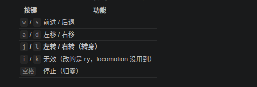
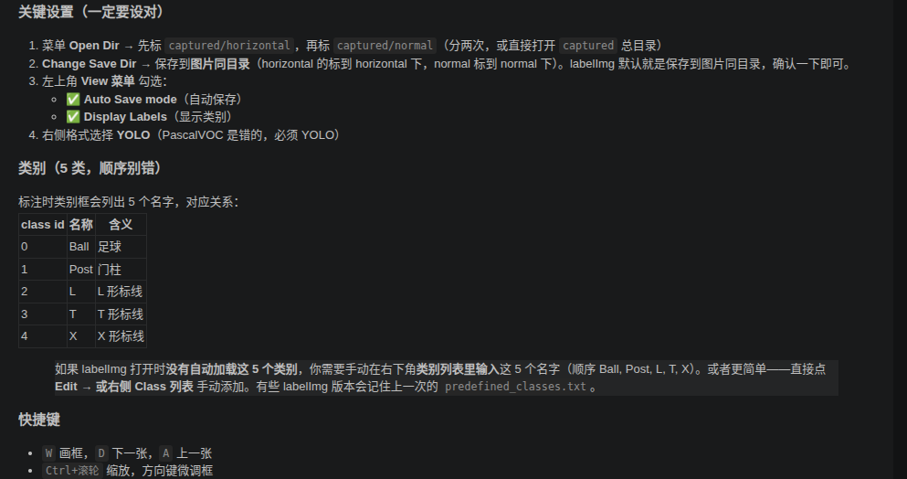

# YOLO数据与训练：Mengyuan Wang 作业参考笔记

作者：Mengyuan Wang。原始来源：个人 Docker 环境文档，第 4967 至 5594 行。

本文件保留个人记录中的步骤、代码、排错与结果。历史命令对应原实验环境；原笔记中的完成状态、曲线和指标是作者记录，整理时没有重新运行训练或真机实验。课件截图改为文字，个人实验截图保留。

## 使用与复核说明

训练/验证集需要避免近邻视频帧造成泄漏。原笔记同时保留各自验证集与同一验证集的指标，比较时应使用同一口径。图像中的置信度、mAP50 与 mAP50-95 是不同指标。

## 原始实验记录整理

### 第六章  实践：基于YOLO11的足球、球门、球场标线 检测和识别

```Bash
conda deactivate
xhost +local:root
docker start ros1_noetic
docker exec -it ros1_noetic bash
conda deactivate
cd /root/ros1_ws/unit6_shenlan
source /opt/ros/noetic/setup.bash
```

#### 本章作业

- 图像采集：订阅水平相机和倾斜相机topic，按照距离或角度选择保存某些图像，筛选出包含足球、 标线、球门的图像。 

- 图像标注：使用labelImg工具对采集的图像进行标注，并划分到训练和验证数据集中。

- 模型训练：使用自定义数据集对YOLO11模型进行训练和推理，在 predict 视频上进行验证。

#### 代码运行（完成作业后，才能运行成功） 

##### 编译&运行 

下载 Gazebo 仿真环境 robocup_g1 后，按照 robocup_g1 中的 readme 进行编译和运行。 

加载球场场景


<details>
<summary>原课件配图的文字说明</summary>

第六章作业：新增 20 张以上、含平视和俯视/倾斜视角的图像，用 labelImg 标注并划分训练/验证集，调整学习率、迭代和 batch，检查曲线与推理视频。扩增前后必须使用一致评估协议；改变验证集时应披露，不能直接比较两个 mAP。

</details>


```Bash
cd /root/ros1_ws/unit6_shenlan/robocup_g1_ws
source /opt/ros/noetic/setup.bash
catkin_make
```

**终端1 ， 启动球场仿真：**

```Bash
cd /root/ros1_ws/unit6_shenlan/robocup_g1_ws
source devel/setup.bash 
roslaunch unitree_guide gazebo.launch
```

**终端2 ， 启动控制器：**

```Bash
cd /root/ros1_ws/unit6_shenlan/robocup_g1_ws
source devel/setup.bash 
./devel/lib/unitree_guide/junior_ctrl
```

#### 采集数据 写采集数据 

- 实测确认相机 topic：

    - 俯视（倾斜）：`/camera/color/image_raw`

    - 平视：`/horizontal_camera/color/image_raw`

    - 两个都是 30Hz 正常出图



写脚本订阅 RGB 图像，根据距离或角度间隔，保存其中的一些图像。

**终端3 ， 自动采集：**

```Bash
cd /root/ros1_ws/unit6_shenlan
source /opt/ros/noetic/setup.bash
python3 capture_images.py --dist 0.5
```

```Python
#!/usr/bin/env python3
# -*- coding: utf-8 -*-
"""
RoboCup 球场图像采集脚本（自动按距离间隔 + 手动补充）
订阅 G1 机器人两台相机：
  - 俯视/倾斜相机: /camera/color/image_raw
  - 平视相机:     /horizontal_camera/color/image_raw

核心逻辑：订阅 /gazebo/model_states 获取机器人(g1_12dof_gazebo)位置，
每当机器人相对上一次保存位置移动超过 dist_interval 米，就自动保存两路图像。
这样你只需要用键盘(w/a/s/d)遥控机器人走动，脚本自动按距离存图，无需手动按键。

同时保留手动键：s=存两路，d=只存平视，a=只存俯视，q=退出。

用法：
    python3 capture_images.py --dist 0.5
参数：
    --dist  距离间隔(米)，默认 0.5
    --min-gap 两次保存之间的最小时间间隔(秒)，默认 0.8（避免短时间重复）
"""
import os
import sys
import time
import argparse
import cv2
import rospy
from sensor_msgs.msg import Image
from gazebo_msgs.msg import ModelStates
from cv_bridge import CvBridge

HORIZONTAL_TOPIC = "/horizontal_camera/color/image_raw"   # 平视
NORMAL_TOPIC = "/camera/color/image_raw"                  # 俯视/倾斜
ROBOT_NAME = "g1_12dof_gazebo"

BASE = os.path.dirname(os.path.abspath(__file__))
HORIZONTAL_DIR = os.path.join(BASE, "captured", "horizontal")
NORMAL_DIR = os.path.join(BASE, "captured", "normal")

bridge = CvBridge()
latest = {"horizontal": None, "normal": None}

# 机器人当前位置 + 上次保存位置
robot_pos = None
last_saved_pos = None
last_save_time = 0.0

def img_cb(key):
    def cb(msg):
        try:
            latest[key] = bridge.imgmsg_to_cv2(msg, desired_encoding="bgr8")
        except Exception as e:
            rospy.logwarn("convert {}: {}".format(key, e))
    return cb

def states_cb(msg):
    global robot_pos
    try:
        idx = msg.name.index(ROBOT_NAME)
        p = msg.pose[idx].position
        robot_pos = (p.x, p.y)
    except (ValueError, IndexError):
        pass

def save(key):
    img = latest[key]
    if img is None:
        return
    d = HORIZONTAL_DIR if key == "horizontal" else NORMAL_DIR
    os.makedirs(d, exist_ok=True)
    name = "{}_{}.jpg".format(key, rospy.Time.now().to_nsec())
    cv2.imwrite(os.path.join(d, name), img)
    return name

def count(dirpath):
    return len(os.listdir(dirpath)) if os.path.isdir(dirpath) else 0

def main():
    ap = argparse.ArgumentParser()
    ap.add_argument("--dist", type=float, default=0.5, help="距离间隔(米)")
    ap.add_argument("--min-gap", type=float, default=0.8, help="最小保存时间间隔(秒)")
    args = ap.parse_args()

    rospy.init_node("image_capture_auto", anonymous=True)
    rospy.Subscriber(HORIZONTAL_TOPIC, Image, img_cb("horizontal"),
                     queue_size=1, buff_size=2**24)
    rospy.Subscriber(NORMAL_TOPIC, Image, img_cb("normal"),
                     queue_size=1, buff_size=2**24)
    rospy.Subscriber("/gazebo/model_states", ModelStates, states_cb,
                     queue_size=1)

    print("=" * 56)
    print("自动采集模式：每移动 {:.2f} 米自动保存两路图像".format(args.dist))
    print("  你只需用键盘(w/a/s/d)遥控机器人走动")
    print("  手动键: s=存两路  d=平视  a=俯视  q=退出")
    print("保存目录: captured/horizontal 与 captured/normal")
    print("=" * 56)

    global last_saved_pos, last_save_time
    rate = rospy.Rate(10)
    while not rospy.is_shutdown():
        # 自动按距离保存
        if robot_pos is not None:
            if last_saved_pos is None:
                last_saved_pos = robot_pos
            else:
                dx = robot_pos[0] - last_saved_pos[0]
                dy = robot_pos[1] - last_saved_pos[1]
                dist = (dx * dx + dy * dy) ** 0.5
                now = time.time()
                if dist >= args.dist and (now - last_save_time) >= args.min_gap:
                    last_saved_pos = robot_pos
                    last_save_time = now
                    n1 = save("horizontal")
                    n2 = save("normal")
                    print("[自动] +{:.2f}m 保存 -> 平视{} 俯视{} | 累计 {} / {}".format(
                        dist,
                        os.path.basename(n1) if n1 else "N/A",
                        os.path.basename(n2) if n2 else "N/A",
                        count(HORIZONTAL_DIR), count(NORMAL_DIR)))

        # 显示
        for key in ("horizontal", "normal"):
            if latest[key] is not None:
                cv2.imshow(key, latest[key])

        k = cv2.waitKey(1) & 0xFF
        if k in (ord("q"), 27):
            break
        elif k in (ord("s"), 32):
            save("horizontal"); save("normal")
            print("[手动] 保存两路 | 累计 {} / {}".format(
                count(HORIZONTAL_DIR), count(NORMAL_DIR)))
        elif k == ord("d"):
            save("horizontal"); print("[手动] 存平视")
        elif k == ord("a"):
            save("normal"); print("[手动] 存俯视")

        rate.sleep()

    cv2.destroyAllWindows()
    print("退出。最终：平视 {} 张，俯视 {} 张".format(
        count(HORIZONTAL_DIR), count(NORMAL_DIR)))

if __name__ == "__main__":
    main()

```

##### 自动采集怎么用

- 脚本会自动订阅机器人的位置（`/gazebo/model_states`），**机器人每移动 0.5 米，自动保存俯视+平视两张图**。

- 你全程只需要在 `junior_ctrl` 终端用 **`w/a/s/d`**** 遥控机器人走动**，不用管存图。

- 弹出两个预览窗口可以看到当前画面；想手动补一张就点图像窗口按 `s`。

- 存够后按 `q` 退出。

#### 数据标注

```Bash
conda activate unitree-rl
pip3 install labelImg 
labelImg # 启动
```



```Bash
docker exec -it ros1_noetic bash
source /root/miniconda3/bin/activate unitree-rl

labelImg /root/ros1_ws/unit6_shenlan/captured/horizontal \
         /root/ros1_ws/unit6_shenlan/captured/predefined_classes.txt \
         /root/ros1_ws/unit6_shenlan/captured/horizontal

labelImg /root/ros1_ws/unit6_shenlan/captured/normal \
         /root/ros1_ws/unit6_shenlan/predefined_classes.txt \
         /root/ros1_ws/unit6_shenlan/captured/normal

```

#### 划分数据集

```Python
#!/usr/bin/env python3
# -*- coding: utf-8 -*-
"""
数据划分脚本：把采集+标注好的新增图像划分到 yolo_dataset 的 train/val。
用法：
    python3 divide_dataset.py [--val-ratio 0.2]
读取 captured/horizontal 和 captured/normal 下所有图像，
只处理「图像 + 同名 .txt 标签」都存在的文件（labelImg 标注后生成）。
将图像复制到 yolo_dataset/{train,val}/{images,labels}，命名加前缀避免冲突。
"""
import os
import shutil
import argparse
import random

BASE = os.path.dirname(os.path.abspath(__file__))
CAPTURE_DIRS = [
    os.path.join(BASE, "captured", "horizontal"),
    os.path.join(BASE, "captured", "normal"),
]
DATASET = os.path.join(BASE, "train_yolo11", "yolo_dataset")
IMG_EXTS = (".jpg", ".jpeg", ".png")

def main():
    ap = argparse.ArgumentParser()
    ap.add_argument("--val-ratio", type=float, default=0.2, help="验证集比例")
    ap.add_argument("--seed", type=int, default=42)
    args = ap.parse_args()

    # 收集所有已标注（图像+同名txt）的文件
    pairs = []  # (img_path, txt_path)
    for d in CAPTURE_DIRS:
        if not os.path.isdir(d):
            print("[跳过] 目录不存在:", d)
            continue
        for fn in sorted(os.listdir(d)):
            if fn.lower().endswith(IMG_EXTS):
                img = os.path.join(d, fn)
                txt = os.path.splitext(img)[0] + ".txt"
                if os.path.isfile(txt):
                    pairs.append((img, txt))
                else:
                    print("[跳过] 无标签:", fn)

    if not pairs:
        print("没有找到任何已标注的图像（图像+同名.txt）。请先用 labelImg 标注。")
        return

    random.seed(args.seed)
    random.shuffle(pairs)
    n_val = max(1, int(round(len(pairs) * args.val_ratio)))
    val_pairs = pairs[:n_val]
    train_pairs = pairs[n_val:]

    print("共 {} 张已标注图像：train {} 张，val {} 张".format(
        len(pairs), len(train_pairs), len(val_pairs)))

    for split, split_pairs in (("train", train_pairs), ("val", val_pairs)):
        img_dir = os.path.join(DATASET, split, "images")
        lbl_dir = os.path.join(DATASET, split, "labels")
        os.makedirs(img_dir, exist_ok=True)
        os.makedirs(lbl_dir, exist_ok=True)
        for img, txt in split_pairs:
            src_name = os.path.basename(img)
            base, ext = os.path.splitext(src_name)
            # 前缀标明来源相机，避免与现有命名冲突
            tag = "hor" if "horizontal" in img else "nor"
            new_base = "aug_{}_{}".format(tag, base)
            shutil.copy(img, os.path.join(img_dir, new_base + ext))
            shutil.copy(txt, os.path.join(lbl_dir, new_base + ".txt"))

    # 汇总
    for split in ("train", "val"):
        n_img = len(os.listdir(os.path.join(DATASET, split, "images")))
        n_lbl = len(os.listdir(os.path.join(DATASET, split, "labels")))
        print("[{}] images={} labels={}".format(split, n_img, n_lbl))
    print("完成。可运行训练脚本。")
    print("train: {}，val: {}".format(len(train_pairs), len(val_pairs)))

if __name__ == "__main__":
    main()

```

#### **YOLO11 足球/球门/标线检测 ，， 扩增前后训练对比报告**

> 深蓝 unit6 作业：基于 YOLO11 的足球、球门、球场标线检测与识别（RoboCup Gazebo 环境）
> 
> 

##### **1. 环境**

|项目|值|
|---|---|
|容器|`ros1_noetic`（镜像 `ros1_noetic_with_js:v1`），ROS Noetic + Gazebo 11|
|Python|3.8.20（conda 环境 `unitree-rl`）|
|PyTorch|2.3.1，CUDA True（NVIDIA RTX 4070 Laptop GPU，8GB）|
|ultralytics|8.4.138|
|预训练权重|`yolo11n.pt`（YOLO11n，101 层，2,583,127 参数，6.4 GFLOPs）|
|路径映射|宿主机 `/home/mengyuan/ros1_ws` ↔ 容器 `/root/ros1_ws`|

##### **2. 数据集**

5 类目标：`0=Ball`（球）、`1=Post`（球门柱）、`2=L`、`3=T`、`4=X`（球场标线交叉点）。

|划分|扩增前（基线）|扩增后|
|---|---|---|
|train|100|179|
|val|18|38|

- 新增图像来自两个视角：平视相机 `/horizontal_camera/color/image_raw`、俯视（倾斜）相机 `/camera/color/image_raw`

- 使用 labelImg 标注，输出 YOLO 格式 `class x_center y_center w h`（归一化）

- 数据集目录：`train_yolo11/yolo_dataset/{train,val}/{images,labels}`

##### **3. 训练代码位置**

|文件|说明|
|---|---|
|`train_yolo11/train_baseline.py`|扩增前基线训练脚本|
|`train_yolo11/train_aug.py`|扩增后训练脚本（调参）|
|`train_yolo11/train.py`|课程原始训练脚本（未修改）|
|`train_yolo11/compare_val.py`|同口径验证集对比脚本|
|`train_yolo11/predict_on_video.py`|对验证视频做检测并输出视频|
|`train_yolo11/yolov11_goalpost_ball.yaml`|数据集配置（训练时自动生成）|
|`train_yolo11/yolo11.yaml`|课程提供的模型结构配置|

##### **4. 训练参数对比**

两个脚本都通过 `YOLO("yolo11n.pt").train(**params)` 训练，关键差异如下：

|参数|扩增前（基线）|扩增后|调整说明|
|---|---|---|---|
|epochs|300|400|迭代次数增加|
|lr0（配置初始学习率）|0.01|0.005|配置减半；auto 优化器可能覆盖，需核对日志|
|lrf（末期学习率比例）|0.01|0.02|比例翻倍；按配置 lr0 × lrf 两组均为 0.0001|
|`batch`|16|16|8GB 显存限制，保持不变|
|`imgsz`|640|640|保持一致|
|`optimizer`|auto|auto|自动选择|
|`workers`|0|0|当时采用单进程绕开共享内存问题；并非 64 MB 必须为 0|
|`amp`|False|False|原记录关闭 AMP 及其检查；额外模型下载行为与版本有关|
|`patience`|50|50|早停轮数|
|`device`|0|0|GPU|

> 完整超参见各训练目录下的 `args.yaml`（`runs/detect/runs/train/<name>/args.yaml`）。
> 
> 

##### **5. 训练命令**

```Bash
# 1. 启动并进入容器
docker start ros1_noetic
docker exec -it ros1_noetic bash

# 2. 进入工作目录
cd /root/ros1_ws/unit6_shenlan/train_yolo11

# 3. 激活 conda 环境
source /root/miniconda3/etc/profile.d/conda.sh   # 或 ~/anaconda3/etc/profile.d/conda.sh
conda activate unitree-rl

# 4. 训练（二选一）
python train_baseline.py     # 扩增前基线
python train_aug.py          # 扩增后（调参）
```

```Python
from ultralytics import YOLO
import yaml, os

os.chdir(os.path.dirname(os.path.abspath(__file__)))

cfg = {
    "path": os.path.abspath("./yolo_dataset"),
    "train": "train/images",
    "val": "val/images",
    "names": {0: "Ball", 1: "Post", 2: "L", 3: "T", 4: "X"},
}
with open("./yolov11_goalpost_ball.yaml", "w") as f:
    yaml.dump(cfg, f)

model = YOLO("yolo11n.pt")

# 扩增后训练参数（对比基线 lr0=0.01, lrf=0.01, epochs=300, batch=16）
params = dict(
    data="./yolov11_goalpost_ball.yaml",
    epochs=400,
    batch=16,
    imgsz=640,
    device=0,
    workers=0,
    optimizer="auto",
    project="./runs/train",
    name="aug_after",
    exist_ok=True,
    augment=True,
    lr0=0.005,
    lrf=0.02,
    amp=False,
    patience=50,
    plots=True,
    val=True,
)
model.train(**params)
print("扩增后训练完成")

```

```Python
#!/usr/bin/env python3
# -*- coding: utf-8 -*-
"""扩增前基线训练：原始 100 train + 18 val，关闭 AMP 避免联网卡点。"""
from ultralytics import YOLO
import yaml, os

os.chdir(os.path.dirname(os.path.abspath(__file__)))

cfg = {
    "path": os.path.abspath("./yolo_dataset"),
    "train": "train/images",
    "val": "val/images",
    "names": {0: "Ball", 1: "Post", 2: "L", 3: "T", 4: "X"},
}
with open("./yolov11_goalpost_ball.yaml", "w") as f:
    yaml.dump(cfg, f)

model = YOLO("yolo11n.pt")

params = dict(
    data="./yolov11_goalpost_ball.yaml",
    epochs=300,          # 基线训练轮数
    batch=16,
    imgsz=640,
    device=0,
    workers=0,   # 单进程加载，避免容器 /dev/shm 64M 太小导致 ConnectionResetError
    optimizer="auto",
    project="./runs/train",
    name="baseline_before_aug",
    exist_ok=True,
    augment=True,
    lr0=0.01,
    lrf=0.01,
    amp=False,           # 关闭 AMP，跳过 yolo26n.pt 联网下载
    patience=50,
    plots=True,
    val=True,
)

model.train(**params)
print("基线训练完成")
```

后台训练（写日志、可退出终端）：

```Bash
nohup python -u train_aug.py > train_aug.log 2>&1 &
```

##### **6. 查看训练结果**

```Bash
cd /root/ros1_ws/unit6_shenlan/train_yolo11

# 查看实时日志（epoch 进度条）
tail -f train_aug.log

# 查看指标曲线（每 epoch 的 loss / precision / recall / mAP）
# 文件：runs/detect/runs/train/<name>/results.png

# 查看逐 epoch 数值表（CSV）
cat runs/detect/runs/train/aug_after/results.csv | head -3

# 查看图表
#   results.png               —— 训练曲线汇总
#   BoxP_curve.png            —— 精确率曲线
#   BoxR_curve.png            —— 召回率曲线
#   BoxPR_curve.png           —— PR 曲线
#   BoxF1_curve.png           —— F1 曲线
#   confusion_matrix.png      —— 混淆矩阵

# 权重文件
ls runs/detect/runs/train/aug_after/weights/   # best.pt / last.pt
```

results.csv 列含义：`epoch, time, train/box_loss, train/cls_loss, train/dfl_loss, metrics/precision(B), metrics/recall(B), metrics/mAP50(B), metrics/mAP50-95(B), val/box_loss, val/cls_loss, val/dfl_loss, lr/pg0, lr/pg1, lr/pg2`

##### **7. 训练结果**

###### **7.1 各训练自身的验证指标**

|模型|验证集规模|mAP50|mAP50-95|P|R|备注|
|---|---|---|---|---|---|---|
|基线 baseline_before_aug|18 张 / 109 实例|0.919|0.633|0.816|0.924|300/300 跑完|
|扩增后 aug_after|38 张 / 197 实例|0.888|0.499|0.834|0.890|早停在 244/400|

> 注：以上是训练内部验证在各自验证集上的原记录，规模不同，不能直接比较。仅传 `train(augment=True)` 不证明内部验证用了 TTA；需核对该版本的验证调用。

###### **7.2 同口径对比（关键结果）**

用 `compare_val.py`让**两个模型在同一 38 张 val 图（197 实例）** 上验证，公平比较：

|指标|扩增前（基线）|扩增后|提升|
|---|---|---|---|
|**mAP50**|0.697|**0.917** |**+0.220** |
|**mAP50-95**|0.415|**0.532** |**+0.117**|
|Precision|0.715 |0.930|+0.215|
|Recall|0.771|0.893 |+0.122|

###### **7.3 各类别对比（同 38 张验证集）**

|类别|基线 mAP50|扩增后 mAP50|基线 mAP50-95|扩增后 mAP50-95|
|---|---|---|---|---|
|Ball（球）|0.995|0.995|0.672|0.869|
|Post（球门柱）|0.967|0.983|0.576|0.601|
|L（标线）|0.360 |**0.775**|0.153|0.269|
|T（标线）|0.328 |**0.839**|0.155|0.318|
|X（标线）|0.834 |0.995|0.518|0.603|

##### **8. 结果分析**

1. **同一验证集的汇总指标提高**：原报告中 mAP50 从 0.697 提升到 0.917，mAP50-95 从 0.415 提升到 0.532；Ball 的 mAP50 均为 0.995，因此不能说每项指标全面提高。这些数字仅对应该验证集与记录的评估配置。

2. **L、T 类 mAP50 增幅明显**：分别从 0.360 到 0.775、0.328 到 0.839。新增视角与样本可能有帮助，但训练参数也同时改变，未做受控消融，不能把提升完全归因于数据扩增。

3. **基线在新增验证集上的表现**：基线原训练集为 100 张，验证集为 18 张。模型不应使用验证图训练；18 张验证图不能被表述为模型见过的训练分布。新增场景可能改变评估难度，需检查划分、视角和逐图错误，原资料不能确定下降的唯一原因。

4. **提前停止的含义**：原记录在 244/400 轮停止。`patience=50` 表示按实现的监控指标持续未改善达到门槛；`best.pt` 通常来自更早的最佳记录轮次，并不等于第 244 轮。早停不能证明全局最优或充分收敛，最佳轮次需查日志与 checkpoint。

5. **TTA 结论需撤回**：仅有训练参数 `augment=True`，不足以证明训练内部验证用了 TTA，也不能用 0.888 与 0.917 的差异直接断定 TTA 有害。应固定同一个 checkpoint、同一数据和其余参数，显式分别运行带/不带 TTA 的独立验证。当前官方验证器在训练验证路径关闭 augment，具体历史 8.4.138 还需对照该版本源码与日志。参见 [官方验证器源码说明](https://docs.ultralytics.com/reference/engine/validator/)；auto 优化器还可能覆盖 lr0，实际学习率应核对 [官方训练器说明](https://docs.ultralytics.com/reference/engine/trainer/) 与结果日志。

##### **9. 预测验证（对作业指定视频）**

用扩增后 best.pt 对 `predict_data/vedio/third - person perspective.mp4`（第三人称视角，1558×884，1110 帧，25fps）做检测：

```Bash
python predict_on_video.py
```

输出：`predict_result_video.avi`（带检测框与类别标签）。

抽样检测统计（每 50 帧抽 1 帧，共 23 帧）：

|类别|检出次数|
|---|---|
|L（标线）|104|
|T（标线）|81|
|Post（球门柱）|70|
|X（标线）|38|
|Ball（球）|15|

抽样预测输出包含 5 个类别，共 308 个检测框，平均每帧约 13.4 个。这里只统计模型输出，未提供视频逐帧真值；不能据此证明检出正确、没有漏检或第三人称视角精度达标。

#### **10. 产物清单**

|产物|路径|
|---|---|
|检测视频|`train_yolo11/predict_result_video.avi`|
|扩增后最优权重|`train_yolo11/runs/detect/runs/train/aug_after/weights/best.pt`|
|基线最优权重|`train_yolo11/runs/detect/runs/train/baseline_before_aug/weights/best.pt`|
|训练曲线|`runs/detect/runs/train/{baseline_before_aug,aug_after}/results.png` 等|
|逐 epoch 指标|`runs/detect/runs/train/{...}/results.csv`|
|训练日志|`train_baseline.log` / `train_aug.log`|
|本报告|`train_yolo11/TRAINING_REPORT.md`|
