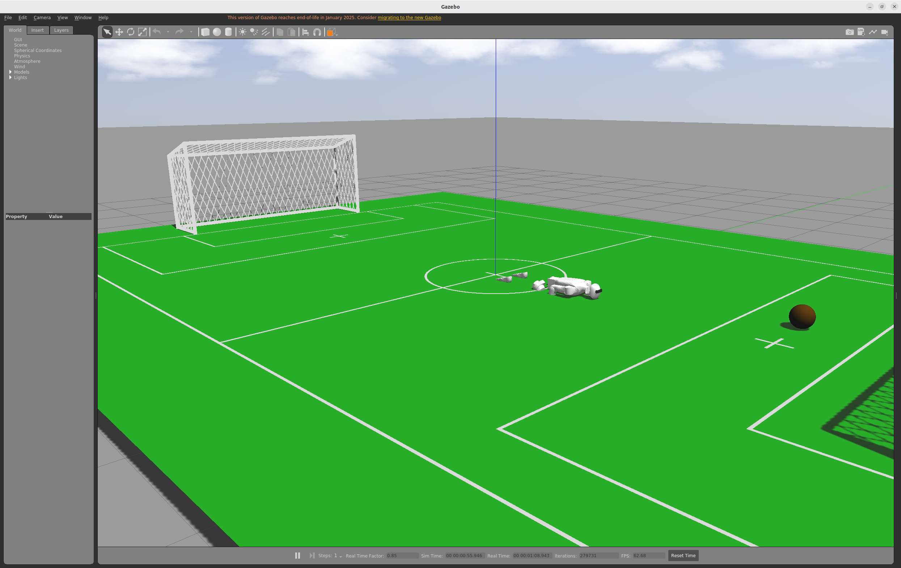
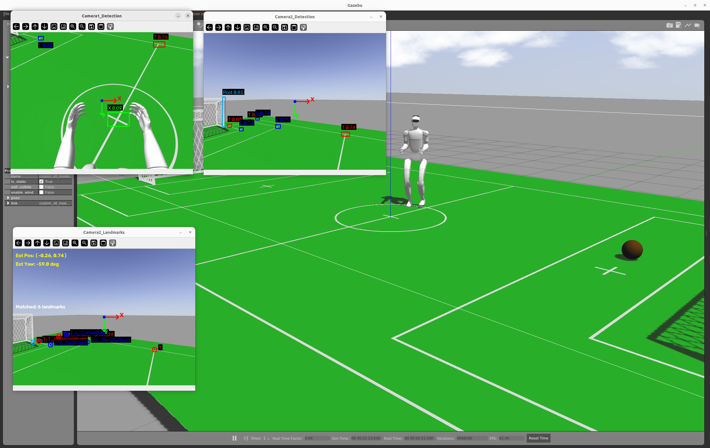

# 视觉定位与踢球：Mengyuan Wang 作业参考笔记

作者：Mengyuan Wang。原始来源：个人 Docker 环境文档，第 5595 至 6139 行。

本文件保留个人记录中的步骤、代码、排错与结果。历史命令对应原实验环境；原笔记中的完成状态、曲线和指标是作者记录，整理时没有重新运行训练或真机实验。课件截图改为文字，个人实验截图保留。

## 使用与复核说明

真值链路和视觉链路分开理解。融合 Gazebo 真值并不等于完成实机视觉定位。球位与球门位应随观测更新，进球应依据球进入球门区域判断。硬编码速度偏置只对应原接口的特定实现。

## 原始实验记录整理

### 7 实践：RoboCup仿真足球赛

#### 必选作业：跑通RoboCup仿真足球赛，总结梳理流程：

- 启动视觉空间重定位、EKF融合、基于YOLO检测的踢球程序 

- 整理整个项目的流程图，方便自己记忆理解 

- 提交作业：踢球视频和整理文档 

#### 附加作业：优化改进视觉重定位、踢球方案：

- 引入俯视相机足球目标检测用于踢球任务 

- 改进踢球策略 

- 修改足球或G1位置，重新踢球，针对问题做优化

- 说明完善的idea和解决的问题，提交代码和分析说明文档

#### 代码运行

##### 编译&运行 

采用前述章节的 robocup_g1 工作空间和 YOLO conda 环境，soccer_robot 的主要脚本用 Python 实现，无需像 C++ 一样编译脚本；ROS 包依赖、消息生成、安装和工作空间环境仍需配置，不能因此省略整个工程构建。

下面所有终端都需要：

```Bash
conda deactivate
xhost +local:root
docker start ros1_noetic
docker exec -it ros1_noetic bash
conda deactivate
cd /root/ros1_ws/unit7_shenlan
source /opt/ros/noetic/setup.bash 
```

```Bash
cd /root/ros1_ws/unit7_shenlan/robocup_g1_ws
source /opt/ros/noetic/setup.bash
catkin_make
```

##### 加载球场场景（共有） 

```Bash
cd /root/ros1_ws/unit7_shenlan/robocup_g1_ws
source devel/setup.bash 
roslaunch unitree_guide gazebo.launch 
```

```Bash
cd /root/ros1_ws/unit7_shenlan/robocup_g1_ws
source devel/setup.bash 
./devel/lib/unitree_guide/junior_ctrl 
```



##### 启动踢足球导航 

目前的代码

| 文件                                                         | 作用                                                         |
| ------------------------------------------------------------ | ------------------------------------------------------------ |
| [publish_true_positions.py](vscode-webview://0fv4r4kip2m34cfr7v227anfoaqr092d3cpcf3u88o8haa4d1v0c/soccer_robot/scripts/publish_true_positions.py) | 写死球 (3,0,0.3) 和两根门柱 (4.5,±1.4) 的真值，10Hz 发布     |
| [ball_kicker.py](vscode-webview://0fv4r4kip2m34cfr7v227anfoaqr092d3cpcf3u88o8haa4d1v0c/soccer_robot/scripts/ball_kicker.py) | 真值版踢球状态机：INIT→移动到踢球点→调朝向→直冲              |
| [robot_localizer.py](vscode-webview://0fv4r4kip2m34cfr7v227anfoaqr092d3cpcf3u88o8haa4d1v0c/soccer_robot/scripts/robot_localizer.py) | 核心：双 D435i + YOLO → 像素转 3D → 相机系转机器人系 → 地标匹配 → 最小二乘求位姿 → 发布机器人/球/球门全局坐标 |
| [vision_odom_ekf_localizer.py](vscode-webview://0fv4r4kip2m34cfr7v227anfoaqr092d3cpcf3u88o8haa4d1v0c/soccer_robot/scripts/vision_odom_ekf_localizer.py) | 7 维 EKF：视觉位姿作测量、/gazebo/model_states 作里程计增量，输出 /global_position_2d_ekf |
| [ball_kicker_yolo.py](vscode-webview://0fv4r4kip2m34cfr7v227anfoaqr092d3cpcf3u88o8haa4d1v0c/soccer_robot/scripts/ball_kicker_yolo.py) | 检测版踢球状态机：多了"原地旋转找球"                         |
| [vision_odom_ekf.launch](vscode-webview://0fv4r4kip2m34cfr7v227anfoaqr092d3cpcf3u88o8haa4d1v0c/soccer_robot/launch/vision_odom_ekf.launch) | 一键起定位 + EKF                                             |

###### ① 用真值导航： 

Gazebo 可直接提供模型或 link 的仿真状态，用作该仿真世界中的 ground truth，绕过视觉测量噪声。它仍受物理模型、数值积分、坐标定义和读取时刻影响，不能称为真实世界绝对精确的状态。

两条链路的对比：

|            | 机器人在哪                                                   | 球在哪                                                       | 球门在哪              | 有噪声吗                         |
| ---------- | ------------------------------------------------------------ | ------------------------------------------------------------ | --------------------- | -------------------------------- |
| ① 真值导航 | pose_publisher 调 Gazebo 的 /gazebo/get_model_state 服务，直接读 g1_12dof_gazebo 模型 | [publish_true_positions.py](http://publish_true_positions.py) 写死的常数 | 同样写死              | ❌ 完全没有                       |
| ② 检测导航 | [robot_localizer.py](http://robot_localizer.py)：YOLO 认标线交点 → 反投影 → 最小二乘求位姿 | 俯视相机检测 Ball + 深度图测距                               | 水平相机检测两根 Post | ✅ 有检测误差、深度噪声、标定误差 |

###### 启动球门柱、足球位置真值发布器： 

```Bash
cd 
conda deactivate 
cd /root/ros1_ws/unit7_shenlan/robocup_g1_ws
source devel/setup.bash 
python3 src/soccer_robot/scripts/publish_true_positions.py 
```

###### 启动机器人位置真值发布器：

```Bash
cd 
conda deactivate 
cd /root/ros1_ws/unit7_shenlan/robocup_g1_ws
source /opt/ros/noetic/setup.bash 
source devel/setup.bash 
rosrun unitree_controller pose_publisher 
```

###### 启动踢足球导航脚本：

```Bash
cd 
conda deactivate 
cd /root/ros1_ws/unit7_shenlan/robocup_g1_ws
source devel/setup.bash 
python3 src/soccer_robot/scripts/ball_kicker.py  
```

**课程为什么要这么设计**：把"感知"和"决策"解耦。用真值跑如果踢不进，那一定是**踢球策略**的问题，跟定位无关；用检测跑踢不进则可能是定位飘了。真值实际上是给检测导航画的一条**上限参照线** —— 真值都踢不进，检测就更别想。

---

###### 两个坑，都在真值链路上

###### 坑 1：球的真值明明拿得到，却没用

球在 Gazebo 里叫 `movable_sphere`（earth.world:65，半径 0.1m）。而 pose_publisher.cpp:21 **已经在发布它的真实位姿**了：

```C++
position_pub_sphere_ = nh.advertise<geometry_msgs::Point>("/movable_sphere/position", 10);
```

也就是说 `/movable_sphere/position` 这条话题上就有球的**真·真值**，10Hz。但 publish_true_positions.py:20-23 完全没订阅它，而是自己硬编码了一个常数。

###### 坑 2：那个硬编码的球坐标是**错的**

| 来源                                                         | 球的位置      |
| ------------------------------------------------------------ | ------------- |
| Gazebo 实际 earth.world:68                                   | 3.0, 0.5, 0.3 |
| [publish_true_positions.py](http://publish_true_positions.py) 写死 | 3.0, 0.0, 0.3 |

**y 差了 0.5 米** ， 而球半径才 0.1 米。

后果：真值导航时，机器人以为球在场地正中，实际球偏了半米。它会朝着"想象的球"走过去，然后在离真球半米的地方停下、对着空气调朝向、冲出去踢空。

---

###### 修改

`publish_true_positions.py` 改动整理

文件（两份同步）：soccer_robot/scripts/publish_true_positions.py · robocup_g1_ws/src/soccer_robot/scripts/publish_true_positions.py

###### 改动 1｜足球位置：硬编码常数 → 查询 Gazebo 真值

**最初**

```Python
# 位置设置（场地坐标系）
# 这些值可以根据实际情况调整或从Gazebo中获取
self.ball_position = Point()
self.ball_position.x = 3.0    # 场地中心位置
self.ball_position.y = 0.0
self.ball_position.z = 0.3    # 球半径约10cm
```

**最后**

```Python
# Gazebo 中足球模型的 link 全名（earth.world: model=movable_sphere, link=movable_sphere_link）
BALL_LINK = 'movable_sphere::movable_sphere_link'

def query_ball_position(self):
    """向 Gazebo 查询足球的真实世界坐标，失败时返回 None"""
    try:
        if self.get_link_state_ is None:
            rospy.wait_for_service('/gazebo/get_link_state', timeout=1.0)
            self.get_link_state_ = rospy.ServiceProxy('/gazebo/get_link_state', GetLinkState)

        response = self.get_link_state_(BALL_LINK, 'world')
        if response.success:
            return response.link_state.pose.position

        rospy.logwarn_throttle(5.0, "[球真值] get_link_state 失败: %s", response.status_message)
    except (rospy.ROSException, rospy.ServiceException) as exc:
        self.get_link_state_ = None      # 清空代理以便重连
        rospy.logwarn_throttle(5.0, "[球真值] Gazebo 服务不可用: %s", exc)

    return None
```

**为什么本记录选用 `get_link_state`**

earth.world:65-68 把球的偏移挂在 `<link>` 上而非 `<model>` 上，因此初始模型位姿与球所在 link 的位姿不同。不能由初始偏移推出模型原点永远固定；查询球中心时应选择对应 link 和明确的 world 参考系：

```XML
<model name="movable_sphere">
  <static>false</static>
  <link name="movable_sphere_link">
    <pose>3.0 0.5 0.3 0 0 0</pose>
```

实测对比：

| 查询方式                                             | 返回            |
| ---------------------------------------------------- | --------------- |
| get_model_state → movable_sphere                     | 0.0, 0.0, 0.0 ❌ |
| get_link_state → movable_sphere::movable_sphere_link | 3.0, 0.5, 0.3 ✅ |

###### 改动 2｜发布逻辑：无条件发布 → 拿到有效值才发布

**最初**

```Python
def timer_callback(self, event):
    """定时发布位置信息"""
    # 发布球的位置
    self.ball_pub.publish(self.ball_position)
    ...
```

**最后**

```Python
def timer_callback(self, event):
    """定时发布位置信息"""
    # 足球：只有拿到 Gazebo 真值后才发布，避免把无效坐标喂给踢球节点
    ball_position = self.query_ball_position()
    if ball_position is not None:
        self.ball_pub.publish(ball_position)
    ...
```

###### 改动 3｜健壮性（新增）

- 服务代理**惰性创建** ，， Gazebo 未启动时 1 秒超时后优雅降级，节点不崩

- **判断 ****`response.success`** ，， 避免把失败响应当有效数据发出去

- 异常时清空代理 + 5 秒节流告警 ，， 可自动重连、不刷屏

###### 改动 4｜清理

- 删除未使用的 `import numpy as np`

- 新增 `from gazebo_msgs.srv import GetLinkState`

- 补充类 docstring，写明两个数据源的差异及本方案为何使用已知门柱坐标

###### 未改动

- **门柱坐标** `(4.5, ±1.4, 0.75)` 在该静态场景中作为已知地图地标。门柱烘焙在场地网格内，没有独立的门柱 model 供同名查询；也可由网格/场地模型几何及变换计算，不是任何场景只能写常数。

- **机器人位姿部分未动**。应确认 `pose_publisher` 输出的是 model 原点还是目标机体 link，以及参考系和时间；由 URDF 生成不保证所有 link 都与 model 原点重合。原记录未提供完整发布器供本轮验证。

###### 验证

```Plain Text
$ rostopic echo /ball_true_position
x: 3.0
y: 0.5
z: 0.2999999999803796
```

与 Gazebo 中球的实际坐标一致，且球被踢走后会**自动跟随**（原硬编码版本做不到）。

###### ② 用检测值导航： 

```Bash
conda activate unitree-rl
pip install rospkg catkin-pkg defusedxml distro
```

###### 启动机器人位置真值发布器：

```Bash
cd 
conda deactivate 
cd /root/ros1_ws/unit7_shenlan/robocup_g1_ws
source /opt/ros/noetic/setup.bash 
source devel/setup.bash 
rosrun unitree_controller pose_publisher 
```

###### 运行检测定位： 

```Bash
conda activate unitree-rl
cd /root/ros1_ws/unit7_shenlan/robocup_g1_ws
source devel/setup.bash
python src/soccer_robot/scripts/robot_localizer.py
```

会弹出 3 个 OpenCV 窗口：`Camera1_Detection` / `Camera2_Detection` / `Camera2_Landmarks`。**盯 ****`Camera2_Landmarks`**** 窗口里的 ****`Pos Error`**** / ****`Yaw Error`**** / ****`Matched: N landmarks`** ，， 这三个是作业的核心指标。

###### 启动EKF融合定位脚本（第一遍先不跑）： 

```Bash
cd 
conda deactivate
cd /root/ros1_ws/unit7_shenlan/robocup_g1_ws
source devel/setup.bash 
python3 src/soccer_robot/scripts/vision_odom_ekf_localizer.py 
```

PS: 若启动EKF融合定位，需修改 ball_kicker_yolo.py 中接收机器人位置话题 /global_position_2d_robot，，\> /global_position_2d_ekf 

```python
# ROS订阅者 - 使用YOLO检测结果
# rospy.Subscriber('/global_position_2d_robot', Pose2D, self.robot_global_position_callback)
# 机器人位姿话题：默认走视觉定位，加 _robot_pose_topic:=/global_position_2d_ekf 可切到 EKF
robot_pose_topic = rospy.get_param('~robot_pose_topic', '/global_position_2d_robot')
rospy.loginfo("订阅机器人位姿话题: %s", robot_pose_topic)
rospy.Subscriber(robot_pose_topic, Pose2D, self.robot_global_position_callback)
```

###### 启动踢足球导航脚本： 

```Bash
# 不带EKF融合
cd 
conda deactivate 
cd /root/ros1_ws/unit7_shenlan/robocup_g1_ws
source devel/setup.bash 
python3 src/soccer_robot/scripts/ball_kicker_yolo.py
```

```Bash
# 带EKF融合
cd 
conda deactivate 
cd /root/ros1_ws/unit7_shenlan/robocup_g1_ws
source devel/setup.bash 
python3 src/soccer_robot/scripts/ball_kicker_yolo.py _robot_pose_topic:=/global_position_2d_ekf
```

###### 运行检测定位的时候环境遇到的问题

病因

conda 环境里存在**"旧 soname → 新库"的假软链接**：

```Plain Text
conda:  libffi.so.7  → libffi.so.8.1.4     ← 假的，libffi 8 没有 LIBFFI_BASE_7.0 那套版本化符号
conda:  libtiff.so.5 → libtiff.so.6        ← 假的，同理
system: libffi.so.7  → libffi.so.7.1.0     ← 真货
system: libtiff.so.5 → libtiff.so.5.5.0    ← 真货
```

**动态链接说明**：RPATH 与 RUNPATH 的依赖搜索范围和优先级不同，RPATH 可影响间接依赖；实际查找还受已有库、环境变量及加载方式影响。原日志中的符号版本缺失与不兼容 soname 软链接相符，但不能概括为全部动态库都必然先加载 Conda 目录；需逐项核对所选库与要求的符号版本。

```Plain Text
DT_RPATH = $ORIGIN/../lib
```

`DT_RPATH`（不是 `DT_RUNPATH`）的坑在于**会被继承给进程里之后加载的所有库**。于是系统库 `libp11-kit.so.0`（需要 `ffi_type_pointer@LIBFFI_BASE_7.0`）和 `libgdal.so.26`（需要 `TIFFReadRGBATileExt@LIBTIFF_4.0`）一被 dlopen，动态链接器就**先去 conda 的 lib 目录**找老 soname，撞上假链接，拿到不兼容的新库 → 符号版本对不上 → `ImportError`。

**修改前的检查**：原记录称已检查依赖，但仓库未附完整依赖审计输出。修改 soname 软链接可能破坏其他程序，需确认相关符号版本和实际依赖，并保留原链接；不能把这里的处理推广到所有 Conda 环境。

改动（2 条软链接）

```Bash
L=/root/miniconda3/envs/unitree-rl/lib

# libffi.so.7
cp -a $L/libffi.so.7 $L/libffi.so.7.orig-backup
ln -sf /usr/lib/x86_64-linux-gnu/libffi.so.7.1.0 $L/libffi.so.7

# libtiff.so.5
cp -a $L/libtiff.so.5 $L/libtiff.so.5.orig-backup
ln -sf /usr/lib/x86_64-linux-gnu/libtiff.so.5.5.0 $L/libtiff.so.5
```

两个 `.orig-backup` 保留了原链接指向，**随时可回滚**：

```Bash
cd /root/miniconda3/envs/unitree-rl/lib
ln -sf libffi.so.8.1.4  libffi.so.7
ln -sf ./libtiff.so.6   libtiff.so.5
```

###### 运行检测定位后弹出的三个OpenCV窗口是什么意思？



###### ① `Camera1_Detection` ，， 俯视相机

**画的是**：cam1（俯视相机，pitch≈47.6° 朝前下方）的原始画面 + 每个检测框，框上方一行 `类型 置信度`，例如 `Ball 0.87`。

绘制函数是 visualize_detections_with_labels:1241。颜色按类别区分：

| 类别      | 颜色 |
| --------- | ---- |
| Post 门柱 | 橙   |
| X 交点    | 绿   |
| L 交点    | 蓝   |
| T 交点    | 红   |
| Ball 球   | 青   |

**作用**：确认俯视相机能不能看到球、检测质量如何。**球的世界坐标就是从这台相机算出来的** ，， publish_ball_and_goal_global_positions:461 里明确注释了"使用俯视相机 camera1 的数据"。俯视角度可能有利于近处球的观测，但可靠性还受遮挡、深度有效性、标定和目标距离影响；原记录没有两相机精度对比。

---

###### ② `Camera2_Detection` ，， 水平相机

**画的是**：cam2（水平相机，pitch=0，平视前方）的原始画面 + 检测框，格式和 ① 完全一样。

**作用**：看水平相机这一帧**看到了哪些标线交点**。这台相机是**定位的主力** ，， 主循环里 `match_landmarks` 和 `estimate_pose` 只用 cam2 的检测结果。

---

###### ③ `Camera2_Landmarks` ，， 定位结果（最重要）

画的是**同一张 cam2 画面**，但叠加的是**定位的中间过程和结果**，而不是检测本身。绘制函数是 visualize_localization:1533。

###### (a) 画面上的圆圈和标签

每个检测目标画一个白圈标出中心点，旁边标 `类型: 标签`：

```Plain Text
L: L_PenaltyLeft        ← 冒号后面是 match_landmarks 打上的"地标身份"
   ⭕
```

**关键**：如果只显示 `L` 而没有冒号后的标签，说明这个点**没匹配上**，不会参与最小二乘。匹配上的才计入 `Matched` 计数。

###### (b) 左上角 6 行文字叠层

```Plain Text
Est Pos:  (0.12, -0.02)         黄色  最小二乘估计出的机器人位置
Est Yaw:  0.1 deg               黄色  估计出的朝向
True Pos: (0.12, -0.02, 0.00)   绿色  Gazebo 真值位置
True Yaw: 0.2 deg               绿色  真值朝向
Pos Error: 0.031m               红色  ← 位置误差
Yaw Error: 0.2 deg              红色  ← 朝向误差
Matched: 5 landmarks            白色  ← 成功匹配的地标数
```

#### 梳理项目流程图

```Plain Text
┌───────────────────────────────────────────────────────────────────────┐
│ ① 仿真层   Gazebo (earth.world)                                        │
│                                                                       │
│    g1_12dof_gazebo   机器人（12 DOF）                                  │
│    movable_sphere    足球，初始位姿 (3.0, 0.5, 0.3)，半径 0.1m          │
│    custom_stl_model  球场网格 football_field.dae (z=0.2)               │
│                      ⚠ 球门柱烤在这个网格里，不是独立模型               │
│                                                                       │
│    机器人身上挂两个 D435i（realsense_gazebo_plugin 模拟）              │
│      · d435_normal     俯视相机  装在 torso，下倾 47.6°                │
│      · d435_horizontal 水平相机  装在 torso，朝正前方                   │
└───────┬────────────────────────────────────┬──────────────────────────┘
        │                                    │
        │ 4 路图像话题                        │ /gazebo/get_model_state (服务)
        │ /camera/color/image_raw            │
        │ /camera/depth/image_raw            ▼
        │ /horizontal_camera/color/image_raw ┌──────────────────────────┐
        │ /horizontal_camera/depth/image_raw │  pose_publisher (C++)    │
        │                                    │  unitree_controller 包    │
        ▼                                    │  查 Gazebo 真值并转发      │
┌─────────────────────────┐                 └───┬──────────────────────┘
│ ② 感知层                 │                     │
│  robot_localizer (Py)   │                     │ /g1_12dof_gazebo/position
│  · YOLO11 检测           │                     │ /g1_12dof_gazebo/orientation
│  · 像素→3D→机器人系       │                     │ /movable_sphere/position ⚠
│  · 地标匹配               │                     │
│  · 最小二乘求位姿          │                     │
└───┬─────────────────────┘                     │
    │                                           │
    │ /global_position_2d_robot                 │
    │ /global_position_2d_ball                  │
    │ /global_position_2d_goal                  │
    ▼                                           │
┌─────────────────────────┐                     │
│ ③ 定位层（可选）          │◄────────────────────┘
│  vision_odom_ekf (Py)   │   /gazebo/model_states（当 odom 用）
│  · 7 维 EKF 融合         │
└───┬─────────────────────┘
    │ /global_position_2d_ekf
    ▼
┌───────────────────────────────────────────────────────────────────────┐
│ ④ 决策/执行层                                                          │
│                                                                       │
│   ball_kicker.py        真值版踢球状态机                                │
│     └─ 订阅 /ball_true_position, /left(right)_goalpost_true_position   │
│   ball_kicker_yolo.py   检测版踢球状态机                                │
│     └─ 订阅 /global_position_2d_{robot|ekf, ball, goal}                │
│                          │                                            │
│                          │ /g1_12dof_gazebo/move_controller/command     │
│                          │ (unitree_legged_msgs/MoveCmd)               │
│                          ▼                                            │
│   junior_ctrl (C++)  unitree_guide 包                                  │
│     └─ IOROS::MoveCallback  把 vx/vy/vyaw 映射成摇杆轴 lx/ly/rx         │
│        └─ FSM 步态控制器 → 关节指令 → Gazebo servo                       │
└───────────────────────────────────────────────────────────────────────┘
```

#### 附加

##### `all_kicker_yolo.py`（482 → 623 行）

###### 球位/球门位：从"首次赋值即锁死"改为持续更新

```Python
# 原来
if self.ball_position_ is None:
    self.ball_position_ = pose2d      # 之后再也不更新
```

新增 `_update_observation()`：1.5 s 时间滑窗 + 取中位数 + 过期丢弃 + 样本不足返回不可用；两个回调都改走它。

**设计作用与限制**：持续更新球位，并用 1.5 s 窗口的中位数减小孤立异常值影响；连续误检或错误关联仍可能通过，运动球还会受窗口延迟影响。超时丢弃是可用性检查，不证明位置正确。

###### 新增 `ball_spread_` / `goal_spread_`，旋转搜索的退出条件改为"观测收敛"

以下为条件/控制思路的伪代码节选，不是可独立执行的 Python：

```text
# 原来：球和门都不为 None 就停
if self.ball_position_ is not None and self.goal_position_ is not None:

# 现在：还要求窗口内离散度 < 0.15 m
and self.ball_spread_ is not None and self.ball_spread_ < self.stability_threshold_
```

**设计作用与限制**：用观测离散程度控制搜索退出，只说明窗口内数据较集中；持续偏差也可能满足门限，不能据此证明球位正确收敛。

###### 进球判据：从"判机器人"改为"判球"

|      | 判据                                            |
| ---- | ----------------------------------------------- |
| 原来 | 距离(机器人, 门中点) < kick_distance_(0.1)      |
| 现在 | 球越过门线 x ≥ 4.4 且 落在门柱之间 \|Δy\| ≤ 1.4 |

新增参数 `goal_line_margin_ = 0.1`、`goal_half_width_ = 1.4`（取代 `kick_distance_`）。

**能实现**：判的是**球**进没进门。原判据要机器人自己贴到门中点 0.1 m 才成立，等于奖励机器人冲进门；门宽 2.8 m，球从边上正常进门也判不出来。

###### 新增冲门超时保护

`kick_timeout_ = 8.0`，超时则 `stop_robot()` 并结束本次；进入冲门时重置 `kick_start_time_ = None`，避免上一轮计时残留导致一进去就超时。

**能实现**：不会朝球门无限冲刺。

###### 冲门段指令：从开环直冲改为闭环对准

以下为条件/控制思路的伪代码节选，不是可独立执行的 Python：

```text
# 原来
cmd.vy = 1.0;  cmd.vx = vx_compensation;  cmd.vyaw = 0.0

# 现在
target_yaw = atan2(门 - 球)                      # 每轮重算推球方向
cmd.vyaw = -sign(yaw_diff) * min(kick_max_yaw_rate_, |yaw_diff|)
cmd.vx   = kick_lateral_gain_ * vx_compensation  # 默认 0
cmd.vy   = 1.0 if |yaw_diff| < kick_align_tolerance_ else 0.0
```

**能实现**：朝向持续对准「球 → 门」连线；没对准时原地转正、对准了才全速推。原来的 `vyaw = 0` 在球被踢偏或朝向漂了之后没有任何补救。横向补偿增益默认关掉（改为 `vyaw` 负责方向），留成参数 `_kick_lateral_gain:=0.5` 可开。

###### 新增 IOROS 偏置反向抵消

`IOROS.cpp:278-280` 给每条指令无条件叠加 `lx+0.120 / ly+0.025 / rx−0.034`，而 `State_locomotion.cpp` 里 `obs_mean[6..8]=0`、`obs_scales[6..8]=1`，策略收到的是原始值。新增 `cancel_ioros_bias_`（默认开）+ 三个偏置常数，在下发前反向减掉：

```Python
cmd.vx -= 0.120;  cmd.vy -= 0.025;  cmd.vyaw += 0.034
```

**条件性结论**：若 IOROS 的偏置、符号与命令缩放确与记录一致，可代数抵消这些偏置；当前附件中 `cmd_scale` 还来自 YAML，不能不检查配置就宣称精确还原或不再侧漂。接触、策略与定位仍会影响运动，完整 IOROS 文件未附，需在实际工程对照测试。

---

##### `robot_localizer.py`（1751 → 1767 行，单柱分支一处）

**原来**：只检测到一根门柱时，直接把那根柱子的坐标当门心发布。

**现在**：改用已知场地几何取两柱中点。

```Python
goal_center = (self.field_markers_global_frame_['P_GoalLeft'] +
               self.field_markers_global_frame_['P_GoalRight']) / 2.0   # = (4.5, 0.0)
```

并加一致性检查：检测柱偏离最近已知门柱 \> 1.0 m（可能是位姿、关联或地图问题）时 `logwarn_throttle` 并跳过本次发布。

**作用与限制**：在这张地图及正确球门关联下，由已知门柱中点恢复 `(4.5, 0.0)`，可避免把单柱当门心造成 1.4 m 横向偏差。1.0 m 一致性门限仅排除部分异常，不保证所有错误位姿与错配都被拦截。
