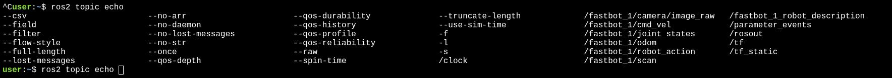

# ROS 2 工作空间、节点编写与小车实战

整理：Mengyuan Wang。

按知识点整理课堂学习笔记，重点概念保留课堂说明。

## 重点概念

### 工作空间

**工作空间是什么？**

**编译的时候在工作空间workspace进行编译**

在 ROS 机器人开发中，我们针对机器人某些功能进行代码开发时，各种编写的代码、参数、脚本等文件，需要放置在某一个文件夹里进行管理，这个文件夹在 ROS 系统中就叫做工作空间。

工作空间的名称我们可以自己定义，其数量也并不是唯一的，且不同的工作空间是并列存在的，一个工作空间改动不影响其它工作空间。

工作空间（workspace）是一个存放项目开发相关文件的文件夹；是开发过程的大本营。

ROS2 的工作空间结构：

- src：代码空间（Source Space）
- build：编译空间（Build Space）
- install：安装空间（Install Space）
- log：日志空间（Log Space）

```bash
# 安装 colcon
sudo apt install python3-colcon-ros

# 创建工作空间
mkdir -p ~/dev_ws/src

# 进入 src
cd ~/dev_ws/src

# 返回工作空间
cd ~/dev_ws

# 编译
colcon build

# 当前终端加载环境(仅在当前终端生效)
source install/local_setup.bash

# 永久加载环境
echo "source ~/dev_ws/install/local_setup.bash" >> ~/.bashrc
source ~/.bashrc
```

### 功能包

**功能包是什么？**

每个机器人可能有很多功能，比如移动控制、视觉感知、自主导航等，如果我们把这些功能的源码都放到一起当然也是可以的，但是当我们想把其中某些功能分享给别人时，就会发现代码都混合到了一起，很难拆分出来。

功能包是 ROS2 里把代码模块化、方便拆开拼装和重复使用的“神器”包装盒。

Python 功能包结构：

setup.py 文件里边也包含一些版权信息，除此之外，还有“entry_points”配置的程序入口，在后续编程讲解中，我们会给大家介绍如何使用。

package.xml 文件，包含功能包的版权描述，和各种依赖的声明。

创建功能包：

```Bash
# 其中：<build-type>：构建类型  <package_name>：功能包名称
ros2 pkg create --build-type <build-type> <package_name>
# 例如Python
ros2 pkg create --build-type ament_python learning_pkg_python
# 创建功能包后返回工作空间
cd ~/dev_ws
# 编译所有工作空间功能包
colcon build
# 让当前终端能够识别刚刚编译出来的功能包。
# 如果不开启新的终端，只要重新编译，就需要再次执行：
source install/local_setup.bash
# 单独编译一个功能包
colcon build --packages-select <package_name>
```

**创建了自己的脚本，必须在setup.py注册这个脚本！！！**

在 Python 功能包中，需要修改

```Plain
setup.py
```

里面有一项：

```Plain
entry_points={
    'console_scripts': [
        'helloworld_executable = learning_pkg_python.helloworld:main',
    ],
},
```

其中：

```Plain
helloworld_executable
```

表示：

以后执行的命令名称，可自定义。

例如：

```Plain
ros2 run learning_pkg_python helloworld_executable
learning_pkg_python
```

表示：

Python 包名称。

```Plain
helloworld
```

表示：

Python 文件脚本名称

```Plain
helloworld.py
main
```

表示：

Python 文件里面必须存在

```Plain
def main():
    ...
```

如果：

-  修改了 Python 文件名 
-  修改了函数名 
-  修改了包名 

都必须同步修改这里，否则 ROS2 找不到程序入口。

### 节点

**什么是节点？**

ROS2 节点是一个独立运行的程序，每个节点都是为处理机器人的特定功能或能力而设计的。

节点实现了机器人的多样化功能，但这些功能并非彼此独立，而是存在复杂的相互关联。

节点之间可能不是同一个语言写的（C++ 或 Python）。

甚至两个节点可以运行在不同机器上（嵌入式或主控机）。

想象一场大型聚餐的后厨运作。

图中角色：洗菜工、切配师傅、大厨、传菜。

每位员工之间都相互独立，共同完成后厨工作。

### 发布与订阅

**什么是话题？**

话题（Topic）是节点间通信的核心机制之一，其本质是**异步**的**发布/订阅**（Publish-Subscribe）模型，类似于现实生活中的“广播电台”：

电台（Publish）：广播电台负责制作节目（如新闻、音乐），并通过特定频率（如 FM98.5）发送信号。

频率（Topic）：电台和听众通过相同的频率（话题名称）建立联系，例如“交通频道”对应 ROS 中的话题名（如 /turtle1/cmd_vel）。

听众（Subscribe）：听众打开收音机，调到对应频率（如 FM98.5）即可接收节目，无需知道电台的具体位置或设备细节。

### 请求与响应

**什么是 ROS2 服务（Service）？**

ROS2 服务采用请求-响应模式。

服务客户端向服务服务器发送请求；服务器处理请求并执行操作后，将响应返回给客户端。

让我们用一个现实生活中的天气查询来类比解释什么是服务吧。

当一个用户 Client 需要获取当地天气情况时，通过发送位置信息给服务器 Server，服务器会反馈天气情况给该用户。

这基本上就是 ROS2 服务的工作方式。

### 动作的执行过程

在生活中也有像 Action 一样的模式。

当你下单一份披萨后，APP 会立即确认订单接受，然后每分钟都会推送实时进度（比如准备面饼、烘烤中等状态）。

特别关键的是，在第10分钟突然改变主意要换成培根披萨时，APP 能马上取消原订单并开启重新制作，最终成功将培根披萨送达手中。

时序图中的文字，按时序列出：

1. 你（Client）、披萨 APP（Server）
2. 目标：一份海鲜披萨
3. 接受目标
4. 立即反馈：订单已接受
5. loop：每分钟状态反馈
6. 进度更新（准备面饼/烘烤中/配送中）
7. 第10分钟：改为培根披萨！
8. 取消成功！已改单
9. 重新制作培根披萨
10. 最终结果：培根披萨送达

### 移动机器人系统

移动机器人核心系统包含了两个部分：

**1. 控制模块**

- 以 /cmd_vel 为核心，如何通过 geometry_msgs/Twist 控制机器人移动
- 差速驱动原理，左右轮转速如何影响运动方向
- 节点与数据流的流程图（teleop → cmd_vel_mux → controller → base_driver）

**2. 感知模块**

- 激光雷达（LaserScan）感知周边障碍物
- IMU（惯性测量单元）监测姿态、倾斜与运动变化
- 如何在 Rviz2 中查看这些传感器数据
- 它们在机器人导航、避障中的核心地位

### 控制模块

#### 坐标与运动方向

控制流程：

teleop_keyboard（用户输入命令）→ cmd_vel 话题发布（geometry_msgs/Twist）→ cmd_vel_mux（控制源选择器）→ diff_drive_controller（控制器转换为左右轮速度）→ base_driver（驱动底层轮子）→ 机器人实际移动。

“矢量速度”是一个物理和机器人学中常用的术语，指的是既包含速度的大小（速度值），又包含方向（运动方向）的一种速度表示方式。

对机器人的速度控制是通过向机器人的核心节点发送速度消息来实现的，这个消息的类型在 ROS 里已经有了定义，就是 geometry_msgs::Twist。

| 节点 | 作用 |
| --- | --- |
| teleop_keyboard | 用户键盘输入控制方向、速度等，生成 /cmd_vel 消息 |
| /cmd_vel | 一个标准话题，用于传递“机器人该怎么动”的命令 |
| cmd_vel_mux | 如果有多个节点发 /cmd_vel，这个节点负责决策哪个生效 |
| diff_drive_controller | 差速控制器，将 Twist 指令转换成左右轮实际速度命令 |
| base_driver | 最接近硬件的部分，控制电机、反馈编码器（实际驱动电机的驱动层节点，与硬件通信） |
| 实际移动 | 最终驱动机器人前进、旋转 |

#### 速度消息

**机器人的“走”（移动位置）**

就像图中那只右手的姿势：

- 大拇指向上（Z轴）：表示机器人能上下移动。比如让手升高或降低，就像电梯上下楼。
- 食指向左（Y轴）：表示机器人能左右移动。比如让手向左或向右平移，像螃蟹横着走。
- 中指向左上方（X轴）：表示机器人能前后移动。比如让手前进或后退，像走路前后挪动。

**机器人的“转”（旋转方向）**

如图中的“右手定则”：

- 竖起的拇指：代表你想让它绕某个轴旋转的方向（比如绕 Z轴、X轴或 Y轴）。
- 握拳的四指：代表实际的旋转方向（顺时针或逆时针）。
- 弧形箭头：就是旋转的轨迹，图中箭头向右表示顺时针旋转。

图中线速度 linear 和角速度 angular 均包含 X轴、Y轴、Z轴分量。

| 成员 | 描述 | 示例 |
| --- | --- | --- |
| linear.x | 沿 X轴的速度（前后） | 0.1 m/s（向前） |
| linear.y | 沿 Y轴的速度（左右） | 0.0 |
| linear.z | 沿 Z轴的速度（上下） | 0.0 |
| angular.x | 绕 X轴旋转速度（滚动） | 通常为 0 |
| angular.y | 绕 Y轴旋转速度（俯仰） | 通常为 0 |
| angular.z | 绕 Z轴旋转速度（转向） | 0.5 rad/s |

### 感知模块

如果控制模块让机器人“动起来”，那么感知模块就像机器人的“眼睛”和“内耳”，让它知道“周围有什么”和“我现在姿态是否正常”。

感知系统提供的信息，是实现避障、导航、地图构建等高级任务的基础。

**激光雷达 LaserScan**

雷达原理：发出激光 → 被物体反射 → 测算距离。

ROS2 中雷达的标准消息：sensor_msgs/msg/LaserScan。

**IMU 惯性测量单元**

作用：监测机器人在三维空间的线性加速度、角速度、姿态变化。

ROS2 消息类型：sensor_msgs/msg/Imu。

### 常用消息类型

**机器人运动状态与空间位置的四大核心消息类型**

机器人就像一位能走路、会转身的智能小助手，它用四种数据来记录自己的动作和位置。

就像你玩游戏要控制角色移动一样，机器人也用这些“密码”来行动：

**速度密码（Twist）：告诉机器人“怎么动”**

- 线速度（linear）：控制前进/后退速度（X轴）、左右平移（Y轴）、上升/下降（Z轴）。
- 角速度（angular）：控制左转/右转（绕 Z轴）、点头/抬头（绕 X轴）、左右摇头（绕 Y轴）。

**位置密码（Pose）：告诉机器人“在哪里”**

- 位置（position）：在空间中的坐标点（x=水平位置，y=垂直位置，z=高度）。
- 朝向（orientation）：用四个数字（四元数）表示头朝哪个方向，就像手机地图上的箭头指向你面对的方向。

**里程密码（Odometry）：记录“走过的路”**

- 位置+朝向：当前停在哪儿、面朝哪（Pose 的信息）。
- 实时速度：此刻移动多快、转多快（Twist 的信息）。
- 额外功能：还能预估位置误差（例如提示“当前位置可能有 ±5 厘米偏差”）。

**空间密码（Transform）：连接“两个世界”**

- 坐标系转换：把“机器人坐标系的数据”翻译成“全局地图坐标”。
- 动态更新：机器人移动时会自动重新计算位置关系。

**四大密码如何配合工作？**

想象控制扫地机器人清扫房间：

1. 你通过 Twist 命令它：“向前走 0.5 m/s，左转 10 度”。
2. 机器人行走时通过 Odometry 记录：“已移动 0.3 米，当前在客厅东南角”。
3. 位置数据通过 Transform 转换：把“距离右边墙 20cm”换成地图坐标（3.2, 4.1）。
4. 最终将 Pose 发送给手机 APP：“机器人正停在沙发旁，面朝窗户”。

注：Twist 管动作，Pose 管定位，Odometry 管记录，Transform 管翻译，四者配合，机器人才能聪明地行走！

| 类型 | 包含字段 | 用途简述 |
| --- | --- | --- |
| Twist | linear(x,y,z)；angular(x,y,z) | 告诉机器人要以多快速度移动和旋转 |
| Pose | position(x,y,z)；orientation（四元数 x,y,z,w） | 描述一个物体或机器人的空间位置与朝向 |
| Odometry | header；pose(Pose)；twist(Twist) | 一帧完整的运动状态估计数据，常用于导航模块，融合 Pose+Twist 的输出 |
| Transform | header；child_frame_id；transform(translation+rotation) | 连接两个坐标系的相对位姿，用于 TF 广播 |

**7月20日下午整理（小车项目）**

实战平台：注册登录后需要重新再次输入 https://app.theconstruct.cn/desktop/rosject/1039112

https://app.theconstruct.ai/l/6c3e7d72/

https://app.theconstruct.cn/l/6c3e7d72/

前置：

```Bash
ros2 topic list
# 打印信息可以使用双击Tap补全
ros2 topic echo /fastbot_1/camera/image_raw

# 打印出来什么都没有
ros2 topic echo /fastbot_1/cmd_vel
# 重新用另一个终端发布topic 之前的终端就有东西了
ros2 topic pub /fastbot_1/cmd_vel geometry_msgs/msg/Twist "{linear: {x: 1.0, y: 0.0, z: 0.0}, angular: {x: 0.0, y: 0.0, z: 0.0}}"
# Ctrl+C是不会让小车停止的
ros2 topic pub /fastbot_1/cmd_vel geometry_msgs/msg/Twist "{linear: {x: 0.0, y: 0.0, z: 0.0}, angular: {x: 0.0, y: 0.0, z: 0.0}}"
```




下面命令主要针对我的功能包

```Bash
# 创建功能包后返回工作空间
cd ~/dev_ws
# 编译所有工作空间功能包
colcon build
# 让当前终端能够识别刚刚编译出来的功能包。
# 如果不开启新的终端，只要重新编译，就需要再次执行：
source install/local_setup.bash
# 单独编译一个功能包
colcon build --packages-select <package_name>
# 构建功能包
cd ~/ros2_ws/src
ros2 pkg create --build-type ament_python follow_track --dependencies rclpy sensor_msgs geometry_msg scv_bridge

# 我常用
cd ros2_ws
# 编译一定在workspace下进行
colcon build
source install/setup.bash
# cd src/follow_back/follow_back/ 可以不需要
# 不需要进入具体路径层级里面
ros2 run follow_back camera_vel_node
```

## 参考资料

- 2026 ROS暑期学校人形机器人灵犀X2二次开发实战.pdf，我的课堂记录及所附课件内容。
- 文中链接的官方文档用于补充解释和核对接口。
