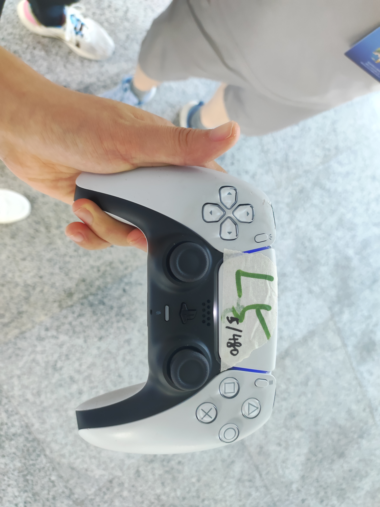
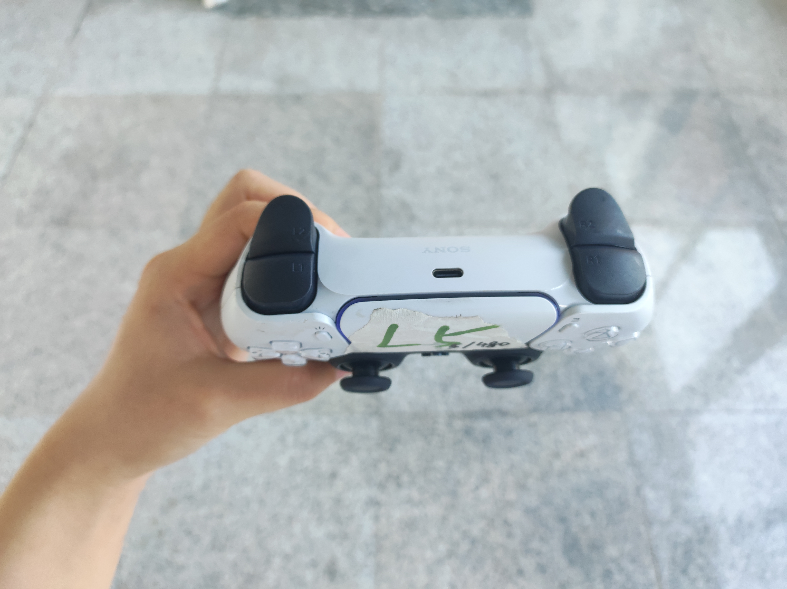
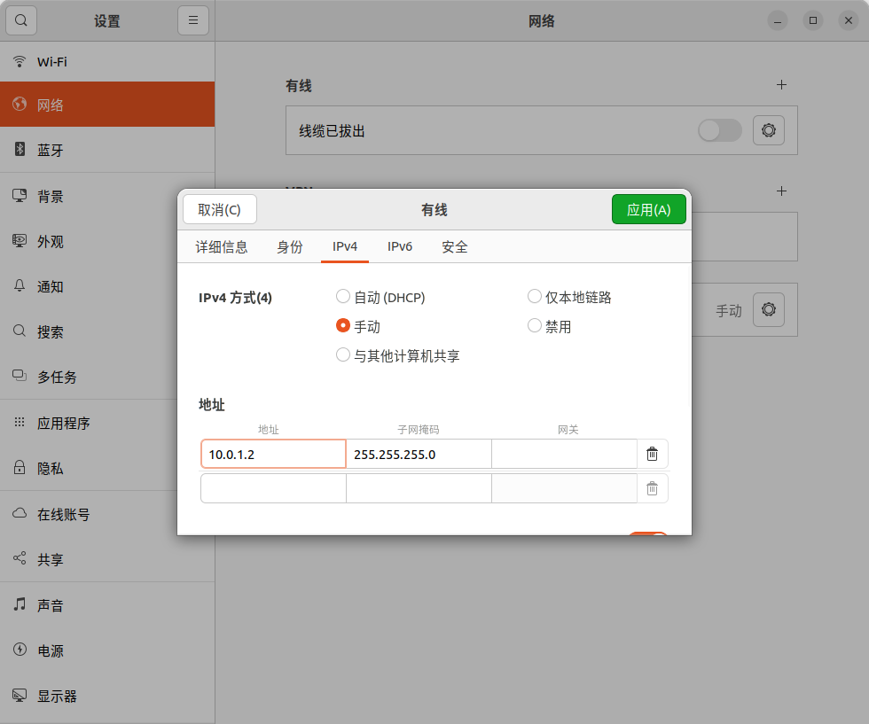

# 灵犀 X2 硬件、计算单元与基本操作

整理：Mengyuan Wang。

按知识点整理课堂学习笔记，重点概念保留课堂说明。

## 重点概念

### 硬件与自由度

| 项目 | X2 青春版 | X2 旗舰版 |
| --- | --- | --- |
| 主动自由度 | 25 | 30 |
| 颈部自由度 | 0 | 1 |
| 单手臂自由度 | 5 | 7 |
| 腰部自由度 | 3 | 3 |
| 单腿自由度 | 6 | 6 |
| 环境温度 | -10℃~40℃ | -10℃~40℃ |
| RGB 摄像头 | 交互 RGB 摄像头、前视双目 RGB 摄像头、后视 RGB 摄像头、RGB-D 摄像头 | 同左（原表合并单元格） |
| 3D 激光雷达 | 〔原表本栏空白〕 | 具备 |
| 交互模块 | 语音、显示 | 同左（原表合并单元格） |
| 二次开发 | 不具备全量 | 具备全量 |
| 灵创平台 | 支持 | 同左（原表合并单元格） |

### 计算单元

灵犀 X2 内部集成了2至3个计算单元（电脑），各自负责处理不同的任务。

| 项目 | 功能 | X2 青春版 | X2 旗舰版 |
| --- | --- | --- | --- |
| 计算单元/电脑（PC1） | 运控计算 | 具备 | 具备 |
| 计算单元/电脑（PC2） | 开发计算 | 不具备 | 具备 |
| 计算单元/电脑（PC3） | 交互计算 | 具备 | 具备 |

### 常见传感器的作用

| 传感器类型 | 功能定位 | 举例说明 |
| --- | --- | --- |
| 摄像头（视觉） | 看见颜色、形状、人脸、物体、文字 | 识别主人、看懂手势、导航避障 |
| 麦克风（听觉） | 接收声音、语音指令 | 听懂“你好”“跳个舞”等命令 |
| IMU（惯性测量单元） | 感知身体姿态、加速度、角速度 | 判断是否站稳、会不会摔倒 |
| 力/力矩传感器 | 测量关节受力或手部接触力 | 握手时知道用多大力，不捏疼人 |
| 触觉传感器 | 感知按压、抚摸、碰撞 | 被摸头时会“害羞”地低头 |
| 激光雷达/深度相机 | 测量周围物体的距离和3D形状 | 在房间中建地图、避开桌椅 |

请缓慢平滑移动航空箱，以免重心不稳。

### 遥控手柄与指示灯





| 键位 | X2 遥控按键名称及意义 |
| --- | --- |
| B：左键/触发器 | L1、L2 按键（PS5 侧面图） |
| A：右键/触发器 | R1、R2 按键（PS5 侧面图） |
| A：方向键 | 左侧十字按键，↑、↓、←、→ 四个方向按键 |
| B：创建按键 | 创建按键 |
| C：光条 | 光条 |
| D：触摸板 | 触摸板 |
| E：玩家指示灯 | 玩家指示灯 |
| F：选项按键 | 选项按键 |
| G：四个动作按键 | △、□、○和×四个功能按键 |
| N&H：摇杆区域 | N：左摇杆（可控前后左右方向）；H：右摇杆（可控旋转方向） |
| PS 按钮 | PS 按钮 |

| 情况说明 | 颜色 |
| --- | --- |
| 遥控开机/连接 | 蓝灯呼吸式闪烁 |
| 遥控正在连接 | 蓝灯常亮 |
| 遥控等待配对 | 在光条和玩家指示灯都已熄灭的状态下，按一次 PS 键，光条（蓝灯）会呼吸式闪烁。此时是遥控器正在搜索已配对的设备。若15秒内没有连接上任何设备，光条（蓝灯）会熄灭。在光条和玩家指示灯都已熄灭的状态下，长按创建键+PS键5秒，光条（蓝灯）会短促快闪，此时是遥控器正在等待配对。 |
| 遥控配对成功 | 白灯常亮 |
| 遥控启动正常 | 白灯呼吸 |
| 遥控充电 | 橙灯呼吸；0–20%：快闪；20–100%：慢闪 |
| 遥控充电完成 | 橙灯熄灭 |
| 固件更新 | 白灯快闪 |

白灯常亮代表遥控配对成功。

### 运动控制模式

模式切换图中的模式：

- 阻尼模式 DAMPING_DEFAULT
- 零力矩模式 PASSIVE_DEFAULT
- 站姿预备模式 JOINT_DEFAULT
- 稳定站立模式 STAND_DEFAULT
- 走跑模式 LOCOMOTION_DEFAULT
- 越野模式 LOCOMOTION_STEP

稳定站立模式 → 走跑模式：摇杆即走；走跑模式 → 稳定站立模式：R2+X。

稳定站立模式 → 站姿预备模式：L2+X；站姿预备模式 → 稳定站立模式：R2+X。

走跑模式 → 越野模式：R2+△；越野模式 → 走跑模式：L2+△。

进入阻尼模式：L2+R2+创建键。进入零力矩模式：L1+R1+创建键。

零力矩模式 → 站姿预备模式：L2+X。

以上按照片文字转录，保留设备版本条件。

### 环境与急停安全

明确操作环境要求和紧急情况的应对措施。

**01 操作环境要求**

机器人必须在平整、干燥、稳定的地面上使用，严禁在陡坡、高落差边缘、潮湿积水地面等危险区域操作。

**02 禁止操作区域**

不得在高振动或极端温度环境下使用，同时要避免在易碎表面（如玻璃、薄木板）上运行。

**03 急停功能须知**

熟悉遥控器急停按钮位置，紧急情况下立即按下。急停后机器人会全身卸力，必须使用保护架支撑，非紧急情况严禁使用。

**04 电源安全须知**

使用前检查电缆、插头、插座是否完好。如遇短路、过热等异常，应立即切断电源。

### 操作安全准则

遵循正确的操作流程，确保机器人运行安全。

**1 启动前确认**

启动前务必确认工作区域内无人员或障碍物，尤其是运动部件附近，并确保机器人已完成自检，系统状态正常。

**2 保持安全距离**

操作机器人时，需与其保持至少1米的距离。在机器人进行高速动作期间，严禁站立于其运动路径上。

**3 负载与操作规范**

严格遵守设计负载限制，最大负载（特定姿态）为3kg，全空间负载 ≤1kg。夹持器需与物体匹配，禁止超载和异常操作。

**4 禁止人为干预**

机器人在运行过程中，严禁手动触碰或阻挡其动作。如需调整，必须先停机并断电。

**5 远程操作安全**

进行远程操作时，必须使用安全网络环境，防止控制信号被劫持。同时必须配备实时监控设备，确保掌握机器人状态。

## 理解与勘误

### 结构与自由度

课件区分青春版 25 主动自由度和旗舰版 30 主动自由度。旗舰版两臂各 7、腰 3、两腿各 6、颈部 1，可合计 30。软件示例又列头 pitch/yaw 两关节，但 pitch 锁定，不能据此把可用主动自由度算成 31。

电动关节配合减速器与控制器产生运动。关节数量、力矩与末端负载是不同指标；多自由度不自动意味着可在所有姿态任意搬重物。课件负载、温度和峰值力矩属于特定配置，不作当前产品承诺。

### 计算单元分工

PC1 负责运控，PC2 负责开发，PC3 负责交互。课件说明部分版本没有 PC2。二开程序部署在开发单元或外部电脑，不在运控单元运行不相关程序，避免干扰原控制任务。

传感器包括激光、RGB-D、前后 RGB、IMU、麦克风、触摸；执行与交互包含关节、夹爪、显示、灯带和扬声器。课件的通用传感器表并不证明每台机器都有独立六维力传感器，需要按实际配置核对。

### 开箱、上电与站起

先检查搬运、机体、电池及周围空间，按资料示意把机器人置于对应稳定姿态。课件要求电量超过两格，再短按唤醒、长按完成上电，观察电量灯与自检。

资料展示吊起、坐姿和平躺站起几条流程，不能将某一键位序列应用到所有起始状态。课件 的数字键位与 课件 流程图使用了不同标记；需要对照实际遥控器及官方操作说明，不能依赖 OCR 推测按键。

### 控制模式

零力矩模式释放关节驱动；阻尼模式抵抗速度；位控预备姿态控制目标角；稳定站立和走跑模式提供主动平衡；越野模式属于特定固件技能。名字相似不代表与 G1 模式可以互换。

进入零力矩或阻尼不会使自由站立的人形机器人自然保持平衡。资料特别要求支撑或吊架，进入低层状态前必须先保证姿态受控。急停是实际安全链的一部分，不能把发一条 ROS 零速度当作同等功能。

### 关机与遥控

课件关机流程先进入预备姿态，人工/支撑辅助放倒或坐下，再进入阻尼/零力矩，最后断电。平躺前尚需支撑，不能先卸力再假定机器人会缓慢倒下。

遥控器含肩键、创建键、方向键、动作键、摇杆、触摸与状态灯。资料说明摇杆用于前后横移与转向，颜色区分搜索、配对、充电和固件更新。这些显示应与实际说明对照，颜色截图不能代替状态查询。

### 有线与开发网络

资料有线示例为开发电脑 `10.0.1.2/24`、PC1 `10.0.1.40`、PC2 `10.0.1.41`。这些是课程内网设置，不是登录凭据。连接二开网口后可 `ping 10.0.1.41` 检查连通，成功只证明网络可达，不证明 SDK 或 ROS 发现已正常。

无线热点在课程配置中用于 SSH 调试，不支持完整跨机 SDK 路径。账号密码和远程连接码不保存在整理文档；真实设备连接信息不要公开在仓库中。

### 操作约束与来源范围

资料要求平整干燥地面、无高落差和易碎支撑、运动范围清空、急停可达、遵守负载与温度范围。远程控制需要实时观察和可靠接管，不能无人确认姿态就调用动作。

课件 硬件与计算、课件 操作与安全、课件 PS5 手柄正面/肩键实拍、课件 日期记录、SDK 压缩包与网卡配置均已纳入范围。压缩包在 PDF 中被引用，本次没有提供其原文件，也没有编造其安装结果。

### 传感器配置表的理解

常见传感器作用表说明的是功能类别与可能用途，不能据此认定每个 X2 版本都安装了独立力/力矩传感器，或已经实现识别、跟随等算法。设备配置以对应型号和实际接口为准。

## 代码与操作记录

https://x2-aimdk.agibot.com/zh-cn/latest/search.html?q=%E9%A2%84%E8%AE%BE&check_keywords=yes&area=default

```text
# 解压运动控制SDK压缩包，放在'/home'路径下作为工作空间,将文件名改为'aimdk'
sudo unzip aimdk-aarch64-a424add7-artifacts.zip  -d /home/mengyuan/Embodied_Artificial_Intelligence/
cd aimdk
# 每次进入终端都必须输入
source /opt/ros/humble/setup.bash
# 编译和设置当前工作空间
colcon build
source install/setup.bash
```

插入RJ45网线



```text
# 测试有没有连接成功机器人
ping 10.0.1.41
```

## 参考资料

- 2026 ROS暑期学校人形机器人灵犀X2二次开发实战.pdf，我的课堂记录及所附课件内容。
- 文中链接的官方文档用于补充解释和核对接口。
