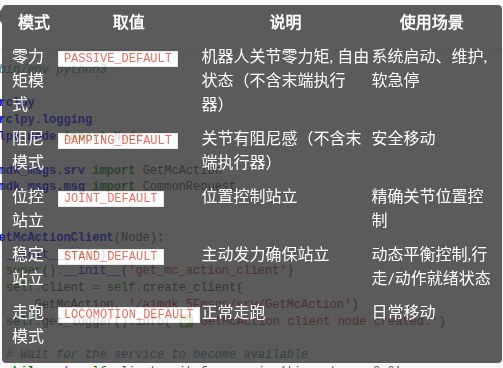
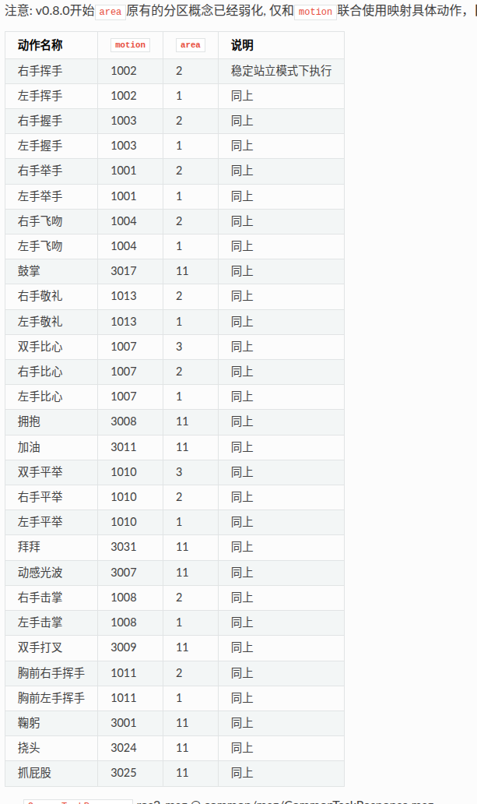
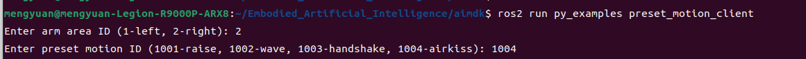

# AimDK 运控 SDK、状态服务与速度控制

整理：Mengyuan Wang。

按知识点整理课堂学习笔记，重点概念保留课堂说明。

## 重点概念

### 运控 SDK

**什么是运控 SDK？**

01 面向开发者提供的软件开发工具包。

简单来说，运控 SDK 就像是机器人的“神经系统”。它把复杂的硬件底层指令封装成了简单的代码接口。

02 连接上层应用与底层机器人硬件的桥梁。

对下：它直接指挥机器人的关节和传感器。

对上：它让开发者只需要写简单的几行代码，就能指挥机器人做出复杂的动作。

### SDK 的核心能力

1. 底层控制：开放底层权限，实现对机器人全身关节电机的精准、直接操控。
2. 状态读取：实时反馈机器人姿态、关节角度数据，精准掌握设备实时状态。
3. 算法集成：基于已有的步态控制、平衡控制等功能，实现自定义运动控制。

### 板端开发与远程开发

了解板端开发与远程开发的特点。

**01 板端开发模式**

在机器人内置的开发计算单元（PC2，IP：10.0.1.41）上直接运行代码。适用于快速验证、低延迟控制和无外网依赖的场景。

**02 远程开发模式**

在外部 PC 编写代码，通过有线直连与机器人通信。适用于大型项目开发、使用 IDE 调试和团队协作的场景。

**03 重要限制**

无线连接仅支持 SSH 终端登录，不能用于运行 SDK 或跨机通信。严禁在运控计算单元（PC1，10.0.1.40）上部署二开程序，以免影响实时任务。

### 节点的协作

ROS2 节点是一个独立运行的程序，每个节点都是为处理机器人的特定功能而设计的。

节点实现了机器人的多样化功能，但这些功能并非彼此独立，而是存在复杂的相互关联。

节点之间可能不是同一个编程语言写的（C++ 或 Python）。

每个功能之间都相互独立，但又共同协作完成赋予机器人的任务。

### 话题通信的广播模型

话题（Topic）是节点之间通信的核心机制之一，其本质是异步的发布/订阅（Publish-Subscribe）模型，类似于现实生活中的“广播电台”：

电台（Publish）：广播电台负责制作节目（如新闻、音乐），并通过特定频道（如 FM98.5）发送信号。

频道（Topic）：电台和听众通过相同的频道（话题名称）建立联系，例如“交通频道”对应 ROS 的话题名（如 /turtle1/cmd_vel）。

听众（Subscribe）：听众打开收音机，调到对应频道（如 FM98.5）即可接收节目，无需知道电台的具体位置或设备细节。

### 服务的请求响应模型

服务（Service）也是节点之间通信的核心机制之一，其本质是采用请求-响应模式，服务客户端向服务服务器发送请求；服务器处理请求并执行操作后，将响应返回给客户端。

### 状态与模式切换

#### 执行状态设置与获取

```Bash
# 设置环境变量
source /opt/ros/humble/setup.bash
# 构建SDK
cd aimdk
colcon build
source install/setup.bash
```

**1 灵犀 X2 的稳定站立与走跑模式**

灵犀 X2 的稳定站立与走跑模式采用一体化设计，会根据运动控制情况内部自动切换。

注意：进入站姿预备模式、阻尼模式和零力矩模式会导致机器人失去平衡摔倒，需谨慎使用且保护机器人，以防损坏。



| 模式 | 取值 | 说明 | 使用场景 |
| --- | --- | --- | --- |
| 零力矩模式 | PASSIVE_DEFAULT | 机器人关节零力矩，自由状态（不含末端执行器） | 系统启动、维护、软急停 |
| 阻尼模式 | DAMPING_DEFAULT | 关节有阻尼感（不含末端执行器） | 安全移动 |
| 位控站立 | JOINT_DEFAULT | 位置控制站立 | 精确关节位置控制 |
| 稳定站立 | STAND_DEFAULT | 主动发力确保站立 | 动态平衡控制，行走/动作就绪状态 |
| 走跑模式 | LOCOMOTION_DEFAULT | 正常走跑 | 日常移动 |

```Bash
# 获取机器人当前的运行模式，包括名称和状态信息
ros2 run py_examples get_mc_action
```

### 预设动作与区域



| 动作名称 | motion | area | 说明 |
| --- | --- | --- | --- |
| 右手挥手 | 1002 | 2 | 稳定站立模式下执行 |
| 左手挥手 | 1002 | 1 | 同上 |
| 右手握手 | 1003 | 2 | 同上 |
| 左手握手 | 1003 | 1 | 同上 |
| 右手举手 | 1001 | 2 | 同上 |
| 左手举手 | 1001 | 1 | 同上 |
| 右手飞吻 | 1004 | 2 | 同上 |
| 左手飞吻 | 1004 | 1 | 同上 |
| 鼓掌 | 3017 | 11 | 同上 |
| 右手敬礼 | 1013 | 2 | 同上 |
| 左手敬礼 | 1013 | 1 | 同上 |
| 双手比心 | 1007 | 3 | 同上 |
| 右手比心 | 1007 | 2 | 同上 |
| 左手比心 | 1007 | 1 | 同上 |
| 拥抱 | 3008 | 11 | 同上 |
| 加油 | 3011 | 11 | 同上 |
| 双手平举 | 1010 | 3 | 同上 |
| 右手平举 | 1010 | 2 | 同上 |
| 左手平举 | 1010 | 1 | 同上 |
| 拜拜 | 3031 | 11 | 同上 |
| 动感光波 | 3007 | 11 | 同上 |
| 右手击掌 | 1008 | 2 | 同上 |
| 左手击掌 | 1008 | 1 | 同上 |
| 双手打叉 | 3009 | 11 | 同上 |
| 胸前右手挥手 | 1011 | 2 | 同上 |
| 胸前左手挥手 | 1011 | 1 | 同上 |
| 鞠躬 | 3001 | 11 | 同上 |
| 挠头 | 3024 | 11 | 同上 |
| 抓屁股 | 3025 | 11 | 同上 |

```Bash
ros2 run py_examples preset_motion_client 
```



### 移动与旋转

**机器人“走”的方向（移动位置）**

- 食指向左（Y轴）：表示机器人能左右移动。比如让手向左或向右平移，像螃蟹横着走。
- 中指向左上方（X轴）：表示机器人能前后移动。比如让手前进或后退，像走路前后挪动。
- 大拇指向上（Z轴）：表示机器人上下移动。比如让手升高或降低，就像电梯上下楼。（灵犀 X2 并不具备沿 z轴，垂直方向，整体平移的能力）

**机器人“转”的方向（旋转方向）**

- 竖起的拇指：代表你想让它绕某个轴旋转的方向（比如绕 Z轴、X轴或 Y轴）。
- 握拳的四指：代表实际的旋转方向（顺时针或逆时针）。
- 弧形箭头：就是旋转的轨迹，图中箭头向右表示顺时针旋转。

### MC控制信号设置

在运控上：

- 灵犀 X2 机器人可能同时间会接受不同的控制信号（如手柄、APP、二次开发程序等）。
- MC 控制信号设置实现了多输入源统一管理，以支持多个控制源的统一管理和优先级仲裁。
- 确保能够安全、可靠地响应优先级最高的指令，避免指令冲突。

**1. 输入源配置**

| 优先级范围 | 控制级别 | 典型应用场景 |
| --- | --- | --- |
| 100–80 | 系统级 | 紧急停止、安全模式（最高权限） |
| 79–60 | 高级控制 | 遥控手柄（RC）、手机 APP 控制 |
| 59–40 | 中级控制 | 语音控制、手势控制 |
| 39–20 | 低级控制 | 二次开发（用户自定义模块） |
| 19–0 | 备用控制 | 调试、测试 |

### 默认控制源

**2. 输入源仲裁和管理规则（续）**

如果你是进行二次开发，应注册一个新的名称（不要与上表重复），并将优先级设置在20–100之间（通常建议低于40，以免干扰系统核心功能，除非你有特殊需求）。

系统内置了以下默认控制源，你在进行二次开发时，建议避开这些名称，并参考其优先级设置：

| 说明 | 优先级 | 输入源 |
| --- | --- | --- |
| 遥控手柄 | 80 | rc |
| 移动 APP 端 AgibotGo | 60 | app_proxy |
| 遥操模块 | 70 | vr |
| 智元灵犀交互模块 | 50 | interaction |
| 智元灵犀 Planner 模块 | 40 | pnc |

### 输入源管理操作

**3. 设置操作**

通过 ROS2 Service 来查询和设置这些配置。

服务名：/aimdk_5Fmsgs/srv/SetMcInputSource。

操作类型（action）：

| 操作类型（值） | 说明 | input_source 必须参数 |
| --- | --- | --- |
| ADD（1001） | 添加新输入源 | name, priority, timeout |
| MODIFY（1002） | 修改现有输入源 | name, priority, timeout |
| DELETE（1003） | 删除输入源 | name |
| ENABLE（2001） | 启用输入源 | name |
| DISABLE（2002） | 禁用输入源 | name |

```Bash
# 控制机器人走跑
ros2 run py_examples mc_locomotion_velocity
```

## 理解与勘误

### SDK 工作空间

课程 `aimdk` 含 C++ `examples`、Python `py_examples` 及 `aimdk_msgs` 接口。示例按 HAL、MC 和 interaction 分层。ROS 2 Humble 环境下构建后 source 安装目录，再运行对应示例。

板端开发运行在 PC2，远程开发运行在有线连接的外部电脑。PC1 留给原运控任务。跨机失败先查网络、Domain、消息版本和服务发现，不能只反复编译。

### 获取运控模式

课程 Python 命令为 `ros2 run py_examples get_mc_action`，C++ 示例位于 `examples` 包。节点创建 `GetMcAction` 服务客户端，等待服务，构造带时间戳的请求，异步调用，检查 Future 与响应，再清理节点。

课件的 `/aimdk_5Fmsgs/srv/GetMcAction` 是示例服务路径，与消息包名不是同一个概念。字符串可能含转义或版本特有命名，实际使用先 `ros2 service list -t` 和 `ros2 interface show` 核对，不能凭 OCR 修成另一个名字。

模式含 `PASSIVE_DEFAULT`、`DAMPING_DEFAULT`、`JOINT_DEFAULT`、`STAND_DEFAULT`、`LOCOMOTION_DEFAULT`、`LOCOMOTION_STEP`。获取状态是读操作，切换模式则可能改变平衡与驱动。请求成功、模式切换完成、机器人稳定三者应分别判断。

### 超时和重试

课程示例最多重试 8 次，短超时约 0.25/0.5 s；幻灯片说明与代码截图的超时数值并不完全一致，应以实际源代码为准。查询可安全重试的条件与执行动作请求不同。动作服务若已执行但响应丢失，盲目重试可能重复动作，需要状态查询或幂等设计。

退出时捕获中断、销毁节点、关闭 rclpy。仅有异常捕获不保证机器人停机，还依赖命令超时和控制状态。

### 预设动作

`preset_motion_client` 构造 `SetMcPresetMotion` 请求，包含动作、区域、时间和中断属性。返回 SUCCESS 或 RUNNING，后者表示已开始或仍执行，不能当作动作已完成。

PDF 给出 v0.8.0 后 area 与 motion 联合映射的说明。以下完整概念表将左右重复项合并，保留课件动作 ID：

| 动作 | motion | area |
| --- | --- | --- |
| 举手 | 1001 | 左 1、右 2 |
| 挥手 | 1002 | 左 1、右 2 |
| 握手 | 1003 | 左 1、右 2 |
| 飞吻 | 1004 | 左 1、右 2 |
| 比心 | 1007 | 左 1、右 2、双手 3 |
| 击掌 | 1008 | 左 1、右 2 |
| 平举 | 1010 | 左 1、右 2、双手 3 |
| 胸前挥手 | 1011 | 左 1、右 2 |
| 敬礼 | 1013 | 左 1、右 2 |
| 鞠躬 | 3001 | 11 |
| 动感光波 | 3007 | 11 |
| 拥抱 | 3008 | 11 |
| 双手打叉 | 3009 | 11 |
| 加油 | 3011 | 11 |
| 鼓掌 | 3017 | 11 |
| 挠头 | 3024 | 11 |
| 抓屁股 | 3025 | 11 |
| 拜拜 | 3031 | 11 |

课件要求稳定站立模式执行。表是授课版本记录，不保证当前固件 ID 相同。参考链接来自资料：[预设动作接口](https://x2-aimdk.agibot.com/zh-cn/latest/Interface/control_mod/preset_motion.html)。未读取的最新网页不作为当前兼容性保证。

### 多输入源仲裁

手柄、APP、遥操、交互和规划模块可能同时发命令，需要明确优先级和超时。PDF 内置源为 rc 80、app_proxy 60、vr 70、interaction 50、pnc 40；二开应使用新的名字，通常低于重要系统控制。

课件优先级分类表把 80 列入系统区间，默认 rc 又是 80，属于表述边界重叠；不要将分类区间当作固件完整权限规则。实际以 SDK 响应和配置为准。

`SetMcInputSource` 可添加 1001、修改 1002、删除 1003、启用 2001、禁用 2002。添加需要 name、priority、timeout；其他操作按接口定义。删除和禁用会影响控制链，不能连续执行教学表中所有操作。

示例注册 `node`、优先级 40、超时 1000 ms。名称不能与现有源冲突，超时含义与单位需按版本确认，发送消息的 source 要与注册名称一致。

### 速度接口与退出

课程 `mc_locomotion_velocity` 发布 `McLocomotionVelocity` 到 `/aima/mc/locomotion/velocity`，包含 Header、source、前进、横向和角速度。它不是标准 Twist，不能仅重命名话题就连接通用导航器。

前进正向向前、横向正向向左、正角速度左转。示例给前进/横向 0 或绝对值约 0.2–1.0 m/s、转向 0 或绝对值约 0.1–1.0 rad/s，这是该代码提示，不是所有状态的安全速度范围。

示例 0.02 s timer 约对应 50 Hz 的期望发布周期。ROS 定时器不保证真实周期精确，日志也可能增加延迟。主程序约 5 s 后停止，信号处理将速度清零。单条零消息可能丢失，还需验证输入源超时与接管行为。

### 实践要求和覆盖

练习修改原速度节点，使用户输入三向速度与 duration，到期停止并清理状态；另一项基于 SDK 调用与调试。应记录状态、输入源和返回码，先验证零速度及停止链，再在允许环境测试。

课件 SDK/网络基础，课件 模式查询与客户端，课件 动作表与请求，课件 坐标、仲裁、速度发布和退出，课件 练习均已整理。课件 远程连接截图中的标识被省略。

### 控制源与 SDK 的条件

节点可以在同一进程或不同进程中运行，课件的独立程序说法用于说明功能划分。课件优先级分段表与默认控制源表不是完全一致的等级边界，例如 rc 的优先级为 80；具体仲裁按当前 SDK 和配置核对。无线开发限制是该设备网络和 SDK 配置的约束，不是 ROS 2 在所有 Wi-Fi 网络上都不能通信。

服务返回 SUCCESS 或 RUNNING 要结合接口含义判断，接受请求或进入执行状态不等于物理动作已经完成。

## 参考资料

- 2026 ROS暑期学校人形机器人灵犀X2二次开发实战.pdf，我的课堂记录及所附课件内容。
- 文中链接的官方文档用于补充解释和核对接口。
