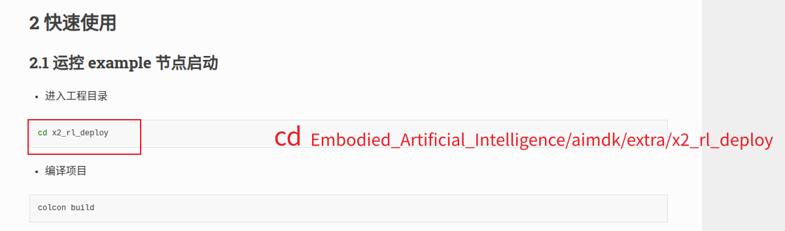
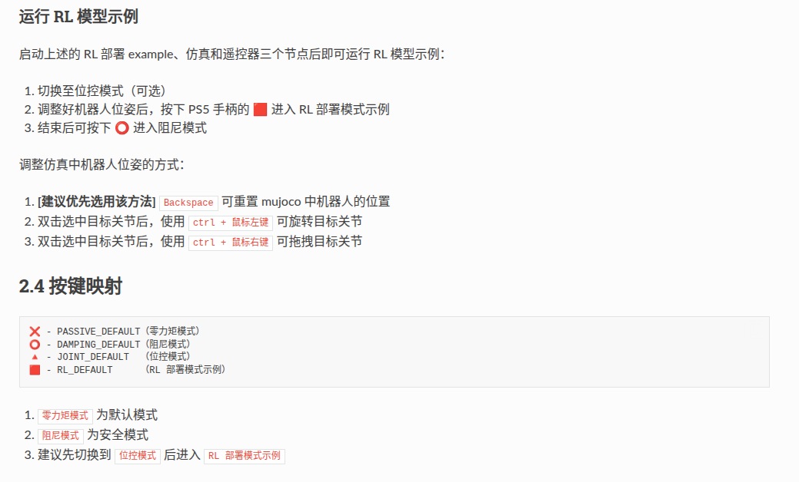

# X2 策略部署、MuJoCo 与 Sim2Real

整理：Mengyuan Wang。

按知识点整理课堂学习笔记，重点概念保留课堂说明。

[安装](https://x2-aimdk.agibot.com/zh-cn/latest/rl_contents.html#id2)

## 重点概念

### 核心挑战：“现实差距”（Reality Gap）

**动力学差距 Dynamics Gap**

仿真中的物理模型本质上是对现实的近似。例如，仿真设定的地面摩擦系数（如0.8）可能与真实地板的实际摩擦系数（如0.6）存在偏差，从而导致机器人在仿真中表现稳定的步态，在现实物理世界中发生打滑甚至摔倒。

**感知差距 Perception Gap**

仿真生成的视觉图像通常是“理想化”的，光照均匀且纹理清晰。而真实世界充满了复杂的光照变化、阴影遮挡、物体反光和传感器本身的噪声干扰，使感知模型面临巨大挑战。

**任务差距 Task Gap**

仿真环境中的任务往往被高度简化，场景和规则是确定的。然而，在真实物理世界中，任务环境是开放且非结构化的，任务目标和执行条件充满了动态性与不确定性，难以被仿真完全建模。

### AimDK RL 示例与部署

x2_rl_deploy 是策略部署脚手架，不是训练框架。

**示例定位**：在MuJoCo中跑通ONNX舞蹈策略，演示从状态输入到关节指令的完整链路。

**改造入口**：替换模型文件与motion_control.yaml；在RlDefault()中适配observation和action。

**安全边界**：官方仅验证仿真。上真机前必须重新适配增益、时序和失效保护。

图示链路：状态输入 → 构造观测 → ONNX推理 → 动作缩放 → 关节指令 → MuJoCo。

### 三类节点通过 ROS 2 组成策略闭环

**控制节点**：订阅关节/IMU，构造观测，调用ONNX Runtime，并发布关节命令。

**MuJoCo仿真**：模拟X2动力学与传感器反馈；启动时选择0:lx2501_3_t2d5。

**PS5手柄**：通过joy_node切换Passive、Damping、Joint和RL模式。

**配置与模型**：motion_control.yaml定义模型路径、关节顺序、增益、缩放和时序。

## 理解与勘误

### 为什么先仿真

真实交互有维修、人员、速度与采样成本，仿真可并行测试并调整参数。差距主要是动力学、感知和任务：摩擦、惯量、执行延迟与电机不同；视觉与噪声不同；真实任务有未知变化。

域随机化覆盖参数扰动，系统辨识改善物理模型，跨仿真测试检查策略对实现的依赖。课件给成本倍数与耗时例子但没有统计依据，正文不把这些数值当作普遍事实。

### `x2_rl_deploy` 是什么

这是策略部署脚手架，不是训练框架。课程用 MuJoCo 和 ONNX 舞蹈策略演示状态输入 → 观测构造 → 推理 → 动作缩放 → 关节指令 → 仿真反馈。

目录分为 `aimdk_msgs`、`x2_rl_deploy_controller` 和 `x2_rl_deploy_mujoco`。`motion_control.yaml` 配模型路径、关节顺序、增益、缩放和时序；模型放 `config/rl_model`；`motion_control_node.cc` 中 `RlDefault()` 是观测与动作适配入口；predictor 管 ONNX Runtime。

### 模型接入必须一致的内容

确认输入维度、观测顺序、单位、归一化、历史窗口、相位和隐藏状态，输出维度、关节顺序、默认姿态、动作尺度和控制周期。只替换 `.onnx` 文件不保证策略兼容。

配置 PD 增益与动作限幅后，还需检查状态超时、推理失败、异常数值、模式切换和退出。无效状态时不继续推理输出。仿真通过只证明该组合在当前仿真条件下运行，不能保证真机安全。

### 依赖和平台

课件环境为 Humble，含 joy、grid-map、Cyclone DDS、gflags、yaml-cpp 与 ONNX Runtime。1.23.2 是资料使用版本，x86_64 与 aarch64 包必须匹配主机。将库复制到系统路径会影响动态链接，实际部署应按项目说明和已有环境检查，不能连续照搬安装截图。

课程 [RL 资料入口](https://x2-aimdk.agibot.com/zh-cn/latest/rl_contents.html) 保留为版本查询来源，本次没有下载或构建整个 SDK。

### 模式与控制权

Passive、Damping、Joint、RL 分别对应释放、阻尼、位控与策略。先进入合适初始姿态再切 RL，异常时使用已验证的退出链。真机阻尼也不自动保持站立，必须有现场保护。

课程三终端为控制器、MuJoCo、输入设备，示例设置 `RMW_IMPLEMENTATION=rmw_cyclonedds_cpp`，各端一致。MuJoCo 通过 `start_sim.sh -s` 选择资料中的模型，不擅自把默认编号推广为所有安装。

### 键盘模拟 PS5 的个人记录

PDF 记录 `keyboard_joy_node` 发布 `/joy`，代替 `joy_node`。不要同时启动两个输入源。按键为 1/P Passive，2/D Damping，3/J Joint，4/R RL，Space 阻尼，Q 先阻尼再退出。

键盘焦点必须在该节点终端，`ros2 topic echo /joy` 用来检查消息。课程运行入口为 `ros2 run x2_rl_deploy_controller keyboard_joy_node`，控制器为 `ros2 run x2_rl_deploy_controller x2_rl_deploy_controller`。

资料说已编译并运行，是我的原记录；未提供 `KEYBOARD_JOY.md` 和节点完整源码，本仓库没有假造这些文件，也未声称本次已复测。

## 安装和实验

### 安装

https://x2-aimdk.agibot.com/zh-cn/latest/rl_contents.html#id2



### 键盘代替手柄（将下面发给codex）

```
用键盘替代 PS5 手柄
keyboard_joy_node 发布标准 sensor_msgs/msg/Joy 到 /joy。现有 x2_rl_deploy_controller 无需修改，也不要同时运行 ros2 run joy joy_node。

编译
cd ~/aimdk/extra/x2_rl_deploy
source /opt/ros/humble/setup.bash
colcon build --packages-select aimdk_msgs x2_rl_deploy_controller
source install/local_setup.bash
如果你的 x2_rl_deploy 不在上述目录，请把 cd 路径替换为实际路径。

启动
先照常启动控制节点和 MuJoCo，然后在第三个终端运行：

cd ~/aimdk/extra/x2_rl_deploy
source /opt/ros/humble/setup.bash
source install/local_setup.bash
ros2 run x2_rl_deploy_controller keyboard_joy_node
节点必须运行在有键盘焦点的交互式终端中。

键位
键位	Joy 按钮	控制模式
1 / P	buttons[0]	PASSIVE_DEFAULT，零力矩
2 / D	buttons[1]	DAMPING_DEFAULT，阻尼/安全停止
3 / J	buttons[2]	JOINT_DEFAULT，位控
4 / R	buttons[3]	RL_DEFAULT，运行策略
Space	buttons[1]	快速进入阻尼模式
Q	buttons[1]	先进入阻尼模式，再退出键盘节点
推荐顺序：按 3 进入位控并确认姿态，再按 4 进入 RL。动作异常时立即按 Space。注意：键盘节点退出并不会停止控制节点，所以退出前会自动发送一次阻尼命令。

可选参数
默认话题是 /joy，按键脉冲为 100 ms：

ros2 run x2_rl_deploy_controller keyboard_joy_node --ros-args \
  -p joy_topic:=/joy \
  -p pulse_ms:=100
验证发布情况：

ros2 topic echo /joy
```


已经按官方文档的手柄逻辑给你接好了：`keyboard_joy_node` 模拟 PS5 手柄，发布 `/joy`，不用再运行 `ros2 run joy joy_node`。

我已编译验证通过，并确认能运行：

```Plain
x2_rl_deploy_controller keyboard_joy_node
x2_rl_deploy_controller x2_rl_deploy_controller
```

运行流程：

**终端 1：启动控制器**

```Plain
cd /home/mengyuan/Embodied_Artificial_Intelligence/aimdk/extra/x2_rl_deploy
source /opt/ros/humble/setup.bash
source install/local_setup.bash
export RMW_IMPLEMENTATION=rmw_cyclonedds_cpp
ros2 run x2_rl_deploy_controller x2_rl_deploy_controller
```

**终端 2：启动 MuJoCo**

```Plain
cd /home/mengyuan/Embodied_Artificial_Intelligence/aimdk/extra/x2_rl_deploy/x2_rl_deploy_mujoco/bin
source /opt/ros/humble/setup.bash
source ../../install/local_setup.bash
export RMW_IMPLEMENTATION=rmw_cyclonedds_cpp
./start_sim.sh -s
```

选 `0`。

**终端 3：启动键盘手柄**

```Plain
cd /home/mengyuan/Embodied_Artificial_Intelligence/aimdk/extra/x2_rl_deploy
source /opt/ros/humble/setup.bash
source install/local_setup.bash
export RMW_IMPLEMENTATION=rmw_cyclonedds_cpp
ros2 run x2_rl_deploy_controller keyboard_joy_node
```

按键：

```Plain
1 或 P     零力矩 PASSIVE_DEFAULT
2 或 D     阻尼 DAMPING_DEFAULT
3 或 J     位控 JOINT_DEFAULT
4 或 R     RL 策略 RL_DEFAULT
Space      立即阻尼
Q          先阻尼，再退出键盘节点
```

推荐操作顺序：

```Plain
先按 3/J
确认站姿
再按 4/R
异常马上按 Space
```

验证 `/joy`：

```Plain
source /opt/ros/humble/setup.bash
source install/local_setup.bash
ros2 topic echo /joy
```

然后回到 `keyboard_joy_node` 那个终端按键。键盘焦点必须在第三个终端里。



## 参考资料

- 2026 ROS暑期学校人形机器人灵犀X2二次开发实战.pdf，我的课堂记录及所附课件内容。
- 文中链接的官方文档用于补充解释和核对接口。
