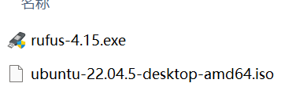
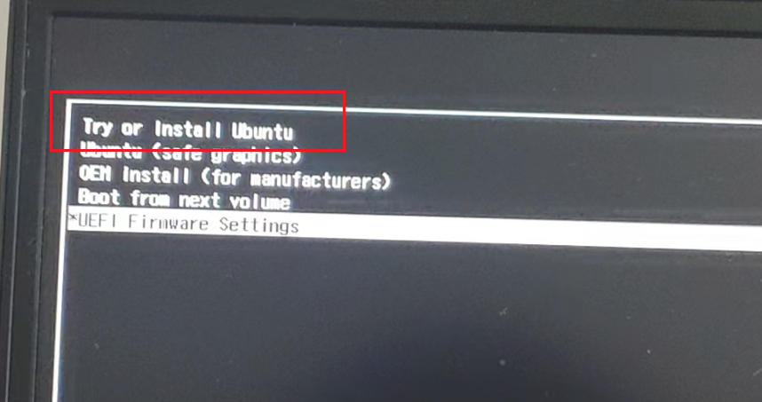

# Ubuntu 22.04 安装、扩容与维护

作者：Mengyuan Wang。原文件：`参考/Liunx22.04系统安装以及扩容过程记录笔记.zip`。

本篇介绍：启动盘、安装黑屏处理、扩容资料入口与缓存维护。保留完整原笔记正文和代码记录，新增核对说明与版本边界；历史结果不等于本次重新运行验证。

## 操作与数据保护

原记录包含 `rm -rf`、日志删除、`apt autoremove`、Conda 卸载和部分进程终止命令。这些代码仅作为历史记录保存，本次整理没有执行。实际操作前必须确认具体目录、环境和进程归属，备份项目、模型、日志与数据，并单独确认删除；不要按全文连续执行，也不要因名称包含 Isaac 就删除搜索结果。磁盘分区与格式化同样需要先核对设备和备份。

## 教程范围与知识说明

启动盘将 Ubuntu 安装镜像写到 USB 设备，通常会改写该 USB 的已有数据；安装目标盘、启动盘和现有系统分区必须区分。原记录使用 Rufus 4.15 和 Ubuntu 22.04.5 desktop amd64 镜像，保存了启动菜单照片。照片中的 Linpus 启动项属于作者当时的固件识别结果，不是所有机器固定选择的名称。

原文的扩容 50 GB 仅有参考链接及启动菜单照片，没有调整前后的分区表、文件系统类型、未分配空间位置或实际扩容步骤，因此不能据此写出完整分区教程，也不能确认 50 GB 已成功扩入目标分区。扩分区与扩文件系统是不同环节；后续需补这些证据后才能形成可复现流程。

安装启动黑屏时使用 `nomodeset` 是作者记录的临时启动排错方式，不等于 NVIDIA 驱动已安装或硬件加速已恢复。应在对应启动项编辑内核参数，保留正确的启动参数结构，不把原记录替换分隔符的说法当作所有启动项的通用规则。

缓存清理主要影响磁盘占用，不能修复分区结构或直接释放 GPU 显存。日志删除也会减少后续排错证据。

## 原笔记整理正文

## Liunx22.04系统安装以及扩容过程记录笔记

## 安装

[安装参考博客](https://yebd1h.smartapps.cn/pages/blog/index?blogId=159769650&_swebfr=1&_swebFromHost=baiduboxapp)

下面是启动盘制作需要的链接

https://rufus.ie/zh/

https://releases.ubuntu.com/jammy/




## 扩容50G

[扩容参考博客](https://yebd1h.smartapps.cn/pages/blog/index?blogId=143953672&_swebfr=1&_swebFromHost=baiduboxapp)

> 原图已转为本文文字说明；固件启动菜单中的设备标识未公开。



点击后如果遇到黑屏问题【【亲测有效】Ubuntu22.04安装黑屏&重启进入系统卡死】https://mbd.baidu.com/ma/s/XDxaCUrG

##### 问题描述：选择 ‘try or install ubuntu’ ，开始安装，出现黑屏。

解决方案：

1.安装时，先选择" try or install ubuntu", 此时不要按enter，按"e"进入编辑模式；
2. 在启动项编辑界面找到 Linux 内核参数行，在 `---` 分隔符之前添加 `nomodeset`；可去掉 `quiet splash` 以观察启动日志，不要把 `---` 当作应直接替换的参数。按该界面提示的启动键运行，是否有效取决于黑屏原因。

## Ubuntu清理缓存

```bash
# 1.清理压缩旧日志
sudo find /var/log -name "*.gz" -delete
# 2.限制journal日志大小
sudo journalctl --vacuum-size=300M
# 3.清理 APT 下载缓存，并移除不再需要的依赖包；autoremove 不是缓存清理，先审查包清单
sudo apt clean && sudo apt autoremove -y
# 4.清理conda、pip缓存
conda clean --all -y
pip cache purge
# 5.Isaac仿真缓存
rm -rf ~/.cache/ov ~/.cache/nvidia ~/.cache/isaac*
```


## 仓库内相关教程

- [ROS 2 Humble 安装与 Isaac Sim 桥接](02_ROS2Humble安装与Isaac桥接.md)
- [MuJoCo 安装与 ros2_control 接入](03_MuJoCo与ros2_control.md)
- [Isaac Sim 5.1 与 Isaac Lab 2.3 实践](04_IsaacSim5.1与IsaacLab2.3实践.md)
- [Isaac Sim 6.1 与 Isaac Lab 3.0 实践](05_IsaacSim6.1与IsaacLab3.0实践.md)
