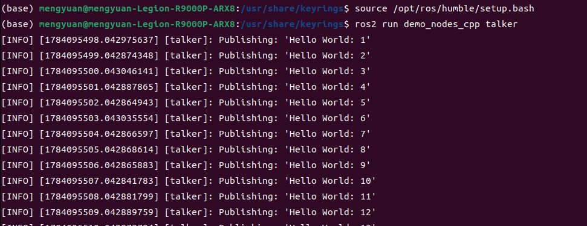
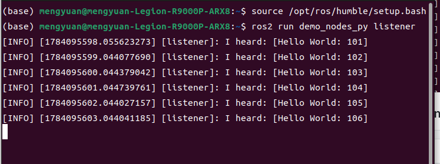
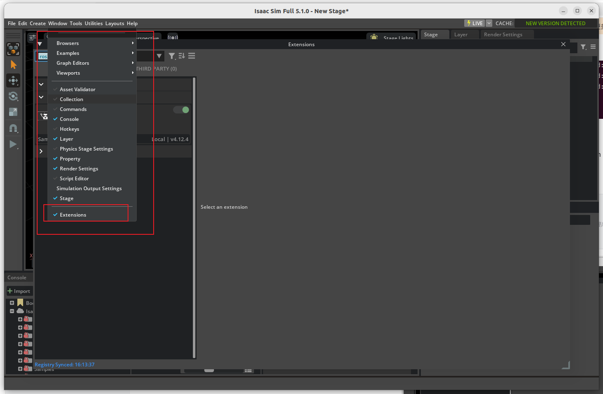
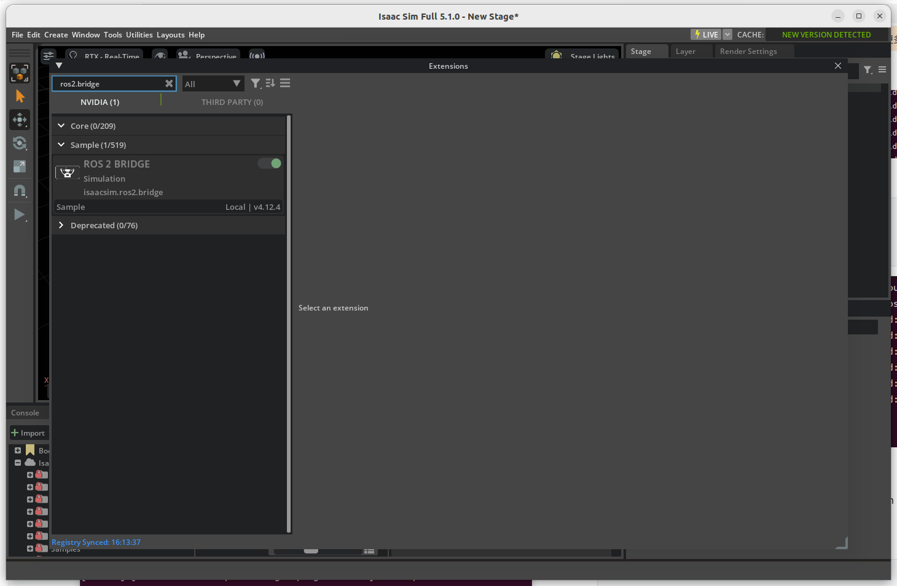
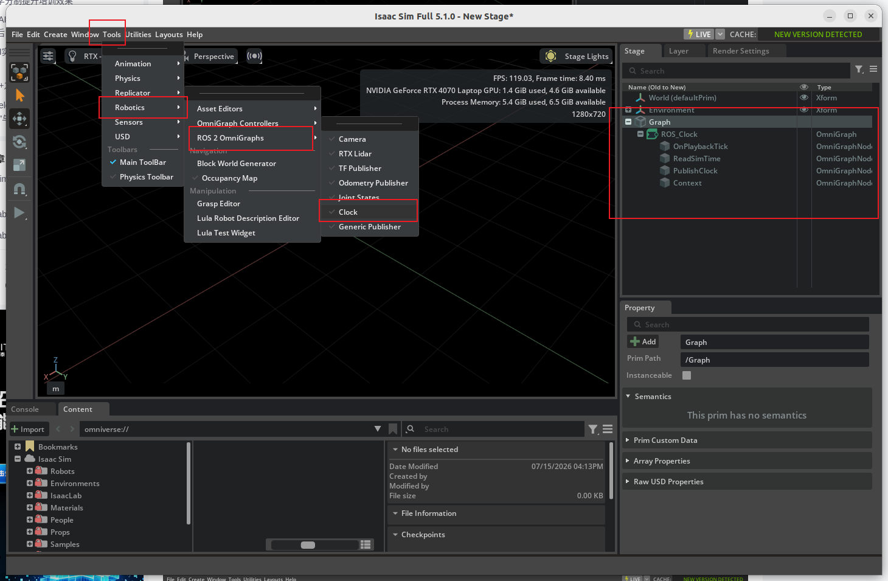
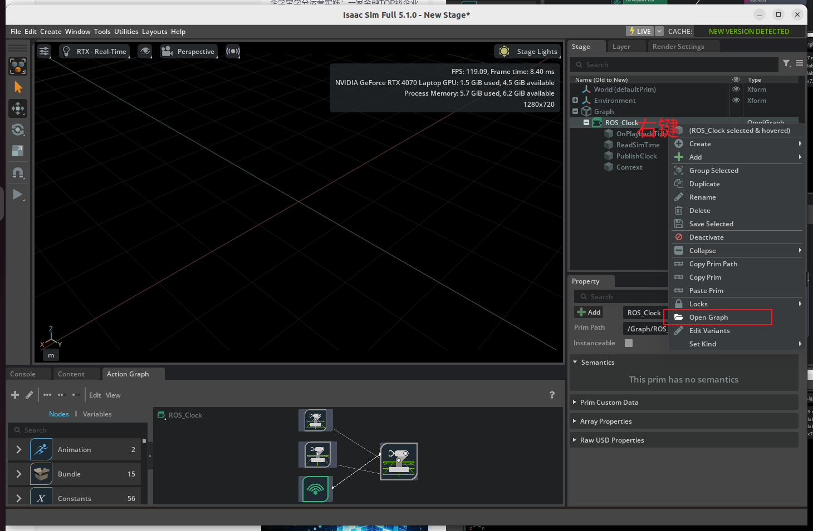
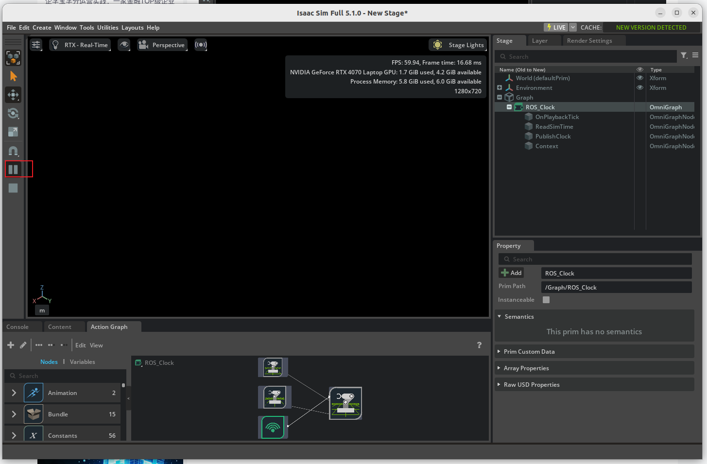
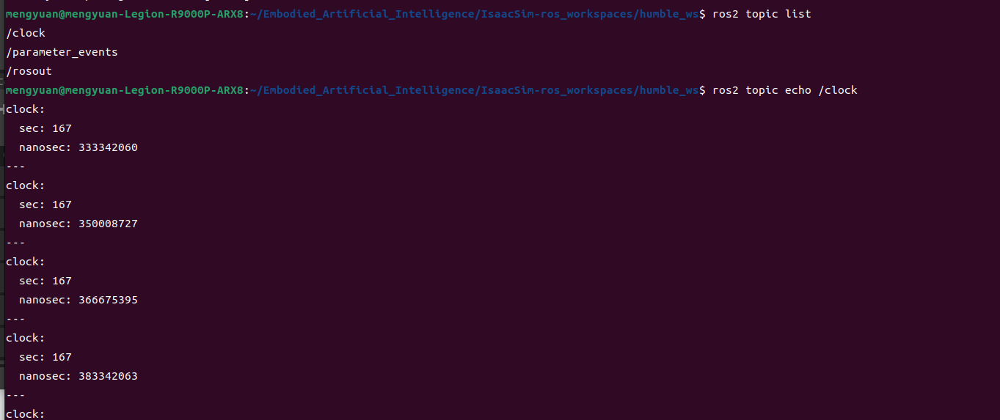
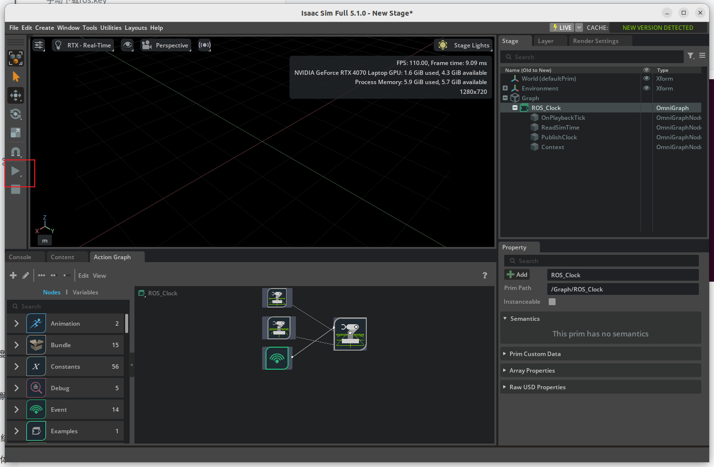
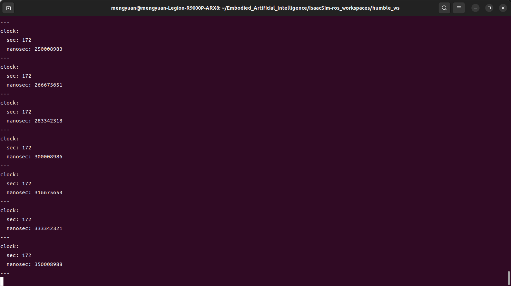

# ROS 2 Humble 安装与 Isaac Sim 桥接

作者：Mengyuan Wang。原文件：`参考/ROS2 Humble安装.zip`。

本篇介绍：原生 ROS 2 安装、C++/Python 通信测试、工作空间构建及仿真时钟验证。保留完整原笔记正文和代码记录，新增核对说明与版本边界；历史结果不等于本次重新运行验证。

## 操作与数据保护

原记录包含 `rm -rf`、日志删除、`apt autoremove`、Conda 卸载和部分进程终止命令。这些代码仅作为历史记录保存，本次整理没有执行。实际操作前必须确认具体目录、环境和进程归属，备份项目、模型、日志与数据，并单独确认删除；不要按全文连续执行，也不要因名称包含 Isaac 就删除搜索结果。磁盘分区与格式化同样需要先核对设备和备份。

## 教程范围与知识说明

本文记录 Ubuntu 22.04 Jammy 上的 ROS 2 Humble Debian 安装。`setup.bash` 给当前 shell 加载包查找、库和命令环境；`colcon build` 构建工作空间，`install/local_setup.bash` 加载当前工作空间覆盖层，不是下载源代码。

talker 发布消息，listener 订阅消息。C++ talker 与 Python listener 收到相同消息，验证了这两个进程间的基础通信；仍不能据此证明所有 QoS、网络机器或机器人控制链路正常。

下方手动下载 ros.key 并写入 apt 源是作者的历史安装方式。当前安装应对照 [Humble 官方 Debian 安装文档源码](https://github.com/ros2/ros2_documentation/blob/humble/source/Installation/Ubuntu-Install-Debs.rst)，核对官方源配置和签名步骤，不重复叠加新旧 apt 源。不要把一次启动报错统一处理为向 Kit Python 安装 torch、psutil、click，应先看缺失模块及当前解释器。

### ROS 桥接的版本条件

ROS 2 节点可以通过中间件通信，Python 扩展库能否导入则受 ABI 约束。Isaac Sim 5.1 使用 Python 3.11，Ubuntu 22.04 原生 Humble 使用 Python 3.10；外部原生节点可独立运行，不应直接把原生 Python 3.10 库引入模拟器的 Python 3.11 进程。自定义接口需要按模拟器侧要求另行构建，不能把这个条件归纳成任何情况下都禁止 source ROS。参见 [Isaac Sim 5.1 官方 ROS 安装说明](https://docs.isaacsim.omniverse.nvidia.com/5.1.0/installation/install_ros.html)。

本文图形界面的历史验证顺序是：启动模拟器，启用 ROS 2 Bridge 扩展，通过 Tools 中 ROS 2 OmniGraph 创建 Clock 图，确认图中时钟发布节点，再点击 Play；另一个已加载 Humble 环境的终端观察 `/clock`。菜单名称和扩展版本随安装变化。`/clock` 有数据只证明时钟发布链路，暂停后停止打印是该示例的观察结果，不代表已验证传感器、控制器及全部接口。需要使用仿真时间的外部节点还应设置 `use_sim_time`。

## 原笔记整理正文

## ROS2 Humble安装

## 安装

[ROS2-Humble超好用的安装教程](https://blog.csdn.net/weixin_44190670/article/details/161383505)

ROS 2 Humble为Ubuntu22.04 LTS的官方推荐版本。

- ROS2版本：Humble

- 操作系统：Ubuntu22.04 LTS

### 确保已启用Ubuntu Universe仓库

```bash
sudo apt install software-properties-common -y
sudo add-apt-repository universe -y
```

### 下载key及添加源

#### 手动下载ros.key

在浏览器打开网址（https://raw.githubusercontent.com/ros/rosdistro/master/ros.key）并下载ros.key，保存在~/下载 目录下

#### 将ros.key放到对应位置

```bash
sudo cp ./下载/ros.key /usr/share/keyrings/ros-archive-keyring.gpg
```

密钥核对：复制为 `.gpg` 不会改变文件格式。如果下载文件是 ASCII armor，APT 应使用 `.asc` 或先 dearmor 为二进制 `.gpg`；若本身已是二进制则另论。下面保留历史复制命令，实际安装应按开头的官方步骤处理，不能仅靠改后缀保证签名有效。

#### 添加ROS2源

```bash
echo "deb [arch=$(dpkg --print-architecture) signed-by=/usr/share/keyrings/ros-archive-keyring.gpg] http://packages.ros.org/ros2/ubuntu $(. /etc/os-release && echo $UBUNTU_CODENAME) main" | sudo tee /etc/apt/sources.list.d/ros2.list > /dev/null
```

### 安装ROS2软件包

```bash
sudo apt update
sudo apt install ros-humble-desktop -y
sudo apt install ros-dev-tools -y
```

### 验证

#### 在一个终端中运行talker

```bash
source /opt/ros/humble/setup.bash
ros2 run demo_nodes_cpp talker
```



#### 在另一个终端中运行listener

```bash
source /opt/ros/humble/setup.bash
ros2 run demo_nodes_py listener
```



## Isaac sim配置ROS2 humble

版本说明：原生 Humble 节点与 Isaac Sim 分终端运行；是否加载 ROS 环境取决于模拟器 Python ABI 与桥接方式，详见本文开头。

[官方教程](https://docs.isaacsim.omniverse.nvidia.com/5.1.0/installation/install_ros.html)

[[ISAAC SIM]isaac sim配置ROS2 humble](https://blog.csdn.net/u012213701/article/details/162152053)

```bash
conda deactivate
cd ~/isaacsim
# 使用推荐的 ROS 2 发行版,则无需额外步骤来加载 ROS 2 桥接库
./isaac-sim.sh
# 如果有启动报错执行下面
# ./kit/python/bin/python3 -m pip install torch psutil click 
```






```bash
conda deactivate
cd ~/Embodied_Artificial_Intelligence
# clone isaac 给ros2配置的workspace
git clone https://github.com/isaac-sim/IsaacSim-ros_workspaces.git
# 要构建 ROS 2 工作区,您可能需要安装其他包:
# For rosdep install command
sudo apt install python3-rosdep build-essential
# For colcon build command
sudo apt install python3-colcon-common-extensions
# 确保ROS环境来自终端或您的~/.bashrc文件。每次任何 ROS 命令之前,必须使用该步骤 确保您的原生 ROS 2 来源:
source /opt/ros/humble/setup.bash
# 通过运行以下命令,从 ROS 2 工作区的根目录中解析任何包依赖项:
cd IsaacSim-ros_workspaces
cd humble_ws
git submodule update --init --recursive # If using docker, perform this step outside the container and relaunch the container
rosdep install -i --from-path src --rosdistro humble -y
# 构建工作区 在根目录下,新建build,install并且log目录被创建
colcon build
```

### 要开始使用在此工作区内构建的 ROS 2 包,请打开新终端

```bash
# 要开始使用在此工作区内构建的 ROS 2 包,请打开新终端,并使用以下命令加载该工作空间的安装环境:
source /opt/ros/humble/setup.bash
cd humble_ws
source install/local_setup.bash
```

### 如何验证isaac sim已经配置好ros2 humble 了







```bash
# 在刚才配置好工作空间的终端 
# 可以看到/clock 话题
ros2 topic list
ros2 topic echo /clock
```



可以看到时间戳在打印



关闭isaac sim 中的play开关，时间戳停止打印

这一步完成该时钟示例的验证，其他接口仍需分别测试。




## 仓库内相关教程

- [Ubuntu 22.04 安装、扩容与维护](01_Ubuntu22.04安装与扩容.md)
- [MuJoCo 安装与 ros2_control 接入](03_MuJoCo与ros2_control.md)
- [Isaac Sim 5.1 与 Isaac Lab 2.3 实践](04_IsaacSim5.1与IsaacLab2.3实践.md)
- [Isaac Sim 6.1 与 Isaac Lab 3.0 实践](05_IsaacSim6.1与IsaacLab3.0实践.md)
