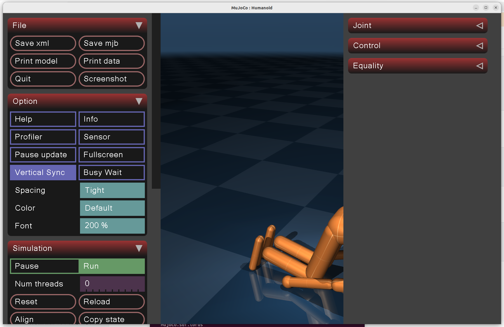
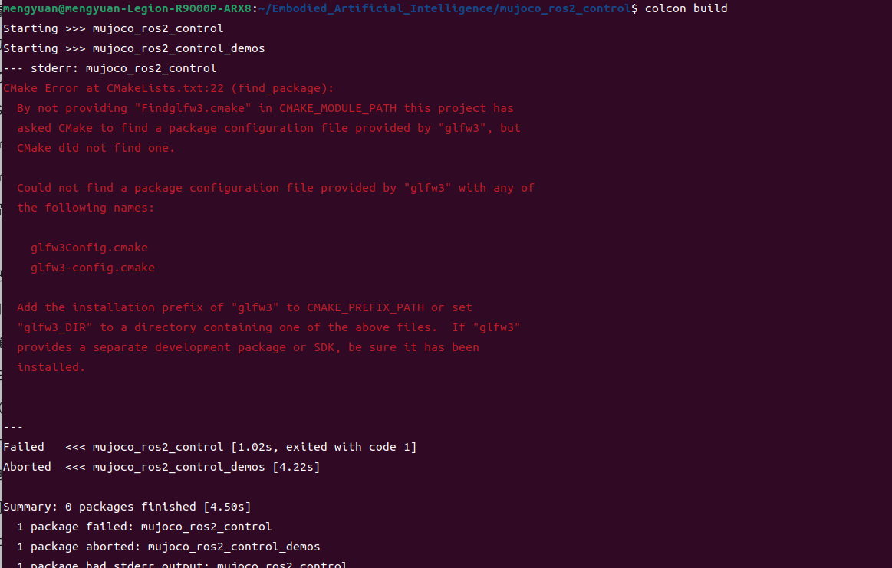

# MuJoCo 安装与 ros2_control 接入

作者：Mengyuan Wang。原文件：`参考/MuJoCo仿真安装+mujoco_ros2_control.zip`。

本篇介绍：MuJoCo 3.10.0 二进制运行、人形模型查看、ROS 2 控制包构建与 GLFW 排错。保留完整原笔记正文和代码记录，新增核对说明与版本边界；历史结果不等于本次重新运行验证。

## 操作与数据保护

原记录包含 `rm -rf`、日志删除、`apt autoremove`、Conda 卸载和部分进程终止命令。这些代码仅作为历史记录保存，本次整理没有执行。实际操作前必须确认具体目录、环境和进程归属，备份项目、模型、日志与数据，并单独确认删除；不要按全文连续执行，也不要因名称包含 Isaac 就删除搜索结果。磁盘分区与格式化同样需要先核对设备和备份。

## 教程范围与知识说明

MuJoCo 负责刚体及接触动力学仿真，ROS 2 负责节点间通信，ros2_control 提供控制器与硬件接口框架；mujoco_ros2_control 将控制框架连接到 MuJoCo。打开 humanoid.xml 只能确认该模型的仿真查看器能运行，不代表已经接入 ROS 2 控制器。

`MUJOCO_HOME` 是原记录为运行库配置的路径，`MUJOCO_DIR` 是该 ROS 包构建时使用的 MuJoCo 安装根路径，二者用途应分开核对。[项目官方 README](https://github.com/moveit/mujoco_ros2_control/blob/main/README.md) 明确要求在 `colcon build` 前设置 `MUJOCO_DIR`。仓库 main 分支会变化，本记录没有锁定提交，不能把 Humble 与所有后续 main 版本的兼容性视为已验证。

截图的实际错误是 CMake 找不到 `glfw3Config.cmake` 或 `glfw3-config.cmake`，安装 `libglfw3-dev` 对应这一缺失；若还存在其他依赖或 ABI 错误，需要分别处理。原记录只有失败截图及修复命令，没有补齐成功构建日志和控制器运行结果，本次没有运行验证。

## 原笔记整理正文

## MuJoCo仿真安装+mujoco_ros2_control

## 安装MuJoCo

[安装链接](https://github.com/google-deepmind/mujoco/releases)

[官方文档](https://mujoco.readthedocs.io/en/stable/overview.html)

[mujoco_ros2_control安装文档](https://github.com/moveit/mujoco_ros2_control/blob/main/README.md)

[mujoco_ros2_control使用](https://github.com/moveit/mujoco_ros2_control/blob/main/doc/index.rst)

### 解压mujoco

```bash
mkdir ~/.mujoco
cd 下载
tar -zxvf mujoco-3.10.0-linux-x86_64.tar.gz -C ~/.mujoco
cd ~
```

### 配置环境变量

配置环境变量，打开.bashrc文件`gedit ~/.bashrc`，添加下面两行内容

```bash
export MUJOCO_HOME=$HOME/.mujoco/mujoco-3.10.0
export LD_LIBRARY_PATH=$LD_LIBRARY_PATH:$MUJOCO_HOME/lib
```

重新加载 `.bashrc`,添加完以后需要执行：

```bash
source ~/.bashrc
```

### 运行指令

路径变为bin文件夹，运行指令,看到下面安装成功

```bash
cd ~/.mujoco/mujoco-3.10.0/bin
./simulate ../model/humanoid/humanoid.xml
```



### 安装mujoco_ros2_control

[ROS2 Humble安装](https://icnolz0735hh.feishu.cn/wiki/QdmEwNwI0igUSsk6SZjcRkZFndb?from=from_copylink)

[文档](https://github.com/moveit/mujoco_ros2_control/blob/main/README.md)

```bash
conda deactivate
cd ~/Embodied_Artificial_Intelligence
git clone https://github.com/moveit/mujoco_ros2_control.git
```

配置环境变量，打开 `.bashrc`，添加下面一行项目构建变量；路径需对应自己的安装目录。

```bash
export MUJOCO_DIR=$HOME/.mujoco/mujoco-3.10.0
```

重新加载 `.bashrc`,添加完以后需要执行：

```bash
source ~/.bashrc
```

执行完成后如果出现base环境需要`conda deactivate` 

使用以下命令编译该包

```bash
cd mujoco_ros2_control
source /opt/ros/humble/setup.bash
colcon build
```

如果执行报错



#### 原因：没有安装 glfw3 开发包

如果是 Ubuntu，可以先检查：

```text
dpkg -l | grep glfw
```

如果什么都没有，就安装：

```text
sudo apt update
sudo apt install libglfw3-dev
```

安装完成以后重新：

```bash
colcon build
```

这是针对截图所示 GLFW 缺失的修复建议；缺少成功构建日志，本次没有复测。


## 仓库内相关教程

- [Ubuntu 22.04 安装、扩容与维护](01_Ubuntu22.04安装与扩容.md)
- [ROS 2 Humble 安装与 Isaac Sim 桥接](02_ROS2Humble安装与Isaac桥接.md)
- [Isaac Sim 5.1 与 Isaac Lab 2.3 实践](04_IsaacSim5.1与IsaacLab2.3实践.md)
- [Isaac Sim 6.1 与 Isaac Lab 3.0 实践](05_IsaacSim6.1与IsaacLab3.0实践.md)
