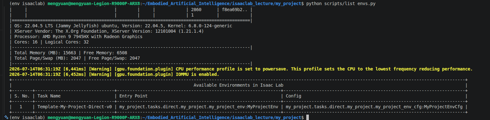
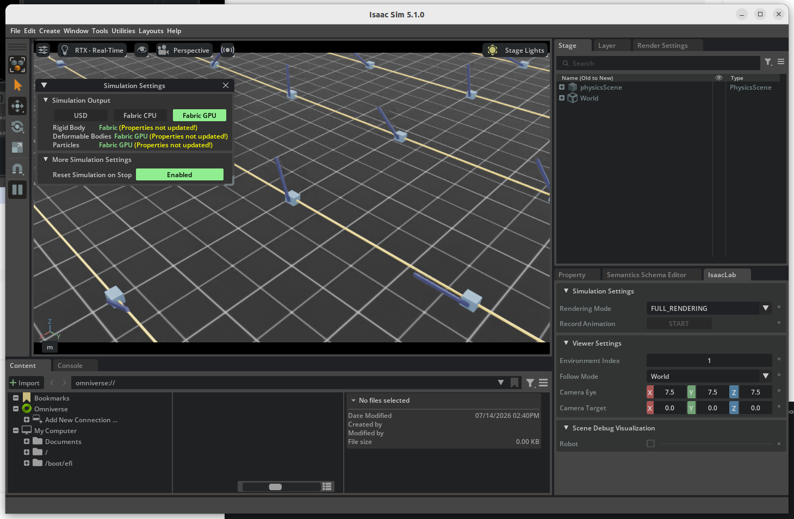

# Isaac Sim 5.1.0 与 Isaac Lab 2.3.0 本地配置与实践

作者：Mengyuan Wang。原文件：`参考/Isaac Lab笔记（学习使用Isaac sim5.1.0+Isaac Lab2.3.0 显存8G Liunx22.04.0）.zip`。

本篇主要介绍本地 Ubuntu 环境中 Isaac Sim 5.1.0 与 Isaac Lab 2.3.0 的配置安装，包括二进制、Conda、项目生成、PPO 训练与 skrl 推理排错。AutoDL/Vulkan 部分保留为另一段环境尝试记录，与本地安装步骤分别阅读。保留完整原笔记正文和代码记录，新增核对说明与版本边界；历史结果不等于本次重新运行验证。

## 操作与数据保护

原记录包含 `rm -rf`、日志删除、`apt autoremove`、Conda 卸载和部分进程终止命令。这些代码仅作为历史记录保存，本次整理没有执行。实际操作前必须确认具体目录、环境和进程归属，备份项目、模型、日志与数据，并单独确认删除；不要按全文连续执行，也不要因名称包含 Isaac 就删除搜索结果。磁盘分区与格式化同样需要先核对设备和备份。

## 教程范围、版本与知识说明

本篇主环境是本地 Ubuntu 上的 Isaac Sim 5.1.0 与 Isaac Lab 2.3.0。下文的本地配置安装章节使用本机下载目录、安装目录、Conda 环境和 GPU，不属于 AutoDL 部署流程。前半段包含 AutoDL 尝试及本地尝试 Sim 6.1 后发现版本不匹配的过程，属于历史记录，不应与最终组合顺序执行。应固定 release/tag 并核对对应文档，不能以 main 或 latest 链接保证旧环境兼容。

Isaac Sim 提供物理、场景与传感器仿真；Isaac Lab 在其上组织学习环境、任务和强化学习训练。Conda 环境隔离 Python 包，`_isaac_sim` 是 Lab 指向二进制安装根目录的符号链接；多个创建环境与链接命令是可选方案，不能重复全部执行。

作者日志显示 RTX 4070 Laptop 8188 MB 显存、Ubuntu 22.04.5，任务列表和零动作示例有运行记录。官方 5.1 系统要求列出 16 GB 显存，不能把作者小场景运行记录推广为 8 GB 满足全部训练或渲染需求。参见 [5.1 官方系统要求](https://docs.isaacsim.omniverse.nvidia.com/5.1.0/installation/requirements.html)。原文的系统要求及版本表网页截图已转为文字，未复制进仓库。

AutoDL 中 Vulkan ICD 指定的是驱动配置文件，原路径依赖当时镜像；`--headless` 关闭图形窗口，不保证任务完全不需要渲染，也不保证任意无 RTX 能力设备可运行。

外部模板项目为 `my_project`，Direct 单智能体工作流和 skrl PPO。任务注册、editable 安装、列出环境、零动作运行、训练、checkpoint 推理是不同检查层次。能生成模板和执行 zero_agent 不等于已经学会人形行走；任务日志路径含 cartpole_direct，不能直接称为人形训练成果。模板打印的框架性能/功能表是当时生成器输出，不是本文做过的通用基准。

pip/setuptools/flatdict、NumPy 降级和 skrl 2.1 API 适配均为当时的排错记录，不是所有版本通用安装步骤。完整修改后的 play.py 未随该 ZIP 提供；下面只保留作者记录的修改说明及历史运行结论，本次没有复测。对于循环策略或确实使用状态的任务，不能简单把 `states` 参数固定为 None。

清理磁盘缓存不直接释放活跃进程的 GPU 显存。遇到显存不足应先观察进程与工作负载，缩减并行环境及相机配置；进程终止只适用于已确认属于自己的实验进程，不应结束桌面或驱动服务。

## 原笔记整理正文

## Isaac Lab笔记（学习使用Isaac sim5.1.0+Isaac Lab2.3.0 显存8G Liunx22.04.0）

[Liunx22.04系统安装以及扩容过程记录笔记](https://icnolz0735hh.feishu.cn/wiki/MOC1wUJWSibc0nkFJAacSVwZnAb)

## Ubuntu清理缓存

```bash
# 1.清理压缩旧日志
sudo find /var/log -name "*.gz" -delete
# 2.限制journal日志大小
sudo journalctl --vacuum-size=300M
# 3.清理 APT 下载缓存，并移除不再需要的依赖包；autoremove 不是缓存清理，先审查包清单
sudo apt clean && sudo apt autoremove -y
# 4.清理conda、pip缓存
conda clean --all -y
pip cache purge
# 5.Isaac仿真缓存
rm -rf ~/.cache/ov ~/.cache/nvidia ~/.cache/isaac*
```

## AutoDL 环境尝试记录

本节保留远程环境中的 Vulkan 与无窗口运行记录；下方 Isaac Sim 5.1.0 + Isaac Lab 2.3.0 的完整配置安装属于本地 Ubuntu 环境。

[如果使用Vulkan时（或者使用其他软件，比如：omnigibson，但是依赖Vulkan），找不到GPU设备，那么按以下方式解决：](https://autodl.com/docs/vulkan/)

[Isaac Sim 5.1.0 部署指南（实验室服务器）](https://blog.csdn.net/qq_46157589/article/details/160023284?ops_request_misc=&request_id=&biz_id=102&utm_term=Isaac%20sim%205.1.0%E5%AE%9E%E9%AA%8C%E5%AE%A4%E9%83%A8%E7%BD%B2%E6%8C%87%E5%8D%97&utm_medium=distribute.pc_search_result.none-task-blog-2~all~sobaiduweb~default-0-160023284.142^v102^pc_search_result_base1&spm=1018.2226.3001.4187)

[中文文档](https://docs.robotsfan.com/isaaclab/source/overview/own-project/template.html)

原笔记记录 16 GB 显存要求；下方另有作者 8 GB 小场景实践，二者适用范围见本文说明。

https://api.autodl.com/docs/gui/

> 原图为官方系统要求或版本兼容表，已在本文说明中转为文字并列出来源。


```bash
screen -S isaaclab
conda activate env_isaaclab
cd ~/autodl-tmp/IsaacLab
export VK_ICD_FILENAMES=/etc/vulkan/icd.d/my_nvidia_icd.json
# 没有GUI界面Autodl  

./isaaclab.sh -p scripts/tutorials/00_sim/create_empty.py --headless
```

## 本地 Ubuntu 环境配置安装

[官网文档](https://isaac-sim.github.io/IsaacLab/main/source/setup/installation/binaries_installation.html)

### 早期尝试 Isaac Sim 6.1.0（后续改用 5.1，不作为本篇最终组合）

[下载二进制文件](https://docs.isaacsim.omniverse.nvidia.com/latest/installation/download.html)

[安装二进制文件](https://docs.isaacsim.omniverse.nvidia.com/latest/installation/install_workstation.html#example-installation)

[验证 Isaac Sim 安装](https://docs.robotsfan.com/isaaclab/source/setup/installation/binaries_installation.html)

#### 安装Isaac Lab（下面的安装不对需要参考下面对应的版本）

[官网文档](https://isaac-sim.github.io/IsaacLab/main/source/setup/installation/binaries_installation.html)

> 原图为官方系统要求或版本兼容表，已在本文说明中转为文字并列出来源。

### 清理缓存

```bash
# Omniverse/Isaac Sim 核心缓存（必清）
rm -rf ~/.cache/ov/*
cd Embodied_Artifical_Intelligence/IsaacLab
#  Isaac Lab 日志与临时文件
rm -rf logs/* 
rm -rf .local/*
# Nvidia 驱动缓存
rm -rf ~/.nv/ComputeCache/*
rm -rf ~/.cache/nvidia/GLCache/*
rm -rf ~/.cache/nvidia
rm -rf ~/.cache/isaac*
```

### 本地配置安装 Isaac Sim 5.1.0 + Isaac Lab 2.3.0

这一节记录在本地电脑的 Ubuntu 系统中安装该版本组合。安装目录为本机的 `~/isaacsim`，Isaac Lab 通过 `_isaac_sim` 链接该目录，并在本机创建和使用 Conda 环境。后续项目与任务操作使用这套本地环境；AutoDL 的 `~/autodl-tmp` 和 Vulkan ICD 配置不属于这里的安装步骤。

[Isaacab2.3.0下载](https://github.com/isaac-sim/IsaacLab/releases#release-v2.3.0)

[Isaacsim5.1.0下载链接](https://docs.isaacsim.omniverse.nvidia.com/5.1.0/installation/quick-install.html)

[Isaacsim5.1.0官方文档](https://docs.isaacsim.omniverse.nvidia.com/5.1.0/installation/install_workstation.html)

[IsaacLab2.3.0官方文档](https://isaac-sim.github.io/IsaacLab/v2.3.0/source/setup/installation/binaries_installation.html)

[中文文档](https://docs.robotsfan.com/isaaclab/source/overview/own-project/template.html)

```bash
conda deactivate
mkdir ~/isaacsim
cd ~/Downloads
unzip "isaac-sim-standalone-5.1.0-linux-x86_64.zip" -d ~/isaacsim
cd ~/isaacsim
./post_install.sh
./isaac-sim.selector.sh
```


```bash
# Isaac Sim root directory
export ISAACSIM_PATH="${HOME}/isaacsim"
# Isaac Sim python executable
export ISAACSIM_PYTHON_EXE="${ISAACSIM_PATH}/python.sh"
${ISAACSIM_PATH}/isaac-sim.sh

${ISAACSIM_PYTHON_EXE} -c "print('Isaac Sim configuration is now complete.')"
${ISAACSIM_PATH}/isaac-sim.sh --reset-user


# enter the cloned repository
cd IsaacLab
# create a symbolic link
ln -s ${ISAACSIM_PATH} _isaac_sim
# For example:
# Option 1: If pre-built binaries were installed:
ln -s ${HOME}/isaacsim _isaac_sim

# Option 1: Default environment name 'env_isaaclab'
./isaaclab.sh --conda  # or "./isaaclab.sh -c"
# Option 2: Custom name
./isaaclab.sh --conda my_env  # or "./isaaclab.sh -c my_env"
# Activate environment
conda activate env_isaaclab  # or "conda activate my_env"
# these dependency are needed by robomimic which is not available on Windows
sudo apt install cmake build-essential
# 这一步骤遇到bug先运行下面问题的代码
./isaaclab.sh --install # or "./isaaclab.sh -i"可能遇到bug   https://github.com/isaac-sim/IsaacLab/issues/4577

# Option 1: Using the isaaclab.sh executable
# note: this works for both the bundled python and the virtual environment
./isaaclab.sh -p scripts/tutorials/00_sim/create_empty.py

# Option 2: Using python in your virtual environment
python scripts/tutorials/00_sim/create_empty.py
```

### 最大的Bug解决办法 No module named 'isaaclab'

[[Bug Report] flatdict can't be install for python3.11 because lack of pkg_resources in setuptools #4577](https://github.com/isaac-sim/IsaacLab/issues/4577)

[[Bug Report] ModuleNotFoundError: No module named 'isaaclab'](https://github.com/isaac-sim/IsaacLab/issues/4576)

[[bug] Executing ./isaaclab.sh --install fails #5662](https://github.com/isaac-sim/IsaacLab/issues/5662)

```bash
pip install pip==23
pip install setuptools==65
pip install flatdict==4.0.0
./isaaclab.sh --install
```

`No module named isaaclab` 只表示当前解释器找不到该包，还可能是环境未激活、editable 安装失败或加载路径错误。flatdict/setuptools 问题是这里的具体排错线索，只有对应安装日志确认后才采用版本调整，不能见到这个异常就统一降级。

## **彻底删除 Isaac Sim 和 Isaac Lab**

如果你想**彻底删除 Isaac Sim 和 Isaac Lab（Ubuntu/Linux）**，建议按下面顺序执行。这样会删除程序、环境、缓存、配置和 Python 依赖。

> ⚠️ 以下命令会删除文件，请确认路径中没有你自己的项目文件。
> 
> 

---

### 删除 Isaac Lab

假设 Isaac Lab 在：

```bash
~/IsaacLab
```

删除：

```bash
rm -rf ~/IsaacLab
```

如果不知道位置：

```bash
find ~ -type d -iname "*isaaclab*"
```

找到后删除对应目录。

---

### 删除 Isaac Lab 的 Conda 环境

查看所有环境：

```bash
conda env list
```

可能看到：

```text
base
isaaclab
env_isaaclab
```

删除：

```bash
conda env remove -n isaaclab
```

如果名字不同，例如：

```bash
conda env remove -n env_isaaclab
```

再次检查：

```bash
conda env list
```

只确认待卸载的 Isaac 环境已移除，其他项目环境应保留。下面 base 仅为作者示意：

```text
base
```

---

### 删除 Isaac Sim

#### 如果通过 Omniverse Launcher 安装

先卸载：

```text
Omniverse Launcher
 → Library
 → Isaac Sim
 → Uninstall
```

然后删除残留。

---

#### 删除 Isaac Sim 文件

执行：

```bash
rm -rf ~/.local/share/ov/pkg/isaac-sim*
```

删除 Omniverse 数据：

```bash
rm -rf ~/.local/share/ov/data
```

删除缓存：

```bash
rm -rf ~/.cache/ov
```

删除日志：

```bash
rm -rf ~/.nvidia-omniverse
```

---

### 删除 Isaac Sim Python 包

如果之前 pip 安装过：

检查：

```bash
pip list | grep -i isaac
```

可能有：

```text
isaacsim
isaacsim-extscache
isaaclab
```

删除：

```bash
pip uninstall isaacsim
pip uninstall isaaclab
```

若仍显示包，先确认当前解释器、环境和准确包名；不同环境或组件不能仅靠反复卸载一个名称清理。

---

### 删除 Omniverse 配置

执行：

```bash
rm -rf ~/.config/omniverse
rm -rf ~/.local/share/ov
```

---

### 清理 Conda 缓存

如果 Isaac 相关包通过 conda 安装：

```bash
conda clean --all
```

输入：

```text
y
```

---

### 检查是否还有残留

搜索：

```bash
find ~ -iname "*isaac*"
```

以及：

```bash
find ~ -iname "*omniverse*"
```

如果看到类似：

```text
/home/user/.cache/isaac
/home/user/.local/share/ov
```

确认不用后删除：

```bash
rm -rf 路径
```

---

### 如果想达到“像从没安装过一样”

下面保留当时的删除示例。Omniverse 共享目录可能包含其他应用数据，必须逐个确认归属并备份后再授权删除；重装 Isaac 不要求重装或移除整个 Miniconda：

```bash
rm -rf ~/.local/share/ov
rm -rf ~/.cache/ov
rm -rf ~/.nvidia-omniverse
rm -rf ~/.config/omniverse
rm -rf ~/IsaacLab
```

然后重新安装：

- Miniconda

- Isaac Sim

- Isaac Lab

---

#### 推荐的干净重装结构

以后建议：

```text
~/miniconda3          ← 只装 Conda
~/isaacsim            ← Isaac Sim
~/IsaacLab            ← Isaac Lab源码

conda env:
    base             ← 不装东西
    isaaclab         ← Isaac Lab专用环境
```

这样以后删除 Isaac Lab 只需要：

```bash
rm -rf ~/IsaacLab
conda env remove -n isaaclab
```

这种目录划分便于隔离，但不能保证系统依赖、配置或共享数据完全不受影响。

## 问题

### 1.IsaacSim相机初始化失败TypeError: Unable to write from unknown dtype, kind=f, size=0

https://blog.csdn.net/sjdjdjsj/article/details/157811484

```bash
# 解决方法：降级numpy版本
pip install numpy==1.26.0
```

## 实验部分

### 创建新项目

```bash
conda activate env_isaaclab
cd Embodied_Artificial_Intelligence/IsaacLab
# 构建外部项目
./isaaclab.sh --new
```

```text
(env_isaaclab) mengyuan@mengyuan-Legion-R9000P-ARX8:~/Embodied_Artificial_Intelligence/IsaacLab$ ./isaaclab.sh --new
[INFO] Installing template dependencies...                                                                                      
  WARNING: Retrying (Retry(total=4, connect=None, read=None, redirect=None, status=None)) after connection broken by 'ProxyError('Cannot connect to proxy.', RemoteDisconnected('Remote end closed connection without response'))': /packages/ce/ff/3b59672c47c6284e8005b42e84ceba13864aa0f39f067c973d1af02f5d91/InquirerPy-0.3.4-py3-none-any.whl
WARNING: Retrying (Retry(total=4, connect=None, read=None, redirect=None, status=None)) after connection broken by 'ProxyError('Cannot connect to proxy.', RemoteDisconnected('Remote end closed connection without response'))': /simple/pfzy/
WARNING: There was an error checking the latest version of pip.

[INFO] Running template generator...

? Task type: External
? Project path: /home/mengyuan/Embodied_Artificial_Intelligence/isaaclab_lecture
? Project name: my_project

      RL environment features support according to Isaac Lab workflows      
┏━━━━━━━━━━━━━━━━━━━━━━━━━━━━━━━━━━━━━━━━━━━━━━━━━┳━━━━━━━━┳━━━━━━━━━━━━━━━┓
┃ Environment feature                             ┃ Direct ┃ Manager-based ┃
┡━━━━━━━━━━━━━━━━━━━━━━━━━━━━━━━━━━━━━━━━━━━━━━━━━╇━━━━━━━━╇━━━━━━━━━━━━━━━┩
│ Single-agent                                    │  yes   │      yes      │
│ Multi-agent                                     │  yes   │      no       │
│ Fundamental/composite spaces (apart from 'Box') │  yes   │      no       │
└─────────────────────────────────────────────────┴────────┴───────────────┘
? Isaac Lab workflow: Direct | single-agent

                                Supported RL libraries                                 
┏━━━━━━━━━━━━━━━━━━━━━━━━━━━━━━┳━━━━━━━━━━┳━━━━━━━━━┳━━━━━━━━━━━━━━━━━━━━━━━┳━━━━━━━━━┓
┃ RL/training feature          ┃ rl_games ┃ rsl_rl  ┃ skrl                  ┃ sb3     ┃
┡━━━━━━━━━━━━━━━━━━━━━━━━━━━━━━╇━━━━━━━━━━╇━━━━━━━━━╇━━━━━━━━━━━━━━━━━━━━━━━╇━━━━━━━━━┩
│ ML frameworks                │ PyTorch  │ PyTorch │ PyTorch, JAX          │ PyTorch │
│ Relative performance         │ ~1X      │ ~1X     │ ~1X                   │ ~0.03X  │
│ Algorithms                   │ PPO      │ PPO     │ AMP, IPPO, MAPPO, PPO │ PPO     │
│ Multi-agent support          │ no       │ no      │ yes                   │ no      │
│ Distributed training         │ yes      │ no      │ yes                   │ no      │
│ Vectorized training          │ yes      │ yes     │ yes                   │ no      │
│ Fundamental/composite spaces │ no       │ no      │ yes                   │ no      │
└──────────────────────────────┴──────────┴─────────┴───────────────────────┴─────────┘
? RL library: skrl
? RL algorithms for skrl: PPO

Validating specification...
Generating external project...
  |-- Copying repo files...
  |-- Copying scripts...
  |-- Copying extension files...
  |-- Generating tasks...
  |    |-- Generating 'Template-My-Project-Direct-v0' task...
  |-- Copying vscode files...
Setting up git repo in /home/mengyuan/Embodied_Artificial_Intelligence/isaaclab_lecture/my_project path...
  |  已初始化空的 Git 仓库于 /home/mengyuan/Embodied_Artificial_Intelligence/isaaclab_lecture/my_project/.git/

--------------------------------------------------------------------------------
Project 'my_project' generated successfully in /home/mengyuan/Embodied_Artificial_Intelligence/isaaclab_lecture/my_project path.
See /home/mengyuan/Embodied_Artificial_Intelligence/isaaclab_lecture/my_project/README.md to get started!
--------------------------------------------------------------------------------
(env_isaaclab) mengyuan@mengyuan-Legion-R9000P-ARX8:~/Embodied_Artificial_Intelligence/IsaacLab$ 

```

```bash
# 切换到自己创建的项目
cd ../isaaclab_lecture/my_project
# 使用vscode打开
# 安装项目
# use 'PATH_TO_isaaclab.sh|bat -p' instead of 'python' if Isaac Lab is not installed in Python venv or conda
python -m pip install -e source/my_project
# 列出项目中可以用的任务
python scripts/list_envs.py
```



```text
(env_isaaclab) mengyuan@mengyuan-Legion-R9000P-ARX8:~/Embodied_Artificial_Intelligence/isaaclab_lecture/my_project$ python scripts/list_envs.py
[INFO][AppLauncher]: Using device: cuda:0
[INFO][AppLauncher]: Loading experience file: /home/mengyuan/Embodied_Artificial_Intelligence/IsaacLab/apps/isaaclab.python.headless.kit
Loading user config located at: '/home/mengyuan/isaacsim/kit/data/Kit/Isaac-Sim/5.1/user.config.json'
[Info] [carb] Logging to file: /home/mengyuan/isaacsim/kit/logs/Kit/Isaac-Sim/5.1/kit_20260714_143113.log
2026-07-14T06:31:13Z [669ms] [Warning] [omni.usd_config.extension] Enable omni.materialx.libs extension to use MaterialX
2026-07-14T06:31:14Z [1,499ms] [Warning] [carb] Acquiring non optional plugin interface which is not listed as dependency: [omni::physx::IPhysxBenchmarks v1.0] (plugin: <default plugin>), by client: omni.physics.physx.plugin. Add it to CARB_PLUGIN_IMPL_DEPS() macro of a client.
2026-07-14T06:31:14Z [1,514ms] [Warning] [omni.isaac.dynamic_control] omni.isaac.dynamic_control is deprecated as of Isaac Sim 4.5. No action is needed from end-users.

|---------------------------------------------------------------------------------------------|
| Driver Version: 580.159.03    | Graphics API: Vulkan
|=============================================================================================|
| GPU | Name                             | Active | LDA | GPU Memory | Vendor-ID | LUID       |
|     |                                  |        |     |            | Device-ID | UUID       |
|     |                                  |        |     |            | Bus-ID    |            |
|---------------------------------------------------------------------------------------------|
| 0   | NVIDIA GeForce RTX 4070 Laptop.. | Yes: 0 |     | 8188    MB | 10de      | 0          |
|     |                                  |        |     |            | 2860      | f8ea69b2.. |
|     |                                  |        |     |            | 1         |            |
|=============================================================================================|
| OS: 22.04.5 LTS (Jammy Jellyfish) ubuntu, Version: 22.04.5, Kernel: 6.8.0-124-generic
| XServer Vendor: The X.Org Foundation, XServer Version: 12101004 (1.21.1.4)
| Processor: AMD Ryzen 9 7945HX with Radeon Graphics
| Cores: 16 | Logical Cores: 32
|---------------------------------------------------------------------------------------------|
| Total Memory (MB): 15663 | Free Memory: 6508
| Total Page/Swap (MB): 2047 | Free Page/Swap: 2047
|---------------------------------------------------------------------------------------------|
2026-07-14T06:31:19Z [6,441ms] [Warning] [gpu.foundation.plugin] CPU performance profile is set to powersave. This profile sets the CPU to the lowest frequency reducing performance.
2026-07-14T06:31:19Z [6,452ms] [Warning] [gpu.foundation.plugin] IOMMU is enabled.
+---------------------------------------------------------------------------------------------------------------------------------------------------------------------------------+
|                                                                       Available Environments in Isaac Lab                                                                       |
+--------+-------------------------------+----------------------------------------------------------------+-----------------------------------------------------------------------+
| S. No. | Task Name                     | Entry Point                                                    | Config                                                                |
+--------+-------------------------------+----------------------------------------------------------------+-----------------------------------------------------------------------+
|   1    | Template-My-Project-Direct-v0 | my_project.tasks.direct.my_project.my_project_env:MyProjectEnv | my_project.tasks.direct.my_project.my_project_env_cfg:MyProjectEnvCfg |
+--------+-------------------------------+----------------------------------------------------------------+-----------------------------------------------------------------------+
(env_isaaclab) mengyuan@mengyuan-Legion-R9000P-ARX8:~/Embodied_Artificial_Intelligence/isaaclab_lecture/my_project$ 
```

```bash
# 零动作智能体验证该任务能启动及步进，不保证全部环境和训练正确
 python scripts/zero_agent.py --task=Template-My-Project-Direct-v0
```



### 训练

```bash
# 训练一个项目
python scripts/<RL_LIBRARY>/train.py --task=<TASK_NAME>
# 历史磁盘缓存清理记录：不能直接释放活跃进程的 GPU 显存
rm -rf ~/.cache/ov ~/.cache/nvidia ~/.cache/isaac*
# 结束掉所有占用显存的进程
nvidia-smi
kill <PID> # 绝对不能杀的进程 Xorg、gnome-shell、nvidia-persistenced 会黑屏、桌面崩溃
# 实时监控显存占用
watch -n 1 nvidia-smi
python scripts/skrl/train.py --task=Template-My-Project-Direct-v0

```

### 推理

```bash
python scripts/skrl/play.py --task Template-My-Project-Direct-v0 --num_envs 1 --checkpoint /home/mengyuan/Embodied_Artificial_Intelligence/isaaclab_lecture/my_project/logs/skrl/cartpole_direct/2026-07-14_15-31-27_ppo_torch/checkpoints/best_agent.pt --video --video_length 50
```

### 推理出现的问题`AttributeError: 'PPO' object has no attribute 'set_running_mode'`（Codex可以将代码改对）

https://github.com/isaac-sim/IsaacLab/issues/5300

https://github.com/isaac-sim/IsaacLab/pull/5311

我改的是 `scripts/skrl/play.py:77`（作者机器上的原项目路径），作者记录的修改点如下：

1. 在导入区加了：
`import inspect`
`import my_project.tasks  # noqa: F401`

2. 这样 `Template-My-Project-Direct-v0` 这个环境会被注册，避免之前的 `Environment ... doesn't exist` 报错。

3. 新增了 `set_agent_eval_mode(agent)`：
旧版 skrl 用 `set_running_mode("eval")`，但你现在是 skrl `2.1.0`，要用：
`agent.enable_training_mode(False, apply_to_models=True)`

4. 新增了 `agent_act(agent, obs)`：
skrl 2.x 的 `agent.act` 需要多传一个 `states` 参数，所以这里自动判断版本接口：

    - 新接口调用：`agent.act(obs, None, timestep=0, timesteps=0)`

    - 老接口调用：`agent.act(obs, timestep=0, timesteps=0)`

最后我把原来的：

```text
runner.agent.set_running_mode("eval")
outputs = runner.agent.act(obs, timestep=0, timesteps=0)
```

替换成了：

```text
set_agent_eval_mode(runner.agent)
outputs = agent_act(runner.agent, obs)
```

我也已经用短视频长度跑过一次，之前那个 `AttributeError: 'PPO' object has no attribute 'set_running_mode'` 已经解决了。


## 仓库内相关教程

- [Ubuntu 22.04 安装、扩容与维护](01_Ubuntu22.04安装与扩容.md)
- [ROS 2 Humble 安装与 Isaac Sim 桥接](02_ROS2Humble安装与Isaac桥接.md)
- [MuJoCo 安装与 ros2_control 接入](03_MuJoCo与ros2_control.md)
- [Isaac Sim 6.1 与 Isaac Lab 3.0 实践](05_IsaacSim6.1与IsaacLab3.0实践.md)
