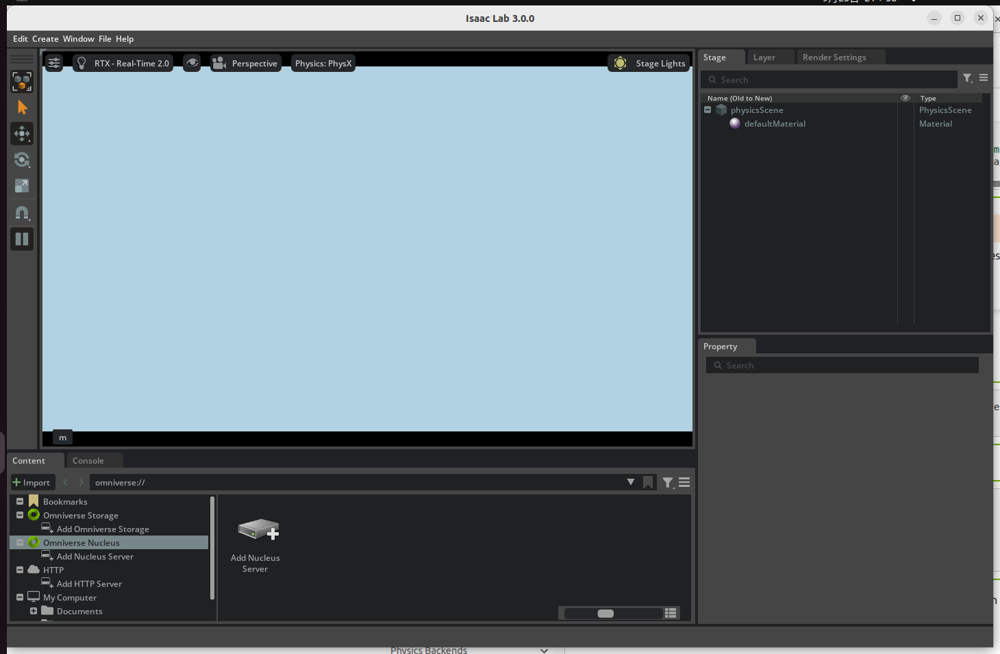
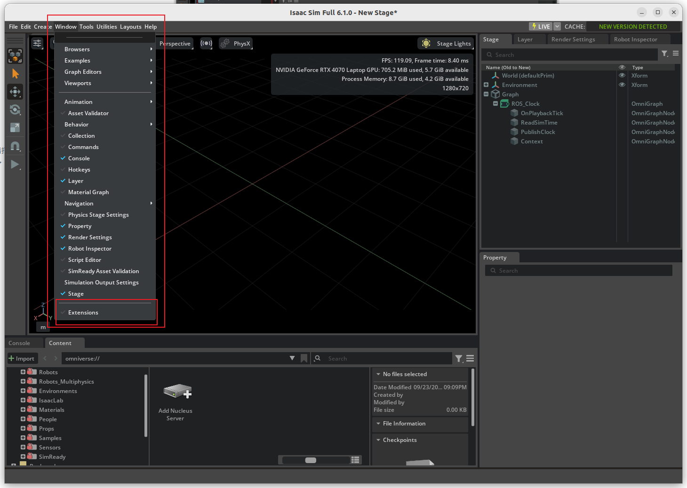
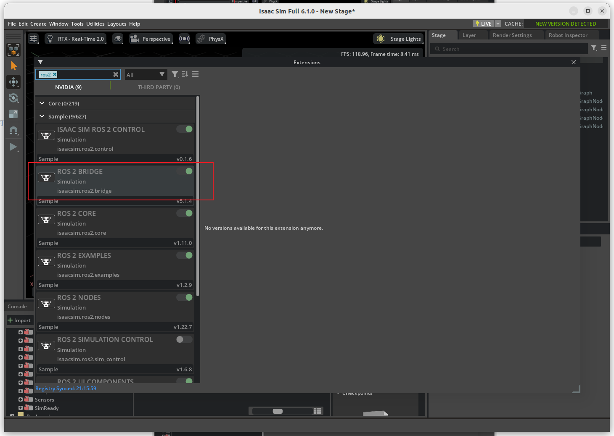
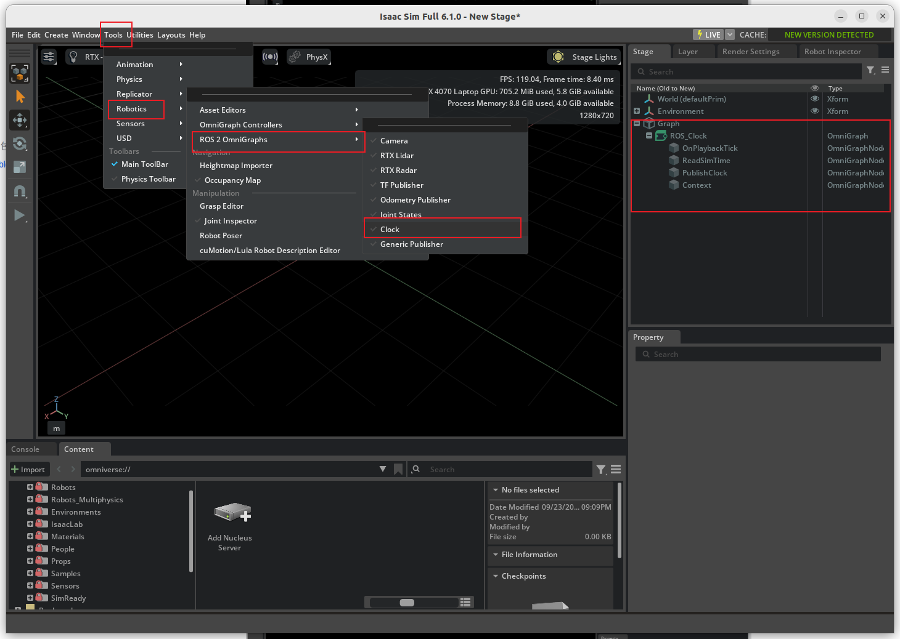
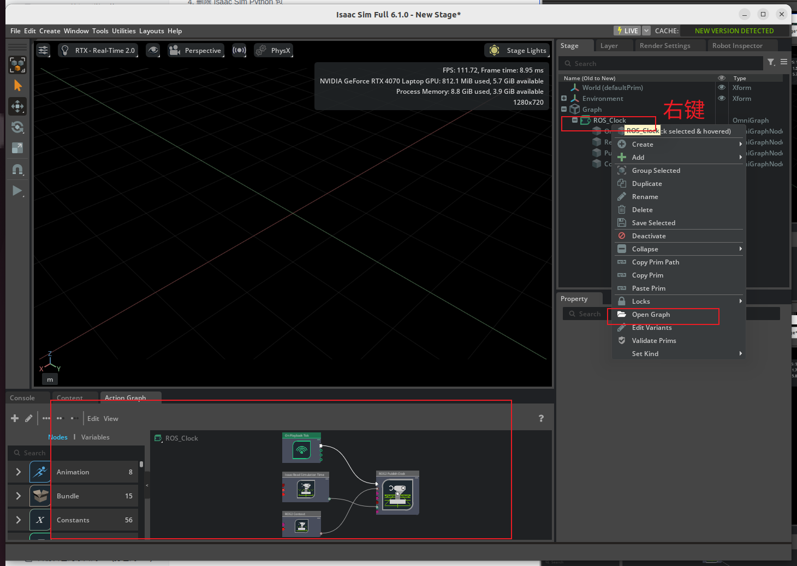
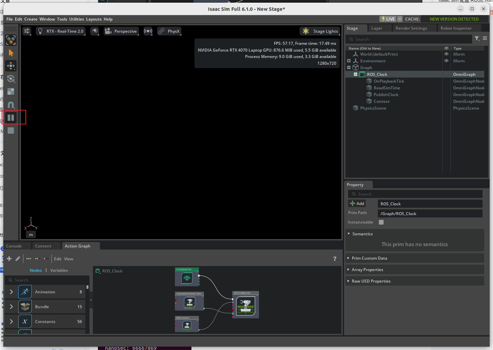
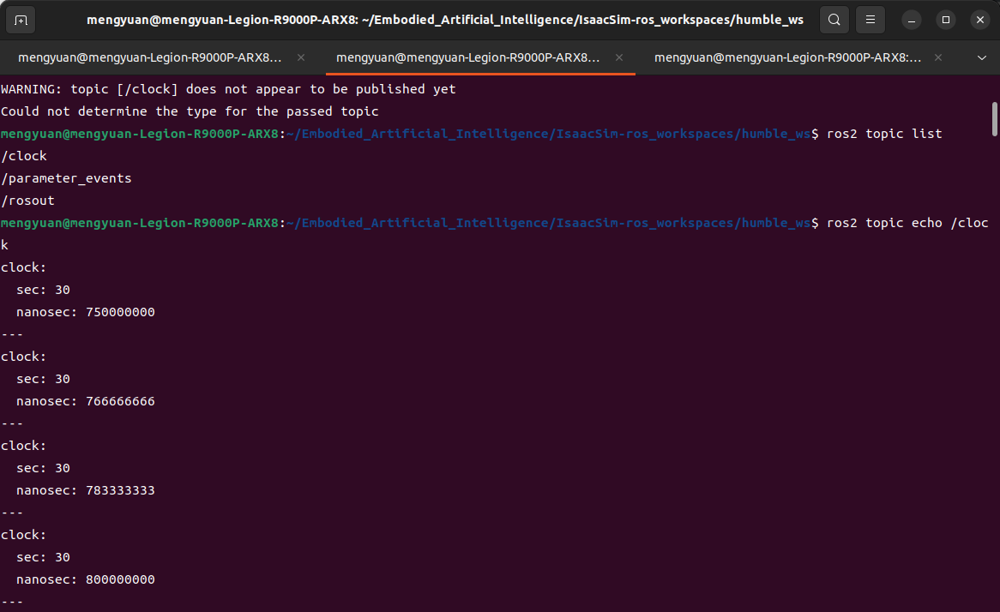
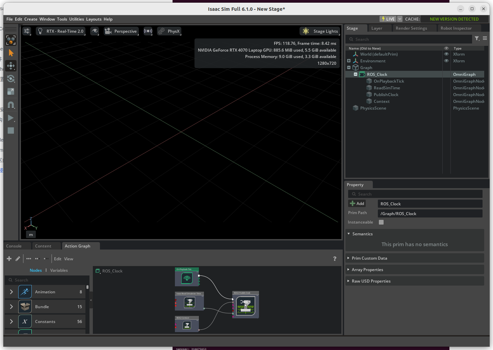
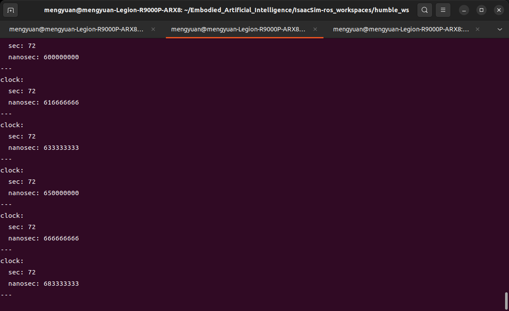

# Isaac Sim 6.1 与 Isaac Lab 3.0 实践

作者：Mengyuan Wang。原文件：`参考/Isaac sim 6.1.0&Isaac Lab3.0.0（使用Isaac sim6.1.0+Isaac Lab3.0.0（release） 显存8G Liunx22.04.0） 副本.zip`。

本篇介绍：release/3.0.0 分支、二进制安装、Kit 可视化、Humble 桥接、时钟与视角操作。保留完整原笔记正文和代码记录，新增核对说明与版本边界；历史结果不等于本次重新运行验证。

## 操作与数据保护

原记录包含 `rm -rf`、日志删除、`apt autoremove`、Conda 卸载和部分进程终止命令。这些代码仅作为历史记录保存，本次整理没有执行。实际操作前必须确认具体目录、环境和进程归属，备份项目、模型、日志与数据，并单独确认删除；不要按全文连续执行，也不要因名称包含 Isaac 就删除搜索结果。磁盘分区与格式化同样需要先核对设备和备份。

## 教程范围、版本与知识说明

本篇记录 Isaac Sim 6.1.0 与 Isaac Lab 的 `release/3.0.0` 分支，不等于锁定某个稳定发布包或提交。[Lab 3.0 官方安装说明](https://isaac-sim.github.io/IsaacLab/release/3.0.0/source/setup/installation/index.html) 区分多后端工作流：完整 Isaac Sim 工作流使用 Python 3.12，并要求配套 Sim 6.1，Sim 5.1 及更早版本不在该工作流支持范围。文档列出的完整工作流配置为至少 32 GB RAM、16 GB VRAM；文件名中的 8 GB 是作者设备情况，不能当作官方最低要求。

在该分支，默认 `./isaaclab.sh -i` 不会自动安装完整 Isaac Sim/Omniverse 依赖。原记录另外解压了二进制并创建 `_isaac_sim` 链接，保留这条实际路线；不能将默认安装命令解释为任何机器上已完成全部 Kit 依赖。需要按所固定提交的安装选项核对。`--viz kit` 对应 Kit 可视化，不能直接套用 2.3 的参数。

`sync` 刷新待写数据，`vm.drop_caches=1` 释放可回收的文件页缓存，不释放训练进程的活跃内存或 GPU 显存，也不是训练加速步骤。缓存可重建不意味着删除目录中所有数据都可以恢复。

原桥接段引用的是 Sim 5.1 文档，不能直接当作 6.1 的完整安装依据。6.1 使用不同 Python 版本，导入式扩展及自定义接口应按 6.1 配套环境构建。下方 GUI 及 `/clock` 截图保留为作者的观察记录。

### ROS 桥接的版本条件

ROS 2 节点可以通过中间件通信，但进程内 Python 扩展需匹配 ABI。本篇 Sim 6.1 完整工作流使用 Python 3.12，Ubuntu 22.04 原生 Humble 使用 Python 3.10；外部节点可独立运行，不应将原生 3.10 扩展直接加载到模拟器 3.12 解释器。自定义接口应按所固定的 6.1 环境构建。下方 5.1 链接仅是原记录的历史参考，不作为 6.1 版本要求；参见本篇开头的 Lab 3.0 官方安装说明。

本文图形界面的历史验证顺序是：启动模拟器，启用 ROS 2 Bridge 扩展，通过 Tools 中 ROS 2 OmniGraph 创建 Clock 图，确认图中时钟发布节点，再点击 Play；另一个已加载 Humble 环境的终端观察 `/clock`。菜单名称和扩展版本随安装变化。`/clock` 有数据只证明时钟发布链路，暂停后停止打印是该示例的观察结果，不代表已验证传感器、控制器及全部接口。需要使用仿真时间的外部节点还应设置 `use_sim_time`。

## 原笔记整理正文

## Isaac sim 6.1.0&Isaac Lab3.0.0（使用Isaac sim6.1.0+Isaac Lab3.0.0（release） 显存8G Liunx22.04.0） 副本

## Ubuntu清理缓存

```bash
# 1.清理压缩旧日志
sudo find /var/log -name "*.gz" -delete
# 2.限制journal日志大小
sudo journalctl --vacuum-size=300M
# 3.清理 APT 下载缓存，并移除不再需要的依赖包；autoremove 不是缓存清理，先审查包清单
sudo apt clean && sudo apt autoremove -y
# 4.清理conda、pip缓存
conda clean --all -y
pip cache purge
# 5.Isaac仿真缓存
rm -rf ~/.cache/ov ~/.cache/nvidia ~/.cache/isaac*
```

## Ubuntu释放内存

```bash
conda deactivate
sudo sync
# 释放可回收的文件页缓存，不释放 GPU 显存；仍需评估性能影响
sudo sysctl -w vm.drop_caches=1
```

## 彻底删除 Isaac Sim 和 Isaac Lab

如果你想**彻底删除 Isaac Sim 和 Isaac Lab（Ubuntu/Linux）**，建议按下面顺序执行。这样会删除程序、环境、缓存、配置和 Python 依赖。

> ⚠️ 以下命令会删除文件，请确认路径中没有你自己的项目文件。
> 
> 

---

### 删除 Isaac Lab

假设 Isaac Lab 在：

```bash
cd /home/mengyuan/Embodied_Artificial_Intelligence
```

删除：

```bash
rm -rf IsaacLab
```

如果不知道位置：

```bash
find ~ -type d -iname "*isaaclab*"
```

找到后删除对应目录。

---

### 删除 Isaac Lab 的 Conda 环境

查看所有环境：

```bash
conda env list
```

可能看到：

```text
base
isaaclab
env_isaaclab
```

删除：

```bash
conda env remove -n isaaclab
```

如果名字不同，例如：

```bash
conda env remove -n env_isaaclab
```

再次检查：

```bash
conda env list
```

只确认待卸载的 Isaac 环境已移除，其他项目环境应保留。下面 base 仅为作者示意：

```text
base
```

---

### 删除 Isaac Sim

#### 如果通过 Omniverse Launcher 安装

先卸载：

```text
Omniverse Launcher
 → Library
 → Isaac Sim
 → Uninstall
```

然后删除残留。

---

#### 删除 Isaac Sim 文件

执行：

```bash
rm -rf ~/.local/share/ov/pkg/isaac-sim*
```

删除 Omniverse 数据：

```bash
rm -rf ~/.local/share/ov/data
```

删除缓存：

```bash
rm -rf ~/.cache/ov
```

删除日志：

```bash
rm -rf ~/.nvidia-omniverse
```

---

### 删除 Isaac Sim Python 包

如果之前 pip 安装过：

检查：

```bash
pip list | grep -i isaac
```

可能有：

```text
isaacsim
isaacsim-extscache
isaaclab
```

删除：

```bash
pip uninstall isaacsim
pip uninstall isaaclab
```

若仍显示包，先确认当前解释器、环境和准确包名；不同环境或组件不能仅靠反复卸载一个名称清理。

---

### 删除 Omniverse 配置

执行：

```bash
rm -rf ~/.config/omniverse
rm -rf ~/.local/share/ov
```

---

### 清理 Conda 缓存

如果 Isaac 相关包通过 conda 安装：

```bash
conda clean --all
```

输入：

```text
y
```

---

### 检查是否还有残留

搜索：

```bash
find ~ -iname "*isaac*"
```

以及：

```bash
find ~ -iname "*omniverse*"
```

如果看到类似：

```text
/home/user/.cache/isaac
/home/user/.local/share/ov
```

确认不用后删除：

```bash
rm -rf 路径
```

---

### 如果想达到“像从没安装过一样”

下面保留当时的删除示例。Omniverse 共享目录可能包含其他应用数据，必须逐个确认归属并备份后再授权删除；重装 Isaac 不要求重装或移除整个 Miniconda：

```bash
rm -rf ~/.local/share/ov
rm -rf ~/.cache/ov
rm -rf ~/.nvidia-omniverse
rm -rf ~/.config/omniverse
rm -rf ~/IsaacLab

# 1) 历史记录中的 Isaac Sim 安装目录，实际名称与版本需逐项确认
ls -la ~/Documents/Kit/apps/            # 先看有没有软链接/旧版本
rm -rf ~/Documents/Kit/apps/Isaac-Sim*  # 含 Full 和 App_Selector

# 2) 桌面快捷方式（几 KB）
rm ~/.local/share/applications/IsaacSim.desktop

# 3) 缓存（删了会自动重建）
rm -rf ~/.nvidia-omniverse ~/.cache/ov ~/.local/share/ov

# 4) Kit 共享截图目录（权限不够那个，确认只是截图后清）
sudo rm -rf ~/Documents/Kit/shared/screenshots
```

然后重新安装：

- Miniconda

- Isaac Sim

- Isaac Lab

---

#### 推荐的干净重装结构

以后建议：

```text
~/miniconda3          ← 只装 Conda
~/isaacsim            ← Isaac Sim
~/IsaacLab            ← Isaac Lab源码

conda env:
    base             ← 不装东西
    isaaclab         ← Isaac Lab专用环境
```

这样以后删除 Isaac Lab 只需要：

```bash
rm -rf ~/IsaacLab
conda env remove -n isaaclab
```

这种目录划分便于隔离，但不能保证系统依赖、配置或共享数据完全不受影响。

## 安装Isaac sim 6.1.0

[安装文档](https://isaac-sim.github.io/IsaacLab/release/3.0.0/source/setup/installation/index.html#installation-method-binary)

[安装文件下载二进制](https://docs.isaacsim.omniverse.nvidia.com/latest/installation/download.html)

[安装解压文档](https://docs.isaacsim.omniverse.nvidia.com/latest/installation/install_workstation.html#example-installation)

[Isaac sim Documention](https://docs.isaacsim.omniverse.nvidia.com/latest/action_and_event_data_generation/index.html)

```bash
conda deactivate
mkdir ~/isaacsim
cd ~/下载
unzip "isaac-sim-standalone-6.1.0-linux-x86_64.zip" -d ~/isaacsim
cd ~/isaacsim
./post_install.sh
./isaac-sim.sh
```

```bash
# 将以下环境变量导出到终端
# Isaac Sim root directory
export ISAACSIM_PATH="${HOME}/isaacsim"
# Isaac Sim python executable
export ISAACSIM_PYTHON_EXE="${ISAACSIM_PATH}/python.sh"
# 使用过 Isaac Sim的旧版本，需要在安装后首次运行以下命令删除所有就的用户数据和缓存变量
${ISAACSIM_PATH}/isaac-sim.sh --reset-user
# 检查模拟器是否按预期运行
# note: you can pass the argument "--help" to see all arguments possible.
${ISAACSIM_PATH}/isaac-sim.sh
# 检查模拟器是否暗由独立Python脚本运行
# checks that python path is set correctly
${ISAACSIM_PYTHON_EXE} -c "print('Isaac Sim configuration is now complete.')"
# checks that Isaac Sim can be launched from python
${ISAACSIM_PYTHON_EXE} ${ISAACSIM_PATH}/standalone_examples/api/isaacsim.simulation_app/hello_world.py
```

## 安装Isaac Lab3.0.0（release）

[官方文档](https://isaac-sim.github.io/IsaacLab/release/3.0.0/source/setup/quickstart.html)

[Isaac Lab源码网站](https://github.com/isaac-sim/IsaacLab)

[安装](https://isaac-sim.github.io/IsaacLab/release/3.0.0/source/setup/installation/index.html#installation-method-python-env)

> 原图为官方系统要求或版本兼容表，已在本文说明中转为文字并列出来源。


```bash
cd /home/mengyuan/Embodied_Artificial_Intelligence
git clone https://github.com/isaac-sim/IsaacLab.git --branch release/3.0.0

cd IsaacLab
ln -s ${ISAACSIM_PATH} _isaac_sim
sudo apt install cmake build-essential
./isaaclab.sh -i
./isaaclab.sh -p scripts/tutorials/00_sim/create_empty.py --viz kit
```



## Isaac sim配置ROS2 humble

版本说明：原生 Humble 节点与 Isaac Sim 分终端运行；是否加载 ROS 环境取决于模拟器 Python ABI 与桥接方式，详见本文开头。

[官方教程](https://docs.isaacsim.omniverse.nvidia.com/5.1.0/installation/install_ros.html)

[[ISAAC SIM]isaac sim配置ROS2 humble](https://blog.csdn.net/u012213701/article/details/162152053)

```bash
conda deactivate
cd ~/isaacsim
# 使用推荐的 ROS 2 发行版,则无需额外步骤来加载 ROS 2 桥接库
./isaac-sim.sh
# 如果有启动报错执行下面
# ./kit/python/bin/python3 -m pip install torch psutil click 
```






```bash
conda deactivate
cd ~/Embodied_Artificial_Intelligence
# clone isaac 给ros2配置的workspace
git clone https://github.com/isaac-sim/IsaacSim-ros_workspaces.git
# 要构建 ROS 2 工作区,您可能需要安装其他包:
# For rosdep install command
sudo apt install python3-rosdep build-essential
# For colcon build command
sudo apt install python3-colcon-common-extensions
# 确保ROS环境来自终端或您的~/.bashrc文件。每次任何 ROS 命令之前,必须使用该步骤 确保您的原生 ROS 2 来源:
source /opt/ros/humble/setup.bash
# 通过运行以下命令,从 ROS 2 工作区的根目录中解析任何包依赖项:
cd IsaacSim-ros_workspaces
cd humble_ws
git submodule update --init --recursive # If using docker, perform this step outside the container and relaunch the container
rosdep install -i --from-path src --rosdistro humble -y
# 构建工作区 在根目录下,新建build,install并且log目录被创建
colcon build
```

### 要开始使用在此工作区内构建的 ROS 2 包,请打开新终端

```bash
# 要开始使用在此工作区内构建的 ROS 2 包,请打开新终端,并使用以下命令加载该工作空间的安装环境:
conda deactivate
source /opt/ros/humble/setup.bash
cd humble_ws
source install/local_setup.bash
```

### 如何验证isaac sim已经配置好ros2 humble 了








```bash
# 在刚才配置好工作空间的终端 
# 可以看到/clock 话题
ros2 topic list
ros2 topic echo /clock
```

可以看到时间戳在打印





关闭isaac sim 中的play开关，时间戳停止打印

这一步完成该时钟示例的验证，其他接口仍需分别测试。



## Isaac sim 6.1.0 使用仿真场景视角漫游方式

- Alt+鼠标左键是环绕选中物体旋转！！！

- 正确漫游方式：按住鼠标右键不放，然后W A S D移动镜头，Q/E 上升/下降

- W 向前、S 后退、A左、D右

- Q/E 控制垂直移动；上下对应关系以当前版本的导航模式和快捷键设置为准，原记录未附完整键位配置。

- 按住右键拖动鼠标，转头看四周

- 选中场景最顶层的根物体Stage,按下F,镜头自动缩放到整个场景，一次性看到全部户型


## 仓库内相关教程

- [Ubuntu 22.04 安装、扩容与维护](01_Ubuntu22.04安装与扩容.md)
- [ROS 2 Humble 安装与 Isaac Sim 桥接](02_ROS2Humble安装与Isaac桥接.md)
- [MuJoCo 安装与 ros2_control 接入](03_MuJoCo与ros2_control.md)
- [Isaac Sim 5.1 与 Isaac Lab 2.3 实践](04_IsaacSim5.1与IsaacLab2.3实践.md)
