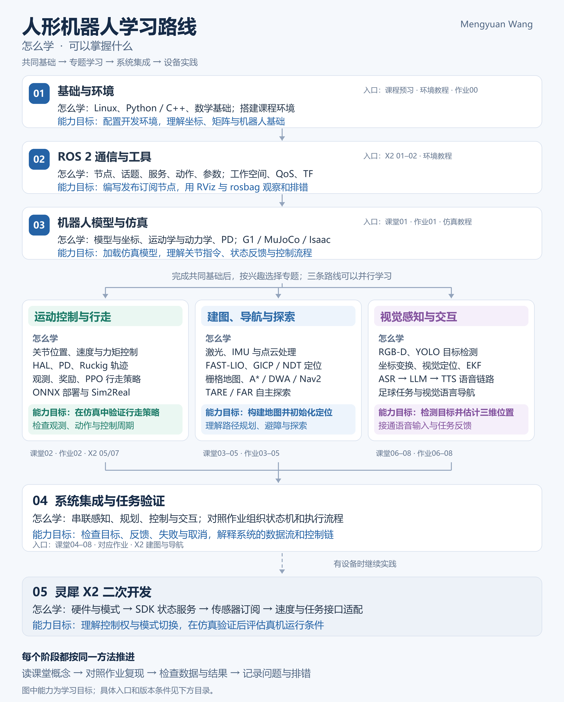

# Mengyuan Wang 人形机器人学习与实践笔记

**[仓库介绍视频版（B站）](https://www.bilibili.com/video/BV1xRJD6TEPe/)**

这份笔记围绕一个问题展开：怎样从基础知识开始，逐步学会让人形机器人感知环境、保持运动、找到路线，并与人交流？

建议先学习开发环境、机器人软件通信、机器人模型与仿真，再选择运动控制、建图导航或视觉交互方向。掌握各模块后，把它们连接起来完成具体任务。有设备时，再结合灵犀 X2 的笔记学习真机开发。图中的能力是学习目标，需要通过对应实验逐步验证。

[查看高清路线图](assets/humanoid-learning-roadmap.png) · [查看可缩放的矢量图](assets/humanoid-learning-roadmap.svg)

作者：**Mengyuan Wang**。这是我上课和实验过程中整理的学习笔记，用于复习与交流分享。正文使用文字、公式和代码解释知识，实验配图来自个人记录。

## 先理解这几个学习方向

| 学习方向 | 主要解决什么问题 | 学完后要尝试做到什么 |
| --- | --- | --- |
| 开发环境与机器人通信 | 程序在哪里运行？不同程序如何交换数据？ | 配置开发环境，让传感器程序、控制程序互相传递信息，并检查通信是否正常。 |
| 机器人模型与仿真 | 机器人的关节如何运动？怎样在电脑中进行实验？ | 加载机器人模型，观察关节状态，理解控制指令怎样影响运动。 |
| 双足运动控制 | 怎样让机器人站立、行走，并根据目标调整动作？ | 理解关节控制和行走策略，在仿真中检查策略输入、输出和运行效果。 |
| 建图、定位与导航 | 周围有什么？机器人在哪里？如何到达目的地？ | 利用传感器建立地图，在地图中确定位置，再规划路线并避开障碍物。 |
| 视觉与语言交互 | 怎样看见目标、估计目标位置，并听懂人的指令？ | 连接目标检测、位置估计、语音识别和语音播报，组织成任务流程。 |
| 系统集成与设备实践 | 怎样让多个模块共同完成任务？ | 理解感知到控制的数据流，检查任务反馈和失败处理，并学习设备接口与运行条件。 |

机器人操作系统（ROS）是一套机器人软件框架和工具集合，用于组织程序、交换数据和调试系统。它不是用来替代 Ubuntu 的操作系统。本仓库同时涉及 ROS 1 和 ROS 2，入门通信部分主要学习 ROS 2。

## 仓库的四个部分

本仓库包含 36 个学习与实践笔记文件。作业环境笔记在作业和环境教程目录中各保留一份，因此共有 35 篇不同内容。每个子目录也有自己的阅读说明。

| 部分 | 笔记数量 | 什么时候看 |
| --- | --- | --- |
| [01 课堂学习笔记](01_课堂学习笔记/README.md) | 9 | 学习概念、公式和系统流程时阅读，包含预习和第一至八章。 |
| [02 作业参考笔记](02_作业参考笔记/README.md) | 10 | 动手做实验时对照阅读，包含环境、代码、操作步骤、排错和已有结果。 |
| [03 灵犀 X2 二次开发](03_灵犀X2二次开发/README.md) | 11 | 学习 ROS 2 通信，以及灵犀 X2 的控制、传感器、交互和导航接口时阅读。二次开发指利用设备已有接口编写自己的功能。 |
| [04 环境配置教程](04_环境配置教程/README.md) | 6 | 安装系统、配置机器人软件和仿真工具、处理版本问题时阅读。不同版本分别记录。 |

## 01 课堂学习笔记：先理解原理

这是我上课整理的学习笔记。可以按章节顺序阅读，也可以在实验中遇到问题时返回对应章节。

| 笔记 | 主要内容 |
| --- | --- |
| [00 课程预习与学习方法](01_课堂学习笔记/00_课程预习与学习方法.md) | 学习前需要准备哪些数学和编程知识，课程各部分如何关联，以及预习方法和微信群学习补充。 |
| [01 人形机器人系统与仿真](01_课堂学习笔记/01_人形机器人系统与G1仿真.md) | 机器人由哪些部分组成；关节与身体如何运动、受力；用零力矩点分析平衡；在电脑中加载 G1 人形机器人模型进行仿真。 |
| [02 双足行走与强化学习](01_课堂学习笔记/02_双足行走与强化学习.md) | 怎样把行走问题表示为状态、动作和奖励；利用强化学习训练策略；用关节位置误差及其变化调节控制；训练后如何部署。包含策略梯度和近端策略优化等方法。 |
| [03 激光建图、定位与传感器融合](01_课堂学习笔记/03_激光建图定位与融合.md) | 利用激光雷达和惯性传感器感知运动与环境；修正机器人运动造成的点云畸变；建立地图、匹配点云并估计机器人位置；处理坐标和测量延迟。 |
| [04 地图制作与路径规划](01_课堂学习笔记/04_地图制作与A星DWA导航.md) | 把三维点云转换为导航使用的栅格地图；用 A 星搜索算法寻找路线；用动态窗口方法选择短时间内可执行的速度；比较不同避障与局部规划方法。 |
| [05 未知环境中的自主探索](01_课堂学习笔记/05_TARE与FAR自主探索.md) | 机器人如何决定下一处探索位置；如何结合局部和全局规划；怎样接入坐标变换、速度指令和点云处理，并调整转向等参数。 |
| [06 深度相机与目标检测](01_课堂学习笔记/06_RGBD相机与YOLO目标检测.md) | 获取彩色图像与深度信息；识别图中的物体及其范围；理解目标检测模型的结构和训练目标；完成数据标注、训练和检测。 |
| [07 视觉定位、状态估计与足球任务](01_课堂学习笔记/07_视觉定位EKF与足球任务.md) | 从图像像素和深度得到三维位置；转换不同坐标系；用扩展卡尔曼滤波融合观测与预测；通过状态机组织找球、接近和踢球任务。 |
| [08 语音交互与视觉语言导航](01_课堂学习笔记/08_语音交互与视觉语言导航.md) | 把语音转换为文字，用大语言模型处理请求，再转换为语音播报；学习结合图像和语言指令的导航方法，以及任务执行反馈。 |

## 02 作业参考笔记：对照步骤做实验

这里保留我的个人实验过程、代码、排错和已有结果。第 00 篇是作业使用的环境，环境教程目录中也保留一份，方便单独查阅。

| 笔记 | 主要内容 |
| --- | --- |
| [00 作业环境配置与机器人软件桥接](02_作业参考笔记/00_环境配置与ROS桥接.md) | 在 Docker 容器中配置 Ubuntu 20.04，以及 ROS 1 的 Noetic 版本和 ROS 2 的 Foxy 版本；设置显卡、显示和代理；测试两代机器人软件之间的数据转发。 |
| [01 仿真环境与遥控](02_作业参考笔记/01_仿真环境与遥控.md) | 启动 G1 仿真、接入遥控输入并检查运行过程。 |
| [02 行走策略训练与部署](02_作业参考笔记/02_行走强化学习与部署.md) | 配置行走训练任务，导出训练模型，连接控制接口，并记录训练与复现时遇到的问题。 |
| [03 激光建图与定位](02_作业参考笔记/03_激光建图与定位.md) | 接入激光雷达与惯性传感器，运行建图和定位程序，检查坐标关系与参数。 |
| [04 地图处理与导航规划](02_作业参考笔记/04_地图处理与A星DWA.md) | 处理点云地图，运行 A 星路径搜索与动态窗口速度规划，并记录工程修改和排错。 |
| [05 自主探索实验](02_作业参考笔记/05_TARE与FAR自主探索.md) | 接入探索程序，调整速度消息、坐标变换和运行参数，记录两种探索与规划方法的实验过程。 |
| [06 目标检测数据与训练](02_作业参考笔记/06_YOLO数据与训练.md) | 整理和标注数据，训练 YOLO 目标检测模型，检查检测结果、模型路径与数据数量。 |
| [07 视觉定位与踢球](02_作业参考笔记/07_视觉定位与踢球.md) | 足球检测、位置估计、任务状态切换与控制代码，以及个人实验记录。 |
| [08 语音交互与导航](02_作业参考笔记/08_语音交互与导航.md) | 接入语音识别、模型调用、语音播报和导航，说明演示内容及实际验证范围。 |
| [09 个人代码与实验录屏说明](02_作业参考笔记/09_个人代码与录屏说明.md) | 说明站立与行走控制代码、实验视频的用途、依赖条件和静态检查发现的问题。 |

## 03 灵犀 X2 二次开发：从通信到设备功能

前两篇可作为 ROS 2 入门资料。后续章节围绕灵犀 X2 展开，学习如何通过设备提供的接口读取状态、发送指令和组织任务。相关概念使用文字说明，代码和命令保留在对应章节。

| 笔记 | 主要内容 |
| --- | --- |
| [01 具身智能与 ROS 2 通信基础](03_灵犀X2二次开发/01_具身智能导论与ROS2通信.md) | 什么是具身智能和机器人软件框架；ROS 1 与 ROS 2 有什么区别；程序如何持续发送数据、请求服务或执行较长任务；消息可靠性、坐标变换和调试工具。 |
| [02 创建程序并控制移动机器人](03_灵犀X2二次开发/02_ROS2工作空间与移动机器人实战.md) | 建立工作空间并编译程序，编写 Python 发布与订阅程序，记录和回放消息，学习差速移动控制与颜色跟踪。 |
| [03 机器人硬件与基本操作](03_灵犀X2二次开发/03_灵犀X2硬件与操作.md) | 关节自由度、计算单元、传感器、遥控模式、网络连接和基本操作条件。 |
| [04 运动控制开发工具与状态查询](03_灵犀X2二次开发/04_AimDK运控SDK与状态服务.md) | 使用厂商提供的开发工具调用运动控制接口，查询机器人状态，处理异步响应，并区分指令被接收与动作真正完成。 |
| [05 关节控制与平滑轨迹](03_灵犀X2二次开发/05_关节控制与轨迹生成.md) | 控制关节位置、速度和力矩；理解比例与微分控制、硬件抽象层，以及满足运动约束的轨迹生成。 |
| [06 读取传感器并查看数据](03_灵犀X2二次开发/06_传感器接口与可视化.md) | 订阅雷达、惯性传感器和相机数据，理解点云消息结构，检查相机标定、坐标变换和时间一致性。 |
| [07 把训练策略用于仿真与真机](03_灵犀X2二次开发/07_策略部署与Sim2Real.md) | 加载导出的模型，检查模型输入、动作输出、关节顺序和控制模式，理解仿真环境与真实机器人之间的差异。 |
| [08 语音、屏幕与灯带交互](03_灵犀X2二次开发/08_语音屏幕灯带交互.md) | 接入语音识别、语音合成和模型对话，控制表情与灯带，处理调用失败、重试和结果回调。 |
| [09 灵创平台与动作创作](03_灵犀X2二次开发/09_灵创平台与动作创作.md) | 学习平台操作流程、动作创作、配置和发布入口；正文注明尚未实际登录验证的内容。 |
| [10 建立地图并确定机器人位置](03_灵犀X2二次开发/10_SLAM建图与定位.md) | 利用激光和惯性测量建立地图，保存与合并点云地图，并在已有地图中定位。 |
| [11 地图转换与自主导航](03_灵犀X2二次开发/11_地图转换与自主导航.md) | 把地图转换为导航所需格式；使用 ROS 2 导航框架发送目标、查看过程反馈并判断完成状态。 |

## 04 环境配置教程：按所用版本选择

不用把所有版本都安装一遍。先确认要做的实验依赖哪套环境，再阅读对应教程。安装记录和排错过程保留在正文中。

| 教程 | 主要内容 |
| --- | --- |
| [00 Docker 作业环境与两代 ROS 通信](<04_环境配置教程/00_Docker Ubuntu20.04 ROS1 版本为 Noetic，ROS2 版本为Foxy环境配置.md>) | 使用容器组织 Ubuntu 20.04 作业环境，配置 Noetic 与 Foxy 两个 ROS 版本、显卡和显示，测试跨版本数据转发。 |
| [01 Ubuntu 22.04 安装与扩容](04_环境配置教程/01_Ubuntu22.04安装与扩容.md) | 制作启动盘、安装系统、处理黑屏，记录扩容入口与缓存维护；完整分区操作尚未记录齐全。 |
| [02 ROS 2 Humble 安装与仿真通信](04_环境配置教程/02_ROS2Humble安装与Isaac桥接.md) | 安装 ROS 2 的 Humble 版本，测试通信和工作空间，把 Isaac 仿真软件与机器人程序连接起来，并设置仿真时间。 |
| [03 MuJoCo 仿真与关节控制框架](04_环境配置教程/03_MuJoCo与ros2_control.md) | 配置 MuJoCo 物理仿真工具、模型路径与 ros2_control 关节控制框架，处理编译和图形窗口依赖问题。 |
| [04 Isaac Sim 5.1 与 Isaac Lab 2.3 本地配置](04_环境配置教程/04_IsaacSim5.1与IsaacLab2.3实践.md) | 在本地 Ubuntu 中安装仿真软件和机器人学习工具，处理 Python 与依赖兼容性，接入外部训练任务；另保留云端平台尝试记录。 |
| [05 Isaac Sim 6.1 与 Isaac Lab 3.0 配置记录](04_环境配置教程/05_IsaacSim6.1与IsaacLab3.0实践.md) | 记录软件分支、运行依赖、安装选项、与 ROS 2 Humble 的通信连接和仿真视角操作。 |

## 路线图中的英文名称怎么理解

不用先背缩写。遇到它们时，先记住它们在系统中负责什么。

| 名称 | 中文含义与用途 |
| --- | --- |
| ROS 2 | 第二代机器人软件框架，帮助不同程序交换数据、组织任务和调试系统。 |
| QoS | 通信服务质量设置，决定消息是否要求可靠传输、保留多少数据等。发送与接收双方的设置需要兼容。 |
| TF | 坐标变换机制，用于表达机器人本体、相机、雷达和地图等坐标系之间的关系。 |
| RViz / rosbag | 前者用于查看机器人模型、地图和传感器数据；后者用于记录与回放消息。ROS 2 中对应录包工具为 rosbag2。 |
| G1 / X2 | 本仓库涉及的两种人形机器人型号。型号相同不代表软件版本与接口完全一致。 |
| MuJoCo / Isaac Sim / Isaac Lab | MuJoCo 和 Isaac Sim 用于机器人仿真；Isaac Lab 基于 Isaac Sim，提供机器人学习任务与训练工具。 |
| PD / HAL / Ruckig | 分别指比例与微分控制、硬件抽象层，以及在线轨迹生成工具。用于关节控制、组织硬件接口和生成平滑运动。 |
| PPO / ONNX / Sim2Real | 分别指近端策略优化训练算法、可交换的模型表示格式，以及把仿真中得到的策略迁移到真实机器人的过程。 |
| IMU / FAST-LIO / GICP / NDT | 分别指惯性测量单元、激光与惯性融合的里程计方法，以及两种点云配准方法。用于估计运动或匹配位置。 |
| A* / DWA / Nav2 | 分别指 A 星路径搜索、动态窗口局部规划方法和 ROS 2 导航框架。它们分别涉及路径搜索、短时运动选择与导航系统组织。 |
| TARE / FAR | 本仓库学习的探索与规划方法，分别关注自主探索中的路线规划，以及基于可见性图的快速路径规划。具体配合方式见第五章。 |
| RGB-D / YOLO / EKF | 分别指彩色与深度图像、目标检测方法和扩展卡尔曼滤波。用于获取视觉数据、识别物体和估计状态。 |
| ASR / LLM / TTS | 分别指自动语音识别、大语言模型和语音合成，对应听取语音、处理文字请求和语音播报。 |
| SDK | 软件开发工具包。这里主要指厂商提供的接口、示例与工具，帮助编写设备功能。 |
| Noetic / Foxy / Humble | ROS 的发行版名称。Noetic 属于 ROS 1；Foxy 和 Humble 属于 ROS 2。实验时需要核对具体版本。 |

## 建议怎么读、怎么做

1. **先准备基础和环境。** 阅读课堂预习，了解数学、编程和坐标知识；按准备做的实验选择环境教程，检查软件能否启动。
2. **再学机器人程序之间怎样通信。** 阅读 X2 的第 01、02 篇，尝试编写一个发送数据的节点和一个接收数据的节点。节点可以理解为承担某项功能的程序，话题是发布与订阅数据所使用的通道。
3. **建立模型与控制的概念。** 阅读课堂第 01 篇和对应仿真作业，观察机器人关节与状态反馈。对行走感兴趣时，再阅读第 02 篇的强化学习与部署内容。
4. **按兴趣选择专题。** 想让机器人在环境中走到目标位置，读第 03 至 05 章；想让机器人识别物体、踢球或与人交互，读第 06 至 08 章。每章都配合作业笔记动手检查结果。
5. **最后组织完整任务。** 检查传感器数据如何进入定位与规划模块，控制指令如何到达机器人，以及任务成功、失败或取消时如何反馈。需要使用 X2 时，再核对它的硬件、开发接口和控制模式。

每个阶段都可以按同一方法推进：读概念，复现实验，检查数据与结果，记录问题与排错。先完成一个能解释清楚的小实验，再逐步连接更多功能。

## 实验图片、代码与录屏

- [作业实验图片与录屏](02_作业参考笔记/assets/README.md)：说明各附件对应的实验及用途。
- [个人控制代码](02_作业参考笔记/code/README.md)：三份 C++ 源码或头文件，需要结合原工程的依赖阅读。
- [环境配置截图](04_环境配置教程/assets/README.md)：对应环境安装与排错记录。
- [首页路线图文件说明](assets/README.md)：高清图片与矢量版本的用途。

## 使用这些笔记时需要核对什么

课堂笔记用于理解原理，作业笔记用于对照个人实验过程。正文会说明哪些内容是补充解释、哪些是历史记录、哪些已有验证结果。源码、参数或解答不完整的地方也保留说明。

课程主要使用 Ubuntu 20.04、ROS 1 Noetic 和 ROS 2 Foxy，部分 X2 实验与环境教程使用 ROS 2 Humble。不同版本的安装命令、开发工具和控制接口可能不同，复现前需要核对。

整理过程中没有重新运行全部安装、训练、仿真与真机操作。程序启动、收到消息或目标被接收，只说明对应步骤发生了；是否完成任务，还需要继续检查状态反馈和实际结果。
